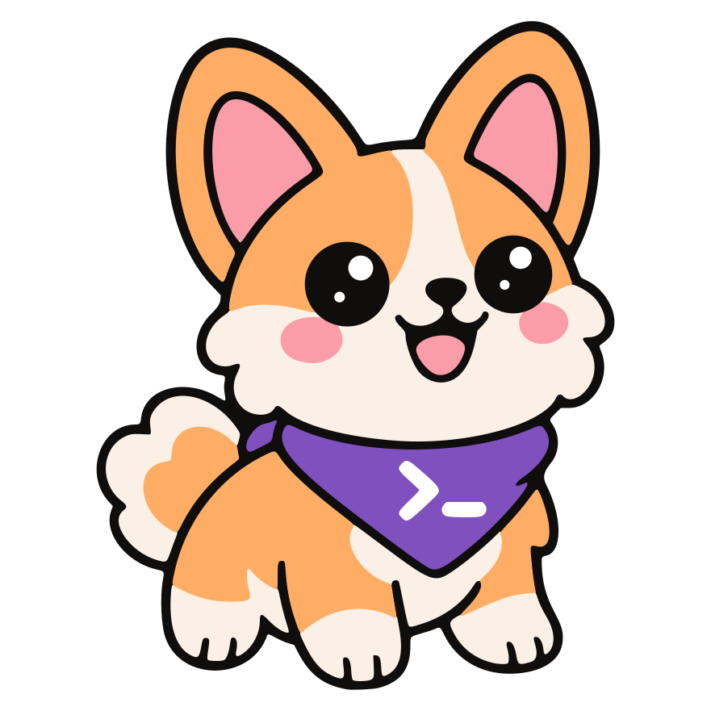

<h1 align="center">
  
  Buddy Sandboxes
</h1>

<p align="center">
  Kubernetes-native platform providing isolated, declarative execution environments for automated AI coding agents.
</p>

## Overview

Buddy Sandboxes allows development teams to run AI coding agents (such as OpenAI Codex and Anthropic Claude Code) safely inside Kubernetes clusters with kernel-level isolation, out-of-pod credential brokering, and declarative lifecycle control.

### Core Capabilities

- **Declarative Sandboxes**: Manage execution environments via the `Sandbox` custom resource (`sandboxes.buddy.io/v1alpha1`).
- **Workload Containment**: Combines non-root execution (UID 1000), dropped Linux capabilities, read-only root filesystems, and optional runtime classes (`gVisor`, `Kata`).
- **Network Isolation**: Automated per-sandbox NetworkPolicies blocking internal cluster services and cloud metadata endpoints, with managed egress filtering.
- **Brokered Credentials**: AI provider API keys remain outside sandbox pods. Short-lived session tokens route through the Buddy gateway with spending and rate enforcement.
- **Developer CLI (`buddy-sbx`)**: Bounded workspace upload snapshots, interactive PTY terminal streaming, one-shot headless task dispatch, and bidirectional change synchronization.
- **Hardened Agent Images**: Production container images with `tini` PID 1 process management, process introspection (`procps`), and unprivileged workspace execution.

## Quickstart

### Prerequisites

- Go 1.25+
- Docker 24+
- Kubernetes cluster (Kind, Minikube, or cloud provider)
- kubectl and kustomize

### 1. Install Operator and CRDs

```bash
git clone https://github.com/hoangndst/buddy-sandboxes.git
cd buddy-sandboxes

# Install CRDs
make install

# Deploy controller manager
make deploy IMG=ghcr.io/hoangndst/buddy-sandboxes-controller:latest
```

### 2. Declarative Sandbox Resource

Create a minimal sandbox configuration:

```yaml
apiVersion: sandboxes.buddy.io/v1alpha1
kind: Sandbox
metadata:
  name: task-runner
  namespace: default
spec:
  image: "golang:1.25"
  command: ["/bin/sh", "-c"]
  args: ["sleep 3600"]
  workingDir: "/workspace"
  maxDurationSeconds: 3600
  workspace:
    ephemeral: true
    mountPath: "/workspace"
  network:
    allowInternetWeb: true
    allowDNS: true
    blockClusterInternal: true
    blockMetadataService: true
```

Apply and inspect the sandbox:

```bash
kubectl apply -f sandbox.yaml
kubectl get sandboxes
```

### 3. Developer CLI (`buddy-sbx`)

Build the CLI binary:

```bash
make build
# Or: go build -o ./bin/buddy-sbx ./cmd/buddy-sbx
```

Execute a task against a local directory using a pre-configured agent preset:

```bash
# Interactive terminal session
./bin/buddy-sbx run codex .

# One-shot task execution without continuous synchronization
./bin/buddy-sbx run codex . --no-sync -- "Fix unit tests in pkg/auth"
```

Run an agent against a remote HTTPS repository without copying a local project:

```bash
./bin/buddy-sbx run codex --clone https://github.com/example/service.git --branch feature/cache
```

The CLI waits for the repository init container before starting the agent. Clone runs are retained by default; pass `--rm` to remove the sandbox when the attached run ends. Changes are kept in the sandbox and are not pushed to the remote repository.

For a private repository, store your Git credential using `buddy-sbx create secret`:

```bash
# Store encrypted Git credentials for a repository
./bin/buddy-sbx create secret github --repo https://github.com/example/service.git

# Run an agent against the private repository
./bin/buddy-sbx run claude --clone https://github.com/example/service.git
```

Buddy's credential broker resolves the repository credentials automatically and mounts them read-only during Git initialization. Inspect clone initialization logs with `./bin/buddy-sbx logs <sandbox-id> --container git-init`.

## Documentation

Full architectural specifications, design documents, and operational guides are available in [docs/](docs/):

- [Architecture and Threat Model](docs/architecture.md)
- [Hardened Agent Base Images and Runtime Tooling](docs/designs/agent_base_images_and_runtime_tooling.md)
- [Agent Presets and One-Shot Task Dispatch](docs/designs/agent_preset_hardening_and_task_dispatch.md)
- [Custom Provider Endpoints and Dynamic Egress Routing](docs/designs/custom_provider_endpoints_and_models.md)
- [Tenant Operations and Admin CLI](docs/designs/admin_cli_and_tenant_operations.md)
- [User Identity and Brokered Credentials](docs/designs/user_identity_and_provider_credentials.md)
- [Cold Workspace Suspension and Resume](docs/designs/cold_workspace_suspension.md)
- [Remote Git Workspaces](docs/designs/isolated_git_clone_and_ignore_engine.md)

## Development

Run test suites:

```bash
make test
```

Run linters and code formatting:

```bash
make fmt vet
make lint
```

## License

Apache License 2.0
