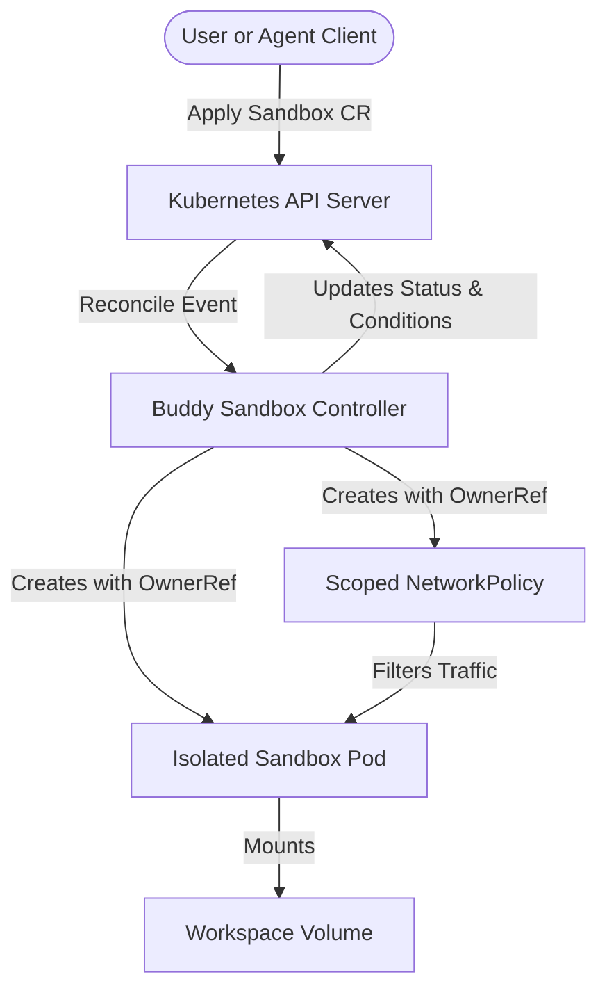
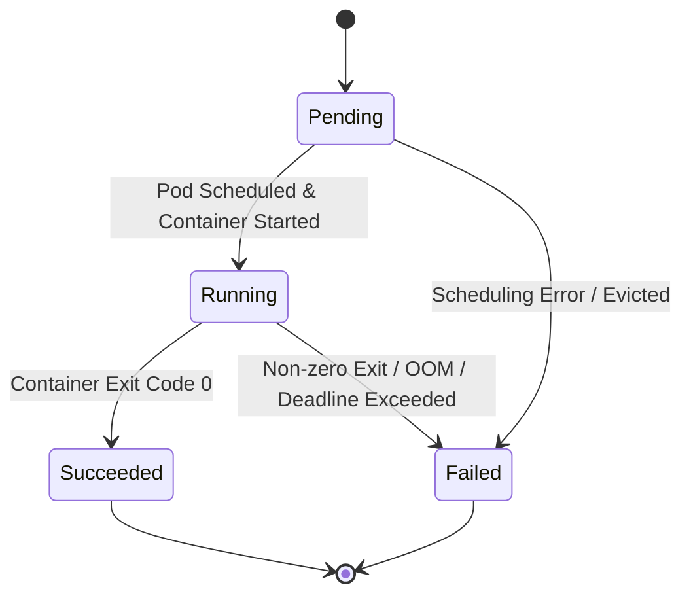

# Buddy Sandboxes: Architecture and System Design

## 1. Overview and Problem Statement

AI coding agents execute arbitrary code, shell commands, and tool calls during software development tasks. Running untrusted agent workloads on developer workstations or unconstrained cluster nodes creates significant operational and security risks:

1. Privilege escalation and container breakout attacks against cluster infrastructure.
2. Unauthorized network access to internal cluster services and cloud provider metadata APIs.
3. Unbounded resource consumption leading to node-level denial of service.
4. Loss of workspace modifications when agent sessions terminate unexpectedly.

Buddy Sandboxes is a Kubernetes-native operator providing isolated, declarative execution environments for automated coding agents. The operator manages the sandbox lifecycle, combining kernel-level isolation profiles, fine-grained network policies, workspace storage, and execution deadlines.

## 2. Design Principles

- Kubernetes Native: Built with custom resource definitions (CRDs) and controller-runtime reconciliation patterns.
- Defense in Depth: Multiple containment layers including restricted container security contexts, runtime kernel sandboxing, and declarative network boundaries.
- Deterministic State: Explicit status conditions, standard phase transitions, and Kubernetes owner references for automated cascading cleanup.
- Minimal Complexity: Prefer built-in Kubernetes primitives (Pods, EmptyDir, NetworkPolicies) over custom hypervisors or node daemon sets.

## 3. Core Architecture and Components

The architecture consists of three core components:

1. Sandbox Custom Resource Definition (`sandboxes.buddy.io/v1alpha1`): The declarative schema describing required sandbox properties, isolation levels, workspace storage, network boundaries, and execution deadlines.
2. Sandbox Controller: A controller-runtime reconciler that watches Sandbox resources, validates configurations, provisions underlying Kubernetes primitives, and tracks workload status.
3. Sandbox Pod and Supporting Primitives: The running agent container, attached workspace storage, and a scoped NetworkPolicy restricting ingress and egress traffic.



## 4. API Design (`sandboxes.buddy.io/v1alpha1`)

### 4.1 Custom Resource: `Sandbox`

The `Sandbox` resource defines an execution environment for an AI agent.

```yaml
apiVersion: sandboxes.buddy.io/v1alpha1
kind: Sandbox
metadata:
  name: agent-task-42
  namespace: default
spec:
  image: "golang:1.25"
  command: ["/bin/sh", "-c"]
  args: ["sleep 3600"]
  workingDir: "/workspace"
  runtimeClassName: "gvisor"
  resources:
    limits:
      cpu: "2"
      memory: "4Gi"
    requests:
      cpu: "500m"
      memory: "1Gi"
  env:
    - name: HOME
      value: "/home/sandbox"
  workspace:
    mountPath: "/workspace"
    ephemeral: true
    size: "10Gi"
  network:
    allowInternetWeb: true
    allowDNS: true
    blockClusterInternal: true
    blockMetadataService: true
  maxDurationSeconds: 3600
status:
  phase: "Running"
  podName: "agent-task-42-sandbox"
  networkPolicyName: "agent-task-42-netpol"
  startTime: "2026-11-20T17:00:00Z"
  conditions:
    - type: "Initialized"
      status: "True"
      reason: "ResourcesCreated"
    - type: "Ready"
      status: "True"
      reason: "PodRunning"
```

### 4.2 Lifecycle Phases and State Transitions

A sandbox aligns with standard Kubernetes pod phases:

1. `Pending`: The controller accepted the custom resource and created the supporting NetworkPolicy and Pod.
2. `Running`: The sandbox container is running and accepting commands.
3. `Succeeded`: The workload process completed with exit code 0.
4. `Failed`: The container exited with a non-zero exit code, exceeded active deadline, failed scheduling, or was evicted.



## 5. Workload Isolation and Security Model

To defend against untrusted or malicious code, the operator applies four containment layers:

### 5.1 Container Security Profile

All sandbox pods enforce restricted security contexts:

- Pod-level security context:
  - `runAsNonRoot: true`
  - `runAsUser: 1000`
  - `fsGroup: 1000`
  - `fsGroupChangePolicy: "OnRootMismatch"`
  - `seccompProfile.type: RuntimeDefault`
- Container security context:
  - `allowPrivilegeEscalation: false`
  - `readOnlyRootFilesystem: true`
  - `runAsNonRoot: true`
  - `runAsUser: 1000`
  - `capabilities.drop: ["ALL"]`
  - `seccompProfile.type: RuntimeDefault`
- Writable volume mounts:
  - EmptyDir volume mounted at `/workspace` for repository code.
  - EmptyDir volume mounted at `/tmp` for temporary files.
  - EmptyDir volume mounted at `/home/sandbox` with `HOME=/home/sandbox` to allow git, npm, and compiler caches to write without permission failures.

### 5.2 Kernel Sandboxing via RuntimeClass and Pre-Flight Validation

Containers sharing the host Linux kernel risk kernel exploit chains. Buddy Sandboxes decouples the isolation runtime via the standard Kubernetes `runtimeClassName` field.

- `gvisor` (`runsc`): Intercepts application system calls in user space, isolating the host kernel from untrusted execution.
- `kata`: MicroVM isolation providing hardware virtualization boundaries per pod.
- `runc`: Standard container runtime. Permitted only in local development clusters. Production clusters should reject `runc` for untrusted code execution.

Before pod creation, the operator performs pre-flight validation against cluster `node.k8s.io/v1` `RuntimeClass` resources:
1. If `spec.runtimeClassName` is set and the `RuntimeClass` does not exist in the cluster, the controller halts pod creation and sets condition `RuntimeClassReady=False` with reason `RuntimeClassUnavailable`.
2. The controller registers dynamic watches on `node.k8s.io/v1` `RuntimeClass` objects, ensuring that when an administrator installs or restores a missing runtime class, affected sandboxes reconcile automatically without manual restarts.
3. Once validated, the operator sets `pod.spec.runtimeClassName`. Kubernetes native admission automatically merges runtime scheduling requirements (node selectors and tolerations).

### 5.3 Network Boundary Enforcement

Agents need outbound access to package repositories (npm, PyPI, Go proxy, GitHub), but must never reach:

1. The cloud instance metadata service (`169.254.169.254`).
2. The internal Kubernetes API server endpoint (`10.96.0.1` or cluster service CIDR).
3. Other tenant pods running in the same cluster.

For each sandbox, the controller synthesizes a dedicated `NetworkPolicy`:

- Ingress: Deny all inbound traffic. Command execution uses the Kubernetes API `exec` subresource via kubelet CRI channels.
- Egress:
  - Rule 1: Allow UDP and TCP port 53 to CoreDNS in `kube-system`.
  - Rule 2: Allow TCP ports 80 and 443 to `0.0.0.0/0` with an `except` CIDR list blocking:
    - `169.254.169.254/32` (cloud metadata service)
    - `10.0.0.0/8` (private network class A)
    - `172.16.0.0/12` (private network class B)
    - `192.168.0.0/16` (private network class C)
    - `100.64.0.0/10` (carrier grade NAT)

## 6. Workspace Persistence and Ephemeral Storage

Agents modify codebases iteratively during tasks.

1. Ephemeral Mode (Default for MVP): An `emptyDir` volume mounts at `/workspace`. This avoids external storage driver latency, multi-attach conflicts, and cloud volume quota limits. Disk state persists across container restarts within the pod and is cleaned up on deletion.
2. Persistent Mode: A dynamically provisioned `PersistentVolumeClaim` or reference to an existing PVC for workflows that require cross-pod workspace preservation.

## 7. Lifecycle and Resource Management

1. Execution Deadlines: `spec.maxDurationSeconds` maps directly to the pod's native `spec.activeDeadlineSeconds`. The kubelet terminates the pod when the deadline elapses without requiring custom polling timers in the controller.
2. Restart Policy: Pods set `spec.restartPolicy: Never`. This prevents failed containers from entering CrashLoopBackOff loops, allowing the controller to immediately inspect the terminal exit code.
3. Garbage Collection via Owner References: All child resources (Pod, NetworkPolicy, PVC) configure `metav1.OwnerReference` pointing to the parent `Sandbox` with `controllerutil.SetControllerReference`. When the `Sandbox` is deleted, Kubernetes garbage collection automatically tears down child resources without custom finalizer code.

## 8. Architectural Decision Records (ADRs)

### ADR 001: Selection of Kubebuilder and Controller-Runtime
- Context: The operator requires declarative reconciliation, CRD generation, and testing frameworks.
- Decision: Use Kubebuilder v4.5.1 with controller-runtime v0.20.
- Rationale: Standardized scaffolding, automatic code generation, and native testing frameworks (`envtest`).

### ADR 002: Dedicated Pod-per-Sandbox Architecture
- Context: Isolation boundaries between separate agent runs.
- Decision: Use a dedicated pod per sandbox instance.
- Rationale: Strong Linux namespace separation, cgroup resource accounting, individual network policies, and compatibility with runtime classes like gVisor and Kata.

### ADR 003: Standard Kubernetes NetworkPolicy for Egress Filtering
- Context: Untrusted agents must be blocked from cluster internals and cloud metadata endpoints.
- Decision: Synthesize standard `networking.k8s.io/v1` NetworkPolicy per sandbox.
- Rationale: Works across standard Kubernetes CNIs without requiring proprietary node daemons.

### ADR 004: Standard Condition-Based Status Model
- Context: Status reporting for client observability.
- Decision: Follow standard Kubernetes API conventions using `metav1.Condition` (`Initialized`, `Ready`, `NetworkConfigured`).
- Rationale: Enables declarative status inspection and programmatic waiting in CI and automation tools.

### ADR 005: Native OwnerReferences Over Custom Finalizers
- Context: Cleanup of child resources when a sandbox is deleted.
- Decision: Use standard Kubernetes `OwnerReferences` with cascading deletion instead of custom finalizers.
- Rationale: Eliminates controller finalizer races, deadlocks on pod termination failures, and reduces code complexity.

## 9. Threat Model and Mitigations

| Threat | Attack Vector | Mitigation |
| :--- | :--- | :--- |
| Host Kernel Compromise | Syzkaller syscall fuzzing or kernel CVEs | gVisor or Kata via `runtimeClassName`, non-root user UID 1000, drop all capabilities |
| Internal Cluster Pivot | Agent probes kube-apiserver or cluster services | NetworkPolicy blocks RFC1918 and cluster subnets; default deny ingress |
| Cloud Metadata Theft | Querying 169.254.169.254 for cloud credentials | NetworkPolicy egress rule explicitly blocks 169.254.169.254/32 |
| Resource Exhaustion | Unbounded memory allocation or CPU consumption | Kubernetes cgroups limits (spec.resources.limits) and node-level PID limits |
| Filesystem Tampering | Modifying system binaries in container image | `readOnlyRootFilesystem: true`, writable storage restricted to `/workspace`, `/tmp`, and `/home/sandbox` |

## 10. Platform Roadmap and Milestone Specifications

For the platform roadmap spanning completed and planned milestones, see [roadmap.md](roadmap.md).

For detailed subsystem designs and technical specifications, see [designs/SITEMAP.md](designs/SITEMAP.md):
- [Milestone 2 Design: Gateway Daemon and Developer CLI](designs/gateway_and_cli.md)
- [Milestone 3 Design: Workload Isolation, RuntimeClasses, and Hardened Runtimes](designs/workload_isolation.md)
