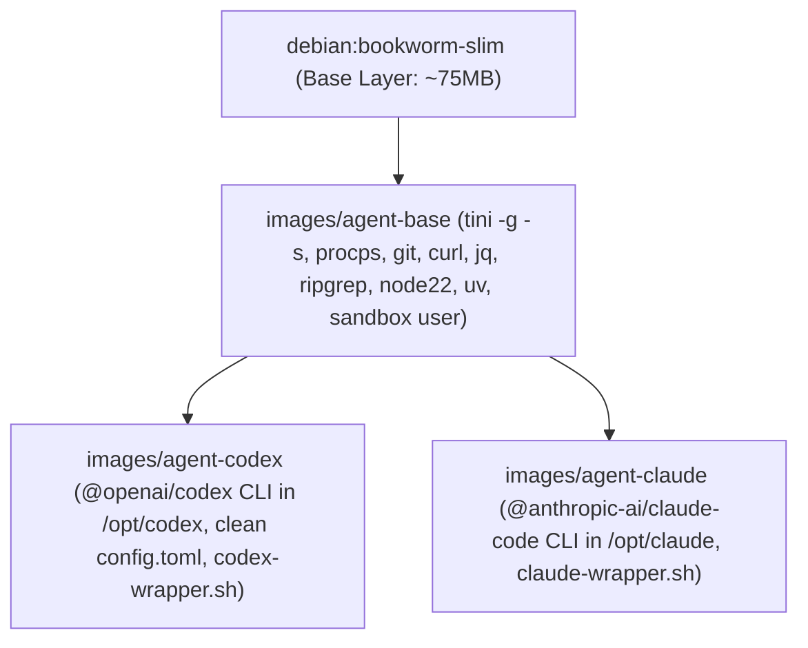

# In-Tree Hardened Agent Base Images and Runtime Tooling

## 1. Problem Statement

Buddy Sandboxes executes AI coding agents within isolated Kubernetes pods. Previously, catalog presets in `cmd/buddy-sbx/presets.go` relied on ad-hoc external images or unversioned configurations that exhibited critical runtime failures and developer friction:

1. **Missing Process Introspection**:
   OpenAI Codex invokes `/usr/bin/ps` via an internal process supervisor. When executed inside standard minimal containers lacking `procps`, Codex crashes immediately with `failed to invoke ps: No such file or directory (os error 2)`.
2. **Zombie Process Accumulation and Broken Signal Handling**:
   Compilers, linters, and nested subshells spawned by AI agents leave orphaned processes. Without a minimal init system running as PID 1 with process-group signal routing and subreaper capabilities, canceled tasks (`Ctrl+C` / `SIGINT`) fail to terminate nested processes, and dead child processes accumulate as zombies until the pod hangs.
3. **Privilege Misconceptions vs. Hardened Container Boundaries**:
   Sandboxes enforce strict non-root execution (`runAsUser: 1000`, `allowPrivilegeEscalation: false`, `readOnlyRootFilesystem: true`, `capabilities: drop: ["ALL"]`). Earlier experiments attempted to configure passwordless `sudo` in the container, but Linux `PR_SET_NO_NEW_PRIVS` and immutable root filesystems make setuid root execution impossible. LLMs often attempt `sudo apt-get install`, triggering confusing errors and self-correction loops.
4. **Deprecated and Unsupported Configuration Warnings**:
   Codex emits repeated warnings (`warning: Codex is ignoring 1 unrecognized configuration setting ... disable_response_storage is ignored`) due to an obsolete key baked into historical configuration templates.
5. **Image Bloat, Slow Pull Latency, and Multi-Arch Build Bottlenecks**:
   Fat base images bundling compilers and Java runtimes balloon to 1.8GB+, adding 30+ seconds of cold-start image pull delay and causing 45-minute QEMU emulation timeouts in CI.

---

## 2. System Architecture & Image Hierarchy

We establish an in-tree container build tree under `images/`:

```text
images/
├── agent-base/
│   ├── Dockerfile
│   ├── entrypoint.sh
│   └── shims/
│       ├── sudo
│       └── apt-get
├── agent-codex/
│   ├── Dockerfile
│   ├── codex-wrapper.sh
│   └── config.toml
└── agent-claude/
    ├── Dockerfile
    └── claude-wrapper.sh
```



### 2.1 The Universal Base Layer (`images/agent-base`)

* **Base Distribution**: `debian:bookworm-slim`. Clean glibc runtime environment without Canonical telemetry or unnecessary daemons.
* **Init System**: `/usr/bin/tini -g -s -- /opt/sandbox/entrypoint.sh` as default `ENTRYPOINT`.
* **Canonical Identity**: Single user `sandbox` (UID 1000, GID 1000) with home directory `/home/sandbox`.
* **Environment Configuration**:
  ```dockerfile
  ENV HOME="/home/sandbox" \
      USER="sandbox" \
      LOGNAME="sandbox" \
      PATH="/workspace/bin:/home/sandbox/.local/bin:/usr/local/bin:/usr/bin:/bin"
  ```
* **Git Safe Directory**:
  ```dockerfile
  RUN git config --system --add safe.directory /workspace
  ```
* **Zero Privilege**: Completely purged of `/usr/bin/sudo` and setuid binaries.
* **Interactive Shims**: Non-zero exit shims installed at `/usr/local/bin/sudo` and `/usr/local/bin/apt-get` directing agents to unprivileged workspace tooling.
* **Installed Utilities**:
  * Diagnostics & Process Management: `tini`, `procps` (`ps`, `pgrep`), `psmisc` (`killall`, `pstree`).
  * Core Workspace Tools: `git`, `curl`, `wget`, `jq`, `ripgrep`, `fd-find`, `tar`, `gzip`, `xz-utils`, `ca-certificates`.
  * Runtimes: Node.js 22 LTS (standalone Linux binaries in `/usr/local`), Python 3 minimal with `uv`.
* **Uncompressed Budget**: Strictly under 350MB (under 120MB compressed).

### 2.2 Agent Derivative Layers

Each specific agent preset derives from `images/agent-base`:
* **`images/agent-codex`**: Packages `@openai/codex` in isolated directory `/opt/codex` with clean configuration template and dynamic model routing wrapper.
* **`images/agent-claude`**: Packages `@anthropic-ai/claude-code` in isolated directory `/opt/claude` with execution wrapper.

---

## 3. Security Boundaries & Zero-Privilege Contract

The Buddy Sandboxes controller enforces non-negotiable security invariants across all agent pods:

```go
PodSecurityContext: &corev1.PodSecurityContext{
    RunAsNonRoot:        &boolTrue,
    RunAsUser:           &uid, // 1000
    FSGroup:             &uid, // 1000
    FSGroupChangePolicy: &fsGroupChangeOnRootMismatch,
    SeccompProfile: &corev1.SeccompProfile{
        Type: corev1.SeccompProfileTypeRuntimeDefault,
    },
},
SecurityContext: &corev1.SecurityContext{
    AllowPrivilegeEscalation: &boolFalse, // prctl(PR_SET_NO_NEW_PRIVS)
    ReadOnlyRootFilesystem:   &boolTrue,  // immutable /
    RunAsNonRoot:             &boolTrue,
    RunAsUser:                &uid,       // 1000
    Capabilities: &corev1.Capabilities{
        Drop: []corev1.Capability{"ALL"},
    },
    SeccompProfile: &corev1.SeccompProfile{
        Type: corev1.SeccompProfileTypeRuntimeDefault,
    },
}
```

### 3.1 Privilege Guidance Shims
When an AI agent hallucinates administrative commands (`sudo apt-get update`), rather than crashing with unhandled permission errors, the shim outputs a deterministic, actionable directive:

```bash
#!/bin/sh
echo "Root package management is disabled in hardened sandboxes. Install user-space dependencies in /workspace using uv, pip --user, npm, or portable standalone binaries." >&2
exit 1
```

### 3.2 User-Space Workspace Isolation
All runtime artifact mutation occurs strictly within writable volumes:
* Python packages: `uv venv /workspace/.venv && source /workspace/.venv/bin/activate` or `PYTHONUSERBASE=/workspace/.local`.
* Node.js dependencies: Local `package.json` and `/workspace/node_modules`, with npm cache redirected to `/tmp/.npm`.
* User binaries: `/workspace/bin` prepended to system `$PATH`.

---

## 4. Process Management & Entrypoint Trampoline

### 4.1 Tini PID 1 Integration & Exec Trampoline Architecture
Tini runs with `-g` (process-group signal forwarding) and `-s` (subreaper support):
* `SIGTERM` / `SIGINT` received by the pod container is immediately fanned out to all child processes and process groups.
* Orphaned child processes are reaped by Tini, preventing zombie process buildup.
* **Exec Trampoline**: Because `buddy-sbx` attaches to running containers via `c.Exec` (which bypasses the container's initial entrypoint), agent wrapper scripts (`/usr/local/bin/codex` and `/usr/local/bin/claude`) explicitly execute under `/usr/bin/tini -g -s --`. This guarantees that all exec sessions, whether interactive or headless tasks, benefit from Tini signal propagation and subreaper process cleanup.

### 4.2 Home Directory Seeding Trampoline
Because `/home/sandbox` is an `emptyDir` mount provided by Kubernetes for writable scratch space under a read-only rootfs, pre-baked files in `/home/sandbox` are masked. The wrapper trampoline dynamically seeds dotfiles on first boot:

```bash
#!/usr/bin/env bash
set -euo pipefail

# 1. Seed home directory dotfiles if masked by emptyDir mount
if [ ! -f /home/sandbox/.bashrc ] && [ -d /etc/skel ]; then
    cp -rn /etc/skel/. /home/sandbox/ 2>/dev/null || true
fi

# 2. Strict umask
umask 0022
```

---

## 5. Agent Image Implementations

### 5.1 Codex Agent (`images/agent-codex`)
* **Base**: `images/agent-base`.
* **Package**: Installed in an isolated directory:
  ```dockerfile
  RUN mkdir -p /opt/codex && npm install --prefix /opt/codex --omit=dev "@openai/codex@0.171.0"
  ```
  The real binary resides at `/opt/codex/node_modules/.bin/codex`.
* **Wrapper Script** (`/usr/local/bin/codex`):
  1. Seeds `/home/sandbox` dotfiles if missing.
  2. Ensures `$HOME/.codex` exists.
  3. When `BUDDY_PROVIDER_MODE=broker`, populates `$HOME/.codex/config.toml` from `/etc/buddy/codex/config.toml`. If `OPENAI_MODEL` is set, it dynamically updates the `model = "..."` field.
  4. Chains execution: `exec /usr/bin/tini -g -s -- /opt/codex/node_modules/.bin/codex "$@"`.
* **Clean Configuration Template** (`/etc/buddy/codex/config.toml`):
  Removes `disable_response_storage = true`.
  ```toml
  model = "gpt-5-codex"
  model_provider = "buddy"

  [model_providers.buddy]
  name = "Buddy API"
  base_url = "http://buddy-api.buddy-sandboxes-system.svc:8080/api/v1/provider/openai/v1"
  wire_api = "responses"
  env_key = "OPENAI_API_KEY"
  supports_websockets = false
  ```

### 5.2 Claude Code Agent (`images/agent-claude`)
* **Base**: `images/agent-base`.
* **Package**: Installed in an isolated directory:
  ```dockerfile
  RUN mkdir -p /opt/claude && npm install --prefix /opt/claude --omit=dev "@anthropic-ai/claude-code@2.1.330"
  ```
  The real binary resides at `/opt/claude/node_modules/.bin/claude`.
* **Wrapper Script** (`/usr/local/bin/claude`):
  1. Seeds `/home/sandbox` dotfiles if missing.
  2. Chains execution: `exec /usr/bin/tini -g -s -- /opt/claude/node_modules/.bin/claude "$@"`.

---

## 6. CI/CD Multi-Arch Pipeline & Tagging Strategy

### 6.1 Workflow Architecture (`.github/workflows/agent-images.yml`)
* **Path Triggers**:
  Triggers only on changes to `images/**` or `.github/workflows/agent-images.yml`.
* **Pull Request Lifecycle**:
  Runs fast, single-architecture (`linux/amd64`) build verification on native runners (`push: false`). Target completion: under 3 minutes. Zero slow QEMU emulation on PRs.
* **Merge to Main Lifecycle**:
  Authenticates with GitHub Container Registry (`ghcr.io`) and builds multi-arch (`linux/amd64`, `linux/arm64`) images (`push: true`).

### 6.2 Three-Tier Tagging Scheme

| Component | Target Image | Version Tag | Git SHA Tag | Latest Tag |
| :--- | :--- | :--- | :--- | :--- |
| **Base Runtime** | `ghcr.io/hoangndst/buddy-sandboxes-base` | `:latest` | `:sha-<commit>` | `:latest` |
| **Codex Preset** | `ghcr.io/hoangndst/buddy-sandboxes-codex` | `:0.171.0` | `:sha-<commit>` | `:latest` |
| **Claude Preset** | `ghcr.io/hoangndst/buddy-sandboxes-claude-code` | `:2.1.330` | `:sha-<commit>` | `:latest` |

---

## 7. Verification Criteria & KinD Smoke Tests

1. **Security Context Verification**:
   Verify container boots cleanly under `allowPrivilegeEscalation: false`, `readOnlyRootFilesystem: true`, and `capabilities: drop: ["ALL"]`.
2. **Sudo Guidance Test**:
   Execute `buddy-sbx run codex -- sudo apt-get update`. Confirm exit code 1 with guidance directing the agent to `/workspace`.
3. **Dotfile Persistence Test**:
   Verify that `/home/sandbox/.bashrc` exists and is writable by UID 1000 despite `emptyDir` mounting.
4. **PID 1 & Zombie Reaping Test**:
   Spawn background subshells. Verify `tini` reaps orphaned child processes without leaving defunct PIDs.
5. **Config Warning Absence**:
   Run `buddy-sbx run codex -- "What is 15 * 15?"`. Verify stderr contains zero unrecognized config warnings.
