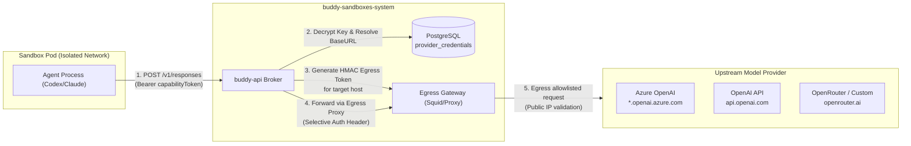

# Custom Provider Endpoints, Models, and Dynamic Egress Routing

## Problem Statement

AI coding assistants running inside Buddy Sandboxes require access to model providers. While earlier iterations supported a fixed endpoint (`https://api.openai.com/v1/responses`) and pinned model (`gpt-6.2-sol`), production teams and developers frequently utilize:
1. Enterprise private endpoints, such as Azure OpenAI (`https://<account>.openai.azure.com/openai/v1`).
2. High-performance model aggregators and gateways, such as OpenRouter (`https://openrouter.ai/api/v1`), LiteLLM, and vLLM.
3. Diverse model selections, including reasoning models (`o3-mini`, `o1`), general-purpose models (`gpt-4o`), and open-weights models (`deepseek-chat`, `llama-3.3-70b`).

Restricting the broker to a single hardcoded endpoint and model rejects these standard configurations. The platform must allow users to configure custom provider endpoints and default models while strictly preserving out-of-pod egress isolation and credential confidentiality.

## System Architecture



### Key Architectural Invariants

1. **Zero Credential Exposure**: Provider API keys are encrypted at rest using AES-256-GCM and decrypted exclusively in memory within the in-cluster `buddy-api` gateway. Sandbox pods never receive plaintext API keys.
2. **Two-Layer SSRF and Egress Defense**:
   - Intake validation rejects non-HTTPS schemes, raw IP literals, and internal/private suffixes (`.cluster.local`, `.svc`, `.internal`, `.local`, `.localhost`, `.onion`, `.test`, `.example`, `.invalid`).
   - The egress gateway verifies that the target resolves strictly to public, non-private IPs via `DialPinnedIP`, neutralizing DNS rebinding attacks.
3. **Canonical Path Normalization**:
   - Subpaths in `base_url` are parsed and normalized.
   - If `baseURL.Path` ends in `/v1`, leading `/v1` in incoming broker request paths is stripped before joining to prevent `/v1/v1` duplication.
   - Any query parameters on `base_url` (such as Azure `api-version`) are preserved and merged with incoming client query parameters.
4. **Selective Authentication Headers**:
   - Azure endpoints (`*.openai.azure.com`, `*.cognitiveservices.azure.com`, `*.azure.com`): Set `api-key: <key>` exclusively.
   - Standard OpenAI and aggregator endpoints: Set `Authorization: Bearer <key>` exclusively.
   - Never broadcast both headers simultaneously, preventing Azure API Management JWT parsing failures.
5. **Accurate Quota Reconciliation**:
   - Usage parser supports both Responses API fields (`input_tokens`, `output_tokens`) and Chat Completions fields (`prompt_tokens`, `completion_tokens`).
   - Upstream error responses (HTTP status >= 400) immediately release reserved quotas back to the tenant session budget.
6. **Model Selection Precedence & Sanitization**:
   - Model names must match `^[a-zA-Z0-9_\-\.:/]{1,128}$` without directory traversal sequences (`..`).
   - Precedence hierarchy: Request Body Model > Container `OPENAI_MODEL` (from `buddy-sbx run --model <name>`) > Credential `default_model` > Fallback (`gpt-4o`).
   - If the request body omits the model, the resolved model is injected into the payload before forwarding.

## Schema Specification

### Database Migration (`002_custom_provider_endpoints.sql`)
```sql
ALTER TABLE provider_credentials ADD COLUMN IF NOT EXISTS base_url text;
ALTER TABLE provider_credentials ADD COLUMN IF NOT EXISTS default_model text;
ALTER TABLE provider_credentials ADD COLUMN IF NOT EXISTS auth_type text;
```

### Credential Record Model
```go
type CredentialRecord struct {
    Key          string
    BaseURL      string
    DefaultModel string
    AuthType     string
}
```

## CLI Specification

### Storing Provider Credentials with Custom Endpoints
```bash
# Standard OpenAI with default endpoint
buddy-sbx secret set openai

# Custom Azure OpenAI endpoint with default model
buddy-sbx secret set openai \
  --url https://get-spektro-rs.openai.azure.com/openai/v1 \
  --model gpt-6-luna

# OpenRouter with default model
buddy-sbx secret set openai \
  --url https://openrouter.ai/api/v1 \
  --model deepseek/deepseek-chat
```

### Running Sandboxes with Model Overrides
```bash
# Uses the credential's default model
buddy-sbx run codex .

# Explicitly overrides the model for this session
buddy-sbx run codex . --model o3-mini

# Pass task-specific arguments directly to the agent CLI
buddy-sbx run codex . -- -m gpt-4o
```

### Inspecting Configured Secrets
```bash
buddy-sbx secret ls
```
Output:
```
SERVICE    SCOPE    SANDBOX    BASE_URL                                                MODEL         UPDATED
openai     user                https://get-spektro-rs.openai.azure.com/openai/v1       gpt-6-luna    2026-11-22 15:30:00 CST
```

## Security & Egress Boundaries

1. **Intake Validation**: Stored base URLs must be absolute HTTPS URLs with valid public FQDNs. Loopback, private RFC 1918 addresses, and internal cluster suffixes are rejected at write time.
2. **SSRF Mitigation**: Hostnames are validated and resolved via `DialPinnedIP` in the egress gateway before establishing upstream TLS connections.
3. **Egress Domain Minting**: The egress HMAC token generated by `buddy-api` contains the parsed destination domain (`upstreamURL.Hostname()`) in `Claims.Domains`. Attempting to access an alternative domain results in HTTP 403 at the egress gateway.

## Acceptance Criteria

1. **Schema Migration**: Database migration `002_custom_provider_endpoints.sql` applies cleanly on existing installations.
2. **Store & Broker Integration**: `Store.Set` and `Store.GetForSandbox` persist and retrieve custom `base_url`, `default_model`, and `auth_type`.
3. **Gateway Forwarding**: Requests to `/api/v1/provider/openai/v1/responses` dynamically forward to normalized target URL, setting `upstreamReq.Host = upstreamURL.Host`, passing valid egress HMAC tokens and selective authentication headers (`api-key` for Azure, `Bearer` for standard).
4. **Model Handling**: Any valid model string passes proxy validation. Sandbox pods receive `OPENAI_MODEL` environment variable when configured.
5. **CLI Usability**: `buddy-sbx secret set` supports `--url` and `--model`, and `buddy-sbx run` supports `--model`.
6. **Live KinD Verification**: Successful execution on `dell-cluster` with custom Azure OpenAI endpoint from `.env`.
