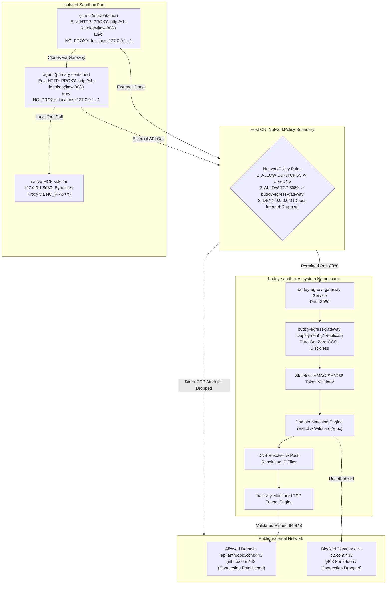
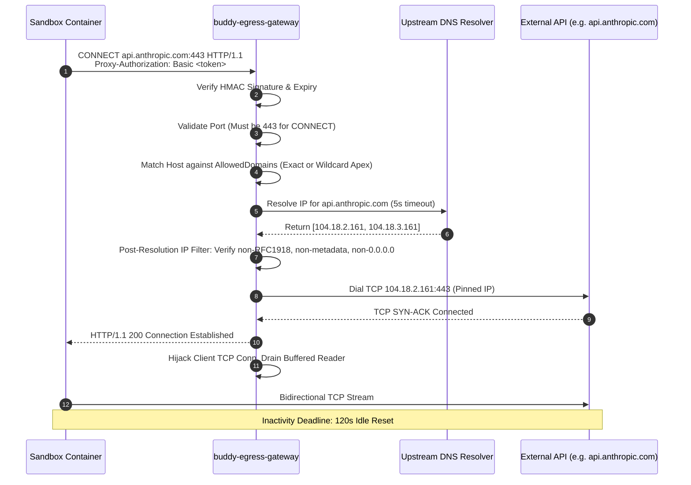

# Out-of-Pod Egress Gateway and Domain Whitelisting

## Problem Statement

Autonomous coding agents executing inside isolated Kubernetes sandboxes require external internet connectivity to clone source repositories, download language dependencies (`npm`, `pip`, `cargo`, `go`), and call remote LLM inference APIs (Anthropic Claude, OpenAI).

Milestone 1 established CIDR-level Kubernetes `NetworkPolicy` rules blocking RFC 1918 private subnets (`10.0.0.0/8`, `172.16.0.0/12`, `192.168.0.0/16`) and cloud instance metadata (`169.254.169.254/32`). However, standard Kubernetes `NetworkPolicy` operates at Layer 3/4 (IP and port). It cannot enforce destination domain name allowlists.

Consequently, any sandbox configured with `allowInternetWeb: true` can establish outbound TCP connections to any arbitrary public IP on ports 80 and 443. This introduces severe security vulnerabilities:
1. **Data Exfiltration**: Malicious code or prompt-injected agents can transmit private source code, secrets, or workspace files to untrusted external command-and-control (C2) servers.
2. **Reverse Shells / C2 Callbacks**: Agents executing untrusted binaries can open outbound reverse shells over standard web ports.
3. **Unvetted Dependency Poisoning**: Agents can download malicious payloads from unapproved third-party domains instead of vetted package registries and approved Git hosts.
4. **Server-Side Request Forgery (SSRF) and DNS Rebinding**: Naive HTTP forward proxies can be tricked into connecting to internal cluster services or metadata endpoints via DNS rebinding (TTL 0) or raw IP literals.
5. **Local MCP Sidecar Hijacking**: When global `HTTP_PROXY` environment variables are injected without an explicit `NO_PROXY` bypass, HTTP clients route all traffic (including `127.0.0.1` and `localhost`) through the proxy, breaking Milestone 6 native Model Context Protocol (MCP) sidecars.

Milestone 7 introduces declarative Layer 7 domain allowlisting (`spec.network.allowedDomains`) backed by an out-of-pod egress gateway daemon (`buddy-egress-gateway`) and host CNI NetworkPolicy lockdown.

---

## Goals and Non-Goals

### Goals
- Implement an in-tree, zero-CGO pure Go forward proxy in `internal/egressgateway` with entrypoint `cmd/buddy-egress-gateway`, deployed as a high-availability Deployment (2+ replicas) in the operator namespace (`buddy-sandboxes-system`).
- Support standard HTTP CONNECT tunneling for TLS/HTTPS restricted to port 443 and standard HTTP forward proxying restricted to port 80. Reject all arbitrary ports (e.g. 22, 6379) with `403 Forbidden`.
- Enforce strict single DNS resolution with post-resolution IP filtering and dialed IP pinning to eliminate SSRF and DNS rebinding attacks.
- Reject unspecified IPs (`0.0.0.0/8`), loopback (`127.0.0.0/8`), RFC 1918 private subnets, carrier-grade NAT (`100.64.0.0/10`), link-local/cloud metadata (`169.254.0.0/16`), IPv6 ULA/link-local, and cluster Pod/Service CIDRs before opening outbound sockets.
- Authenticate client sandbox requests using stateless HMAC-SHA256 bearer tokens minted by the controller, eliminating Informer or API server dependencies in the proxy data plane.
- Inject `HTTP_PROXY`, `HTTPS_PROXY`, `NO_PROXY`, and `no_proxy` environment variables into both the primary `agent` container and the `git-init` container, explicitly protecting Milestone 6 MCP sidecars on `127.0.0.1`.
- Synthesize Kubernetes `NetworkPolicy` rules that drop direct open internet egress (`0.0.0.0/0`) when `allowedDomains` is configured, permitting egress only to CoreDNS (port 53) and the egress gateway Service port (8080).
- Expose `allowedDomains` through the `SandboxSpec` CRD, REST API, Go SDK, and `buddy-sbx run --allow-domain <domain>`.
- Provide deterministic KinD cluster integration testing using an in-cluster mock server (`mock-egress-target`) and custom CoreDNS test zone.

### Non-Goals
- Implement SOCKS5 proxy protocol (RFC 1928 / RFC 1929). Standard development tools and runtimes natively support HTTP and HTTPS proxies.
- Support arbitrary raw TCP egress on port 22 for Git over SSH. Sandboxes route Git operations over HTTPS (`https://github.com/org/repo.git`) using Git credentials or automatic URL rewrites.
- Implement Man-in-the-Middle (MitM) TLS decryption or certificate inspection. Client TLS handshakes pass through raw TCP tunnels negotiated via HTTP CONNECT directly to destination servers.
- Use unsafe pod sysctls (`net.ipv6.conf.*`), which violate standard Pod Security Admission (PSA) Restricted standards. Network isolation is enforced strictly at the NetworkPolicy and CNI layer.
- Dynamic runtime domain allowlist updates on running sandboxes. Network configuration remains immutable after creation to match immutable Pod environment variables.

---

## System Architecture



---

## Technical Specifications

### 1. Declarative API Schema and Validation

The `NetworkSpec` in `api/v1alpha1/sandbox_types.go` is extended with `AllowedDomains`:

```go
// NetworkSpec defines the network boundaries for the sandbox.
type NetworkSpec struct {
    // AllowInternetWeb permits outbound HTTP and HTTPS traffic to ports 80 and 443.
    // Defaults to true.
    // +kubebuilder:default=true
    // +optional
    AllowInternetWeb bool `json:"allowInternetWeb,omitempty"`

    // AllowDNS permits outbound DNS traffic to CoreDNS.
    // Defaults to true.
    // +kubebuilder:default=true
    // +optional
    AllowDNS bool `json:"allowDNS,omitempty"`

    // BlockClusterInternal blocks egress to private RFC1918 subnets and cluster internal ranges.
    // Defaults to true.
    // +kubebuilder:default=true
    // +optional
    BlockClusterInternal bool `json:"blockClusterInternal,omitempty"`

    // BlockMetadataService blocks egress to cloud instance metadata at 169.254.169.254/32.
    // Defaults to true.
    // +kubebuilder:default=true
    // +optional
    BlockMetadataService bool `json:"blockMetadataService,omitempty"`

    // AllowedDomains specifies declarative FQDNs and wildcard domains permitted for egress.
    // When populated with one or more domains, direct open internet access is blocked and
    // traffic is routed strictly through the out-of-pod buddy-egress-gateway.
    // Wildcard domains (e.g. *.npmjs.org) match both subdomains and the apex domain.
    // +optional
    // +listType=set
    // +kubebuilder:validation:MaxItems=32
    AllowedDomains []string `json:"allowedDomains,omitempty"`
}
```

#### CEL Validation Rules
Add explicit CEL validation on `SandboxSpec`:

```yaml
// 1. Matrix Rule: allowedDomains cannot be configured when allowInternetWeb is false
+kubebuilder:validation:XValidation:rule="!has(self.network) || (has(self.network.allowInternetWeb) && !self.network.allowInternetWeb ? !has(self.network.allowedDomains) || size(self.network.allowedDomains) == 0 : true)",message="allowedDomains cannot be configured when allowInternetWeb is false"

// 2. Domain Format Rule: Must be valid hostname or wildcard subdomain (*.example.com) without scheme, port, or path
+kubebuilder:validation:XValidation:rule="!has(self.network) || !has(self.network.allowedDomains) || self.network.allowedDomains.all(d, !d.contains('://') && !d.contains('/') && !d.contains(':') && (d.matches('^([a-zA-Z0-9-]+\\.)+[a-zA-Z]{2,}$') || d.matches('^\\*\\.([a-zA-Z0-9-]+\\.)+[a-zA-Z]{2,}$')))",message="Each allowedDomain must be a valid hostname or wildcard subdomain (e.g. example.com or *.example.com) without scheme, port, or path"

// 3. Immutability Rule: Network specification cannot be modified after Sandbox creation
+kubebuilder:validation:XValidation:rule="(!has(oldSelf.network) && !has(self.network)) || (has(oldSelf.network) && has(self.network) && oldSelf.network == self.network)",message="network configuration is immutable after Sandbox creation"
```

#### Reserved Agent Environment Variables
Update `IsReservedAgentEnvName` and the `SandboxSpec.Env` CEL rule in `sandbox_types.go` to reserve proxy environment variables:
`HTTP_PROXY`, `HTTPS_PROXY`, `http_proxy`, `https_proxy`, `NO_PROXY`, `no_proxy`.

#### Three-State Egress Matrix
1. **Isolated Mode (`allowInternetWeb: false`)**: Pod NetworkPolicy drops all outbound internet traffic. No proxy environment variables are injected.
2. **Unrestricted Internet Mode (`allowInternetWeb: true`, `len(allowedDomains) == 0`)**: Legacy Milestone 1 mode. Direct internet egress on ports 80 and 443 is permitted by NetworkPolicy (`0.0.0.0/0`).
3. **Allowlist Gateway Mode (`allowInternetWeb: true`, `len(allowedDomains) > 0`)**: Direct internet egress (`0.0.0.0/0`) is dropped by NetworkPolicy. Egress is permitted only to CoreDNS (port 53) and `buddy-egress-gateway` Service (port 8080). Proxy environment variables are injected into both `agent` and `git-init` containers.

---

### 2. Stateless Authentication and Token Minting

To ensure the egress gateway remains completely stateless, resilient, and decoupled from the Kubernetes API server, authentication uses HMAC-SHA256 bearer tokens.

#### Token Structure and Signing
The controller and gateway share a symmetric HMAC secret key stored in Secret `buddy-egress-gateway-secret` under key `hmac-secret` in namespace `buddy-sandboxes-system`.
When creating a sandbox pod, the controller signs a compact JSON claims payload:

```json
{
  "sub": "sb-01jf8x",
  "ns": "default",
  "domains": ["github.com", "*.npmjs.org", "api.anthropic.com"],
  "exp": 1735689600
}
```

The expiration timestamp (`exp`) is set to `creationTimestamp + spec.maxDurationSeconds + 3600` (1-hour buffer). If `maxDurationSeconds` is omitted, `exp` defaults to 7 days (`604800` seconds).

The token is formatted as:
`token = base64url(payload) + "." + base64url(HMAC_SHA256(secretKey, base64url(payload)))`

#### Proxy Environment Injection
The controller injects standard Basic Auth proxy URLs into the container specifications (`agent` and `git-init`):
```bash
HTTP_PROXY="http://sb-01jf8x:<token>@buddy-egress-gateway.buddy-sandboxes-system.svc.cluster.local:8080"
HTTPS_PROXY="http://sb-01jf8x:<token>@buddy-egress-gateway.buddy-sandboxes-system.svc.cluster.local:8080"
http_proxy="http://sb-01jf8x:<token>@buddy-egress-gateway.buddy-sandboxes-system.svc.cluster.local:8080"
https_proxy="http://sb-01jf8x:<token>@buddy-egress-gateway.buddy-sandboxes-system.svc.cluster.local:8080"
NO_PROXY="localhost,127.0.0.1,::1,.cluster.local,.svc"
no_proxy="localhost,127.0.0.1,::1,.cluster.local,.svc"
```

Standard HTTP clients (`curl`, `urllib`, `requests`, `axios`, Go `net/http`) parse the proxy URL, automatically sending the header:
`Proxy-Authorization: Basic <base64("sb-01jf8x:<token>")>`

#### Gateway Token Verification
1. Extract username and password from incoming `Proxy-Authorization` header.
2. If missing or invalid, respond with `HTTP 407 Proxy Authentication Required` and header `Proxy-Authenticate: Basic realm="buddy-egress-gateway"`.
3. Verify token signature against `EGRESS_GATEWAY_HMAC_SECRET` in constant time (`subtle.ConstantTimeCompare`).
4. Check `exp` timestamp against current wall clock. Reject expired tokens with `HTTP 407`.
5. Extract `domains` claims from the verified token.

---

### 3. Gateway Core Engine (`internal/egressgateway`)

The gateway is implemented in pure Go using standard library `net/http` and `net`.



#### HTTP CONNECT Tunneling Lifecycle
1. **Header Parsing**: `http.Server` configured with `ReadHeaderTimeout: 5 * time.Second`.
2. **Port Restriction**: Split host and port via `net.SplitHostPort(req.Host)`. For `CONNECT`, target port MUST be `443`. Reject all other ports with `403 Forbidden`.
3. **Domain Matching**:
   - Normalize target hostname: lowercase and strip trailing dots (`strings.TrimSuffix(strings.ToLower(host), ".")`).
   - Match exact: `domain == pattern`.
   - Match wildcard apex: If `pattern` starts with `*.`, let `root = pattern[2:]`. Match if `domain == root || strings.HasSuffix(domain, "."+root)`.
4. **Hijack & Buffer Draining**:
   ```go
   hijacker, ok := w.(http.Hijacker)
   if !ok {
       http.Error(w, "hijacking not supported", http.StatusInternalServerError)
       return
   }
   clientConn, rw, err := hijacker.Hijack()
   if err != nil {
       http.Error(w, err.Error(), http.StatusServiceUnavailable)
       return
   }
   defer clientConn.Close()

   // Drain buffered reader bytes into upstream socket before piping
   if buffered := rw.Reader.Buffered(); buffered > 0 {
       if _, err := io.CopyN(upstreamConn, rw.Reader, int64(buffered)); err != nil {
           return
       }
   }
   ```
5. **Bidirectional Streaming with Inactivity Deadlines**:
   Send `HTTP/1.1 200 Connection Established\r\n\r\n`. Pipe traffic bidirectionally between `clientConn` and `upstreamConn`. Update socket deadlines (`SetDeadline`) on every read/write to enforce an inactivity timeout of 120 seconds.
6. **Per-Sandbox Concurrency Limits**:
   Track active connections in memory per `sub` claim. Reject connections with `HTTP 429 Too Many Requests` if a single sandbox exceeds 64 concurrent sockets.

#### Plain HTTP Forward Proxying
For plain HTTP requests (e.g. `GET http://registry.npmjs.org/package`):
1. Target port MUST be `80`.
2. Verify `req.URL.Hostname()` and `req.Host` match `allowedDomains`. Reject if `req.URL.Hostname() != req.Host`.
3. Strip hop-by-hop headers: `Proxy-Authorization`, `Proxy-Connection`, `Keep-Alive`. Clear `req.RequestURI = ""` to prevent Go HTTP client transport panics.
4. Perform single DNS resolution and dialed IP pinning. Forward request via custom `http.Transport` configured with pinned dialer and `DisableKeepAlives: true`.

---

### 4. SSRF and DNS Rebinding Protection Engine

To guarantee that the gateway cannot be used as an SSRF pivot into internal cluster infrastructure:

```go
func DialPinnedIP(ctx context.Context, host, port string, resolver *net.Resolver) (net.Conn, error) {
    // 1. Disallow raw IP literals in hostnames
    if net.ParseIP(host) != nil {
        return nil, fmt.Errorf("direct IP literals are forbidden: %s", host)
    }

    // 2. Resolve hostname using controlled timeout
    resolveCtx, cancel := context.WithTimeout(ctx, 5*time.Second)
    defer cancel()
    ips, err := resolver.LookupIP(resolveCtx, "ip4", host)
    if err != nil || len(ips) == 0 {
        return nil, fmt.Errorf("dns resolution failed for %s: %w", host, err)
    }

    // 3. Post-Resolution IP Validation across all resolved addresses
    for _, ip := range ips {
        if err := ValidatePublicIP(ip); err != nil {
            return nil, err
        }
    }
    targetIP := ips[0]

    // 4. Dial Pinned IP directly (prevents secondary DNS re-resolution)
    dialer := &net.Dialer{Timeout: 10 * time.Second}
    return dialer.DialContext(ctx, "tcp", net.JoinHostPort(targetIP.String(), port))
}

func ValidatePublicIP(ip net.IP) error {
    // 1. Block unspecified IP (0.0.0.0 and ::)
    if ip.IsUnspecified() {
        return fmt.Errorf("unspecified IP forbidden: %s", ip)
    }
    ip4 := ip.To4()
    if ip4 != nil && ip4[0] == 0 {
        return fmt.Errorf("0.0.0.0/8 subnet forbidden: %s", ip)
    }

    // 2. Block Loopback
    if ip.IsLoopback() {
        return fmt.Errorf("loopback IP forbidden: %s", ip)
    }

    // 3. Block RFC 1918 Private Ranges
    if ip.IsPrivate() {
        return fmt.Errorf("RFC1918 private IP forbidden: %s", ip)
    }

    // 4. Block Link-Local and Cloud Metadata (169.254.169.254)
    if ip.IsLinkLocalUnicast() || ip.IsLinkLocalMulticast() || ip.Equal(net.ParseIP("169.254.169.254")) {
        return fmt.Errorf("link-local or cloud metadata IP forbidden: %s", ip)
    }

    // 5. Block RFC 6598 Carrier-Grade NAT (100.64.0.0/10)
    _, cgnat, _ := net.ParseCIDR("100.64.0.0/10")
    if cgnat.Contains(ip) {
        return fmt.Errorf("carrier-grade NAT IP forbidden: %s", ip)
    }

    // 6. Block Multicast and Broadcast
    if ip.IsMulticast() || ip.Equal(net.ParseIP("255.255.255.255")) {
        return fmt.Errorf("multicast or broadcast IP forbidden: %s", ip)
    }

    return nil
}
```

---

### 5. NetworkPolicy and Pod Security Lockdown

#### NetworkPolicy Synthesis
When `len(sandbox.Spec.Network.AllowedDomains) > 0`, `internal/controller/sandbox_controller.go` adjusts NetworkPolicy reconciliation:
1. **CoreDNS Egress**: UDP/TCP port 53 to namespace `kube-system` matching `k8s-app: kube-dns`.
2. **Egress Gateway Egress**: TCP port 8080 to namespace `buddy-sandboxes-system` matching `app.kubernetes.io/name: buddy-egress-gateway`.
3. **Suppress Open Internet**: The `0.0.0.0/0` rule is omitted entirely. Any direct outbound connection is rejected by the Linux kernel veth filter before reaching the network wire.

---

## Developer CLI Experience (`buddy-sbx`)

Extend the CLI `run` command with domain allowlisting flags:

```bash
# Allow specific API and package registry domains
buddy-sbx run --image golang:1.24 \
  --allow-domain github.com \
  --allow-domain "*.golang.org" \
  --allow-domain proxy.golang.org \
  -- go test ./...

# List sandboxes with network indicator
buddy-sbx list
```

In `buddy-sbx list`, when `len(allowedDomains) > 0`, format the `NETWORK` column as `Allowlist (3)` instead of `Web` or `Isolated`.

---

## Verification & Quality Gates

### Unit and Integration Tests
1. **Token Generator / Validator**: Verify HMAC token generation, expiry validation, and rejection of tampered tokens in constant time.
2. **SSRF IP Filter**: Test rejection of `0.0.0.0`, `127.0.0.1`, `10.0.0.1`, `172.16.0.1`, `192.168.1.1`, `169.254.169.254`, `100.64.0.1`, and accept valid public IPs (`104.18.2.161`).
3. **HTTP CONNECT Hijacker**: Verify port 443 enforcement, buffered reader draining, and 120s inactivity deadline cleanup.
4. **Wildcard Apex Matching**: Verify `*.npmjs.org` matches `npmjs.org`, `registry.npmjs.org`, and rejects `evilnpmjs.org`.
5. **CEL Validation Tests**: Verify that invalid domains (`http://github.com`, `github.com:443`, raw IPs) and mutations to `spec.network` are rejected by API server admission.

### Local KinD Cluster E2E Tests (`dell-cluster`)
1. **Mock Upstream Target**: Deploy an in-cluster test server (`mock-egress-target`) serving HTTP (80) and HTTPS (443) with test certificates for `allowed.test.internal` and `blocked.test.internal`.
2. **CoreDNS Custom Zone**: Map `*.test.internal` to the `mock-egress-target` service IP.
3. **Test Scenarios**:
   - **Allowed Domain**: `curl -sSk https://allowed.test.internal` succeeds with HTTP 200.
   - **Blocked Domain**: `curl -sSk https://blocked.test.internal` receives HTTP 403 Forbidden from gateway.
   - **Direct Bypass Attempt**: `curl -k --noproxy '*' https://allowed.test.internal` times out (NetworkPolicy drops direct packets).
   - **Milestone 6 MCP Coexistence**: `curl -sS http://127.0.0.1:<mcp-port>` succeeds, confirming `NO_PROXY` prevents local MCP sidecars from hitting the egress gateway.
   - **Git Init Egress**: Sandbox with `spec.workspace.git.url: https://allowed.test.internal/repo.git` successfully seeds workspace through the egress gateway.
