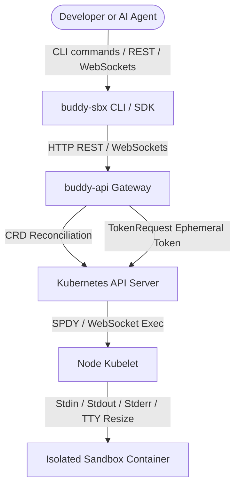

# System Design: Buddy API Gateway (buddy-api) and Developer CLI (buddy-sbx)

## 1. Overview and Motivation

Buddy Sandboxes provides a Kubernetes operator for isolated agent environments. However, requiring developers or automated AI coding agents to use `kubectl`, possess raw `kubeconfig` credentials, or manage custom resource manifests introduces significant operational friction and security exposure:

1. **Direct Cluster Exposure**: Distributing cluster credentials to untrusted coding agents exposes `/api` discovery endpoints and permits namespace reconnaissance.
2. **Coarse RBAC Permissions**: Kubernetes RBAC grants `pods/exec` at the namespace level, which allows executing into any container in that namespace.
3. **Developer Ergonomics**: Developers and agents expect a single-command workflow similar to Docker container execution (`buddy-sbx run`, `buddy-sbx exec`) without understanding Kubernetes internals.

This document specifies the design for:
* `buddy-api`: A stateless in-cluster gateway daemon that translates developer and agent requests into `Sandbox` custom resources and proxies interactive terminal sessions.
* `buddy-sbx`: A standalone developer CLI and client SDK.

---

## 2. System Architecture



---

## 3. Wire Protocol & API Specification

### 3.1 REST Lifecycle Endpoints
The gateway exposes standard HTTP/JSON endpoints for sandbox lifecycle management:

| Method | Endpoint | Description |
|---|---|---|
| `POST` | `/api/v1/sandboxes` | Provisions a new sandbox custom resource. Returns HTTP 201 with Sandbox metadata. |
| `GET` | `/api/v1/sandboxes` | Lists sandboxes in the tenant's namespace with pagination (`limit`, `offset`) and status filtering. |
| `GET` | `/api/v1/sandboxes/{id}` | Retrieves sandbox status, pod phase, condition list, and container exit code. |
| `DELETE` | `/api/v1/sandboxes/{id}` | Initiates cascading deletion of the sandbox and associated resources. |

#### Request Payload (`POST /api/v1/sandboxes`)
```json
{
  "image": "golang:1.25",
  "command": ["/bin/sh", "-c"],
  "args": ["sleep 3600"],
  "workingDir": "/workspace",
  "maxDurationSeconds": 3600,
  "resources": {
    "limits": { "cpu": "2", "memory": "4Gi" },
    "requests": { "cpu": "500m", "memory": "1Gi" }
  },
  "env": [
    { "name": "ENV", "value": "development" }
  ],
  "workspace": {
    "ephemeral": true,
    "mountPath": "/workspace"
  },
  "network": {
    "allowInternetWeb": true,
    "allowDNS": true,
    "blockClusterInternal": true,
    "blockMetadataService": true
  }
}
```

### 3.2 WebSocket Streaming Endpoints
Interactive terminal execution and real-time log streaming use standard WebSockets (RFC 6455).

#### Endpoint: `GET /api/v1/sandboxes/{id}/exec`
Initiates an interactive command execution session. Upgrades HTTP connection to WebSocket.

Query parameters:
* `cmd`: Repeated string argument representing the command to execute (e.g. `cmd=bash`).
* `tty`: Boolean indicating whether to allocate a pseudo-terminal (default: `true`).
* `stdin`: Boolean enabling stdin channel (default: `true`).
* `stdout`: Boolean enabling stdout channel (default: `true`).
* `stderr`: Boolean enabling stderr channel (default: `true`).

#### Multiplexed Sub-Channel Protocol
Payload frames start with a 1-byte channel prefix:
* `0x00` (Channel 0): Stdin data from client to container.
* `0x01` (Channel 1): Stdout data from container to client.
* `0x02` (Channel 2): Stderr data from container to client.
* `0x03` (Channel 3): Exit code and error status (JSON object `{"exitCode": int, "error": string}`).
* `0x04` (Channel 4): Terminal window resize control frame from client to container (JSON object `{"cols": int, "rows": int}`).

#### Endpoint: `GET /api/v1/sandboxes/{id}/logs`
Streams container logs. Supports chunked HTTP transfer encoding or WebSocket streaming.
Query parameters:
* `follow`: Boolean indicating whether to stream live output (default: `false`).
* `tailLines`: Integer count of recent lines to return (default: `100`).
* `timestamps`: Boolean prepending RFC 3339 timestamps to each line.

---

## 4. Security Boundaries & Privilege Isolation

### 4.1 Eliminating the Confused Deputy Vulnerability
Granting `buddy-api` ambient, cluster-wide `pods/exec` RBAC permissions creates an unacceptable security blast radius. To prevent cross-tenant escalation:

1. **No Ambient Exec Rights**: The gateway ServiceAccount is denied static `pods/exec` ClusterRoles.
2. **Pod-Scoped Ephemeral Tokens**: When a client requests an exec session on sandbox `sbx-1`, `buddy-api` invokes the Kubernetes `TokenRequest` API to mint a short-lived ServiceAccount token (5-minute TTL) strictly restricted to `resourceNames: ["sbx-1-sandbox"]`.
3. **User Impersonation Alternative**: When configured with external identity providers, `buddy-api` sends downstream Kubernetes API requests using `Impersonate-User` and `Impersonate-Group` headers, allowing the Kubernetes API server to enforce namespace-level RBAC.
4. **Hardcoded Non-Root Execution**: The gateway forces `runAsUser: 1000` when invoking remote command execution, preventing execution as root even if the container image default user is UID 0.
5. **Session Auditing**: The gateway logs all command invocations, arguments, tenant IDs, timestamps, and exit codes to structured JSON logs.

### 4.2 Graceful Termination and Connection Draining (DEC-004)
To ensure rolling updates or node drains do not abruptly sever active interactive sessions:

1. **Two-Phase Lifecycle Signals**:
   * Upon receiving `SIGTERM`, `buddy-api` immediately transitions `/readyz` to HTTP 503 while keeping `/livez` healthy.
   * A 5-second routing propagation window allows kube-proxy and Ingress controllers to withdraw the pod IP from active routing endpoints.
2. **Inbound Exec Admission Rejection**:
   * New incoming `/api/v1/sandboxes/{id}/exec` requests are rejected with HTTP 503 (`Retry-After: 5`) without connection upgrade.
3. **Protocol-Compliant Stream Tracking**:
   * Active WebSocket connections are tracked via an in-memory wait group.
   * The gateway does NOT inject non-status advisory text on Channel 3, preserving strict `v4.channel.k8s.io` client protocol compliance.
4. **Bounded Drain & Close Sequence**:
   * Active commands are granted up to 60 seconds to finish naturally and return true exit codes on Channel 3.
   * If the drain window expires before commands exit, `buddy-api` transmits an RFC 6455 Close Control Frame with code 1001 (Going Away), cancels the upstream Kubelet context, and terminates TCP sockets cleanly.
   * The Kubernetes Deployment configures `terminationGracePeriodSeconds: 90`.

---

## 5. Storage and File Transfer Architecture

### 5.1 Initial Phase: Git-Native Transfer
Direct tarball streaming through gateway memory presents high risk of memory exhaustion and out-of-memory crashes under concurrent multi-gigabyte transfers. 

For the initial release:
* File transfer relies on native Git operations inside the sandbox container.
* The synthesized NetworkPolicy permits external HTTPS access (`ports: [80, 443]`), enabling sandboxes to run `git clone`, `git fetch`, and `git push` directly against GitHub, GitLab, or internal repositories.

### 5.2 Future Phase: Zero-Allocation Streaming Copy
When the dedicated `buddy-sbx cp` command is implemented in a future milestone:
* The gateway must use pooled 64 KB ring buffers (`sync.Pool`) coupled directly to transport-layer backpressure.
* Gateway memory allocation remains bounded to $O(1)$ relative to file size.
* Tar headers must be validated against directory traversal attacks (preventing Tar-Slip vulnerabilities).

---

## 6. Client Experience (`buddy-sbx`)

The developer CLI is implemented in Go using `spf13/cobra`. It provides the following command interface:

### 6.1 Core Commands and Agent Presets
`buddy-sbx` supports first-class agent presets providing a seamless developer experience:

```bash
# Run Claude Code in an isolated sandbox (auto-forwards ANTHROPIC_API_KEY)
buddy-sbx run claude

# Run Codex in an isolated sandbox (auto-forwards OPENAI_API_KEY)
buddy-sbx run codex

# Run Aider coding assistant
buddy-sbx run aider

# Run custom container image
buddy-sbx run golang:1.25 --entrypoint "/bin/bash" --duration 1h

# Enable opt-in shared process namespace orphan reaping
buddy-sbx run golang:1.25 --share-process-namespace --duration 1h

# Run in detached mode (background task)
buddy-sbx run python:3.12 -d --name test-agent-01

# Execute a command in an existing sandbox
buddy-sbx exec test-agent-01 -- pytest

# Open an interactive shell with full TTY allocation
buddy-sbx exec -it test-agent-01 -- /bin/bash

# View and follow container logs
buddy-sbx logs -f test-agent-01

# List active sandboxes in current context
buddy-sbx list

# Remove a sandbox and tear down resources
buddy-sbx rm test-agent-01
```

`--share-process-namespace` defaults to false and changes the PID 1 behavior and process visibility boundary inside the Pod. The setting is fixed for the Sandbox lifetime; delete and recreate the Sandbox to change it. A zero `--duration` is omitted, negative values are rejected, and positive fractional seconds round up to the next whole second.

### 6.2 Agent Preset Catalog & Credential Forwarding
When a user specifies a known alias (such as `claude` or `codex`), `buddy-sbx` resolves the preset:

1. **Preset Definitions**:
   * `claude`:
     * Image: `ghcr.io/hoangndst/sandbox-claude:latest`
     * Command: `["claude"]`
     * Environment Auto-Forwarding: Inspects host environment for `ANTHROPIC_API_KEY` and passes it to the sandbox container.
   * `codex`:
     * Image: `ghcr.io/hoangndst/sandbox-codex:latest`
     * Command: `["codex"]`
     * Environment Auto-Forwarding: Inspects host environment for `OPENAI_API_KEY`.
   * `aider`:
     * Image: `ghcr.io/hoangndst/sandbox-aider:latest`
     * Command: `["aider"]`
     * Environment Auto-Forwarding: Forwards available `ANTHROPIC_API_KEY` or `OPENAI_API_KEY`.
2. **Interactive TTY Attachment**:
   * Unless `-d` (detached) is passed, `buddy-sbx run` automatically waits for the sandbox to enter `Running` phase, opens the WebSocket connection to `/api/v1/sandboxes/{id}/exec`, switches the local terminal to raw mode, and attaches directly to the agent's interactive prompt.
3. **Preset Customization**:
   * Developers can override preset images or define custom agent templates in `~/.buddy/config.yaml`.

### 6.2 Terminal Handling & UX Mechanics
* **Window Resizing (`SIGWINCH`)**: The CLI intercepts OS resize signals via `syscall.SIGWINCH`, queries terminal dimensions via `golang.org/x/term.GetSize`, and transmits resize control packets on Channel 4.
* **Signal Forwarding**: In raw TTY mode, `Ctrl+C` (`0x03`) passes through stdin directly to the container process. In non-interactive mode, interrupt signals cleanly cancel the execution context.
* **Exit Code Propagation**: The CLI captures the container process exit code from Channel 3 and exits with the identical status code (`os.Exit(code)`), ensuring seamless integration into shell scripts and CI pipelines.
* **Terminal State Restoration**: Terminal state is restored on application termination using a deferred `term.Restore()` call to prevent terminal corruption.

### 6.3 Context Configuration (`~/.buddy/config.yaml`)
```yaml
current_context: local
contexts:
  - name: local
    endpoint: http://localhost:8080
    token: "dev-token-secret"
    default_namespace: default
  - name: staging
    endpoint: https://buddy-gateway.internal.net
    token: "jwt-token-string"
    default_namespace: agent-sandboxes
```

---

## 7. Go Package Architecture

```
cmd/
  operator/         # Kubernetes controller manager binary
    main.go
  buddy-api/        # Gateway service daemon entrypoint
    main.go
  buddy-sbx/        # Developer CLI entrypoint
    main.go
pkg/
  api/v1/           # Public request/response models and WebSocket channel types
    types.go
  client/           # Standalone Go SDK client library (REST + WebSocket)
    client.go
    exec.go
    logs.go
internal/
  gateway/          # HTTP routes, auth middleware, and TTY multiplexers
    server.go
    handlers.go
    auth.go
    ws.go
  k8s/              # Kubernetes client-go remotecommand bridge and CRD client
    client.go
    exec_bridge.go
```
