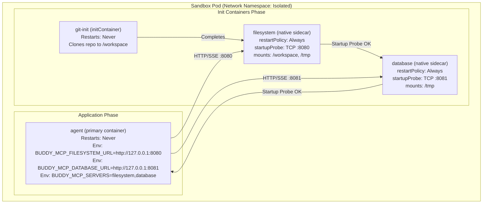

# Native Model Context Protocol (MCP) Sidecars

- **Milestone:** 6
- **Status:** Accepted
- **Principal Engineer Decision:** DEC-008, Native Sidecars with Pod-Local HTTP/SSE, Startup Probes, and Exit Isolation

## Problem Statement

Autonomous coding agents executing inside isolated Kubernetes Sandboxes require tool services (filesystem inspection, database querying, documentation retrieval, code search, and runtime testing). Rather than bundling diverse tool implementations into the agent image, tools are packaged into dedicated containers speaking the Model Context Protocol (MCP), an open JSON-RPC 2.0 based protocol operating over HTTP/SSE.

Deploying MCP sidecars alongside ephemeral agent containers introduces several Kubernetes lifecycle and networking hurdles:
1. **Pod Completion Hangs:** In batch-oriented sandboxes (`RestartPolicy: Never`), standard containers in `spec.containers` run indefinitely. If an MCP server runs as a standard container, the Pod never terminates after the agent finishes its work, locking compute resources on the cluster.
2. **Termination Status Confusion:** Kubernetes native sidecar containers (`initContainers` with `restartPolicy: Always`, KEP-753) solve completion hangs because Kubelet sends SIGTERM/SIGKILL when all primary containers exit. However, Kubelet records sidecar shutdown in `pod.Status.InitContainerStatuses` with exit code 143 (SIGTERM) or 137 (SIGKILL). If the operator controller naively inspects init container termination codes, successful agent runs are falsely marked as `Failed`.
3. **Startup Race Hazards:** Kubelet starts native sidecars sequentially, but unblocks subsequent containers immediately upon process launch unless a `startupProbe` is configured. If an agent starts before the MCP server binds its port, initial tool calls fail immediately with `ECONNREFUSED`.
4. **Tool Discovery:** Agents require deterministic discovery of tool endpoints without manual configuration file edits or external service registration.
5. **Security Isolation:** Sidecars must adhere to Pod Security Admission (PSA) Restricted profiles (non-root UID 1000, read-only root filesystems, dropped capabilities) without breaking third-party runtimes that require scratch directories.

## Goals and Non-Goals

### Goals
- Enable declarative MCP sidecar definitions in `spec.mcpServers` on the `Sandbox` Custom Resource Definition (CRD) and REST API.
- Deploy MCP sidecars as native Kubernetes sidecars (`initContainers` with `restartPolicy: Always`).
- Standardize on pod-local HTTP/SSE communication over `127.0.0.1:<port>`.
- Automatically synthesize a TCP socket `startupProbe` on declared sidecar ports (30s threshold) to guarantee the server is listening before the agent container launches.
- Isolate the Sandbox completion phase and exit code so they depend strictly on the primary `agent` container, ignoring sidecar SIGTERM (143) and SIGKILL (137) exit codes.
- Report mid-flight sidecar crashes as `Ready=False` with reason `SidecarDegraded` while allowing the agent to exit cleanly.
- Inject discovery environment variables (`BUDDY_MCP_<NAME>_URL`, `BUDDY_MCP_<NAME>_PORT`, `BUDDY_MCP_SERVERS`) into the agent container.
- Enforce PSA Restricted compliance by default, mounting a dedicated scratch `emptyDir` at `/tmp` and setting `HOME=/tmp`.
- Provide optional access to the sandbox workspace volume via `mountWorkspace: true`.

### Non-Goals
- Implement in-pod stdio-to-network bridges or proxy daemons (e.g. `socat`). Agents running stdio MCP tools execute them directly as child processes within the agent container.
- Implement in-pod L7 JSON-RPC reverse proxies or tool filtering firewalls.
- Support Unix Domain Sockets (UDS) via shared memory volumes.
- Permit arbitrary host volume mounts in MCP sidecars.
- Auto-restart failed agents when sidecars crash.

## System Architecture



### 1. Declarative CRD Schema

The `SandboxSpec` in `api/v1alpha1/sandbox_types.go` is extended with `MCPServers`:

```go
// MCPServerSpec defines a declarative Model Context Protocol (MCP) sidecar container.
type MCPServerSpec struct {
    // Name is the unique identifier of the MCP server sidecar.
    // Must conform to RFC 1123 DNS label format ([a-z0-9]([-a-z0-9]*[a-z0-9])?, max 55 characters
    // to ensure generated scratch volume names stay within the Kubernetes 63-character limit).
    // Cannot be 'agent' or 'git-init'.
    // +kubebuilder:validation:Required
    // +kubebuilder:validation:MinLength=1
    // +kubebuilder:validation:MaxLength=55
    // +kubebuilder:validation:Pattern="^[a-z0-9]([-a-z0-9]*[a-z0-9])?$"
    Name string `json:"name"`

    // Image is the container image running the MCP server.
    // +kubebuilder:validation:Required
    // +kubebuilder:validation:MinLength=1
    Image string `json:"image"`

    // Port is the TCP port on which the MCP server listens for HTTP/SSE connections.
    // The MCP server process must bind to all interfaces (0.0.0.0) or the Pod IP so that
    // kubelet TCP startup probes succeed, while agent containers communicate locally via 127.0.0.1.
    // External ingress from outside the pod is blocked by the Sandbox NetworkPolicy.
    // +kubebuilder:validation:Required
    // +kubebuilder:validation:Minimum=1
    // +kubebuilder:validation:Maximum=65535
    Port int32 `json:"port"`

    // Command overrides the container entrypoint.
    // +optional
    Command []string `json:"command,omitempty"`

    // Args provides arguments to the entrypoint.
    // +optional
    Args []string `json:"args,omitempty"`

    // Env specifies environment variables passed to the MCP server container.
    // +optional
    Env []corev1.EnvVar `json:"env,omitempty"`

    // Resources defines compute resource requests and limits for the sidecar container.
    // +optional
    Resources corev1.ResourceRequirements `json:"resources,omitempty"`

    // MountWorkspace grants the MCP sidecar access to the sandbox workspace volume.
    // When true, mounts the workspace directory at the configured workspace mount path (default /workspace).
    // +kubebuilder:default=false
    // +optional
    MountWorkspace bool `json:"mountWorkspace,omitempty"`

    // MountWorkspaceReadOnly specifies whether the workspace should be mounted read-only in the sidecar.
    // If the Sandbox workspace itself is configured read-only, this setting is always true.
    // +kubebuilder:default=false
    // +optional
    MountWorkspaceReadOnly bool `json:"mountWorkspaceReadOnly,omitempty"`
}
```

In `api/v1alpha1/sandbox_types.go`, `SandboxSpec` incorporates validation rules via Kubebuilder CEL markers:

```go
// MCPServers defines optional native Model Context Protocol (MCP) sidecar containers.
// +kubebuilder:validation:XValidation:rule="oldSelf.mcpServers == self.mcpServers",message="mcpServers is immutable after creation"
// +kubebuilder:validation:XValidation:rule="!has(self.mcpServers) || self.mcpServers.all(s, self.mcpServers.filter(o, o.name == s.name).size() == 1)",message="mcpServers names must be unique"
// +kubebuilder:validation:XValidation:rule="!has(self.mcpServers) || self.mcpServers.all(s, self.mcpServers.filter(o, o.port == s.port).size() == 1)",message="mcpServers ports must be unique"
// +kubebuilder:validation:XValidation:rule="!has(self.mcpServers) || self.mcpServers.all(s, !(s.name in ['agent', 'git-init']))",message="mcpServers name collides with reserved container names"
// +listType=map
// +listMapKey=name
// +optional
MCPServers []MCPServerSpec `json:"mcpServers,omitempty"`
```

Additionally, `IsReservedAgentEnvName` and the CEL rule on `SandboxSpec.Env` are updated to protect `BUDDY_MCP_*` discovery variables from collisions with user-specified environment entries:
- `IsReservedAgentEnvName`: returns true for `strings.HasPrefix(name, "BUDDY_MCP_")`.
- `SandboxSpec.Env` CEL validation: `!e.name.startsWith('BUDDY_MCP_')`.

### 2. Sample Sandbox YAML Manifest

```yaml
apiVersion: sandboxes.buddy.io/v1alpha1
kind: Sandbox
metadata:
  name: coding-agent-with-tools
  namespace: default
spec:
  image: golang:1.24
  command: ["go", "run", "main.go"]
  workspace:
    emptyDir: {}
  mcpServers:
    - name: filesystem
      image: mcp/filesystem:latest
      port: 8080
      mountWorkspace: true
      resources:
        limits:
          cpu: 500m
          memory: 512Mi
    - name: memory-db
      image: redis:7-alpine
      port: 6379
      resources:
        limits:
          cpu: 200m
          memory: 256Mi
```

### 3. Pod Construction & Native Sidecar Ordering

The controller constructs the Pod with native sidecars placed in `pod.Spec.InitContainers`:
1. **Sequential Declaration Order:**
   - Git repository seeding init container (`git-init`), if configured.
   - MCP sidecar containers in `spec.mcpServers` declaration order, configured with `RestartPolicy: ContainerRestartPolicyAlways`.
2. **Startup Synchronization via Automated Probes:**
   Each MCP sidecar container receives an automated `StartupProbe`:
   ```go
   StartupProbe: &corev1.Probe{
       ProbeHandler: corev1.ProbeHandler{
           TCPSocket: &corev1.TCPSocketAction{
               Port: intstr.FromInt32(server.Port),
           },
       },
       InitialDelaySeconds: 0,
       PeriodSeconds:       1,
       TimeoutSeconds:      1,
       SuccessThreshold:    1,
       FailureThreshold:    30,
   }
   ```
   Kubelet delays starting subsequent init containers and the primary `agent` container until the probe succeeds. If the server fails to listen within 30 seconds (30 attempts at 1s intervals), Kubelet restarts the container.
   *Socket Binding Requirement*: The MCP server process inside the sidecar must bind to `0.0.0.0` (all interfaces) or the Pod IP so that Kubelet's node-level TCP probe can reach `PodIP:<port>`, while the primary agent container communicates locally via `127.0.0.1:<port>`. Inbound traffic from outside the pod remains blocked by the Sandbox NetworkPolicy.
3. **Security Context & Storage Isolation:**
   - Container security context: `runAsUser: 1000`, `runAsNonRoot: true`, `allowPrivilegeEscalation: false`, `readOnlyRootFilesystem: true`, `drop: ["ALL"]`, `seccompProfile: RuntimeDefault`.
   - Dedicated scratch volume: Each sidecar receives its own dedicated scratch volume (`emptyDir: {}`) named `tmp-mcp-<name>` (bounded within the 63-character DNS label limit via `mcpScratchVolumeName`) mounted at `/tmp`, preventing cross-container file leakage. Default environment `HOME=/tmp` is set unless overridden in `server.Env`.
   - Workspace access: If `server.MountWorkspace` is true, the workspace volume (`workspace-volume`) is mounted at the configured workspace path (defaults to `/workspace`).
     The mount is read-only if `server.MountWorkspaceReadOnly` is true, or if `sandbox.Spec.Workspace.PersistentVolumeClaim != nil && sandbox.Spec.Workspace.PersistentVolumeClaim.ReadOnly`.

### 4. Agent Environment Discovery Contract

When `spec.mcpServers` is non-empty, the controller injects standard discovery variables into the primary `agent` container:
- `BUDDY_MCP_<UPPER_NAME>_URL`: Base HTTP URL formatted as `http://127.0.0.1:<port>`. Names are normalized to uppercase with hyphens replaced by underscores (e.g. sidecar `file-search` generates `BUDDY_MCP_FILE_SEARCH_URL=http://127.0.0.1:8080`).
- `BUDDY_MCP_<UPPER_NAME>_PORT`: Decimal port string (e.g. `8080`).
- `BUDDY_MCP_SERVERS`: Comma-delimited list of declared sidecar names in specification order (e.g. `filesystem,memory-db`).

When `spec.mcpServers` is empty or omitted, no `BUDDY_MCP_*` environment variables are injected. Standard MCP clients connect to `/sse` or root endpoints on the base URL.

### 5. Lifecycle Reconciliation & Status Filtering

The controller reconciles Pod status into `SandboxStatus` with strict container isolation:
1. **Pod Completion & Exit Isolation:**
   - In `observePodStatus`, the terminal phase of the Sandbox (`Succeeded` vs `Failed`) and `sandbox.Status.ExitCode` depend strictly on the container named `"agent"`.
   - If the `"agent"` container terminated with exit code 0:
     - `sandbox.Status.Phase = SandboxPhaseSucceeded`
     - `sandbox.Status.ExitCode = 0`
     - This holds true even if Kubelet marks `pod.Status.Phase = PodFailed` due to sidecars exiting with code 143 (SIGTERM) or 137 (SIGKILL) upon pod teardown.
   - If the `"agent"` container terminated with non-zero exit code:
     - `sandbox.Status.Phase = SandboxPhaseFailed`
     - `sandbox.Status.ExitCode = agentExitCode`
   - If the Pod failed due to infrastructure reasons (e.g. `DeadlineExceeded` or eviction) before the agent ran:
     - `sandbox.Status.Phase = SandboxPhaseFailed`
     - Reason and message reflect the Pod condition.
2. **Pending Initialization Filtering in `checkPendingPodErrors`:**
   - The controller correlates container status names with `sandbox.Spec.MCPServers` to identify native sidecars.
   - For native sidecars (`restartPolicy: Always`), ignore `ics.State.Terminated` during `PodPending`. Initial startup failures are retried by Kubelet.
   - Fail the Sandbox during `PodPending` only if an MCP sidecar has a fatal waiting condition (`CrashLoopBackOff`, `ImagePullBackOff`, `ErrImagePull`).
   - For standard init containers (e.g. `git-init`), any non-zero termination continues to fail immediately.
3. **Mid-Flight Sidecar Degradation:**
   While `pod.Status.Phase == corev1.PodRunning`:
   - If the `"agent"` container is already terminated, skip degradation checks (normal shutdown sequence).
   - If an MCP sidecar container is currently failing:
     `ics.State.Waiting != nil && ics.State.Waiting.Reason == "CrashLoopBackOff"` OR `!ics.Ready && ics.State.Running == nil && ics.RestartCount > 0`
     - The controller sets condition `Ready=False` with reason `SidecarDegraded` and message `MCP sidecar '<name>' is crashing (restarts: <count>)`.
     - The controller does not terminate the Pod; the agent continues running and handles tool errors at the application layer.
   - If all MCP sidecars are healthy (`ics.Ready == true`), `Ready` condition is restored to `True` with reason `PodRunning`.

## REST API and CLI Support

### REST API
`MCPServerSpec` is mirrored in `pkg/api/v1/types.go` under `CreateSandboxRequest` and `SandboxResponse`:

```go
type MCPServerSpec struct {
    Name                   string                `json:"name"`
    Image                  string                `json:"image"`
    Port                   int32                 `json:"port"`
    Command                []string              `json:"command,omitempty"`
    Args                   []string              `json:"args,omitempty"`
    Env                    []EnvVar              `json:"env,omitempty"`
    Resources              *ResourceRequirements `json:"resources,omitempty"`
    MountWorkspace         bool                  `json:"mountWorkspace,omitempty"`
    MountWorkspaceReadOnly bool                  `json:"mountWorkspaceReadOnly,omitempty"`
}
```

In `internal/gateway/handlers.go`:
- `handleCreateSandbox`: converts `apiv1.MCPServerSpec` to `sandboxesv1alpha1.MCPServerSpec`, parsing resource quantities.
- `mapSandboxToResponse`: converts `sbx.Spec.MCPServers` into `apiv1.SandboxResponse.MCPServers`.

### Developer CLI (`buddy-sbx`)
The `buddy-sbx run` command supports `--mcp-server`:
- Format: `--mcp-server name=filesystem,image=mcp/filesystem:latest,port=8080,mountWorkspace=true`
- Repeatable flag for attaching multiple sidecars.
- The `buddy-sbx list` command formats an `MCP` column displaying attached sidecars (e.g. `filesystem:8080`).

## Security and Failure Modes

| Failure Mode | Detection / Mitigation | Blast Radius |
| :--- | :--- | :--- |
| MCP image cannot be pulled | `checkPendingPodErrors` flags `ImagePullBackOff` on sidecar; sandbox transitions to `Failed` and the controller terminates the Pod. | Pod terminates before agent runs; compute resources freed. |
| MCP server port conflict | CRD CEL validation rejects duplicate ports or reserved ports on sandbox creation. | Sandbox rejected before Pod creation. |
| MCP server fails startup probe / crashes on boot | Kubelet holds back `agent` container; on `CrashLoopBackOff` the controller marks sandbox `Failed` and deletes the Pod. | Agent container never starts; prevents hanging sidecar retries or half-initialized runs. |
| MCP server crashes mid-run | Controller updates condition to `Ready=False` (`SidecarDegraded`); agent receives connection error on HTTP/SSE call. | Localized to tool calls; agent decides whether to abort or retry. |
| Agent finishes and exits 0 | Kubelet sends SIGTERM/SIGKILL to sidecars; controller isolates exit evaluation; sandbox marks `Succeeded`. | Clean termination of all sidecars; zero hanging pods. |
| Malicious MCP container tries root access | Enforced `runAsNonRoot: true`, `runAsUser: 1000`, `drop: ["ALL"]`, `seccompProfile: RuntimeDefault`. | Container blocked by Kubernetes admission and runtime. |
| Scratch space isolation | Dedicated `tmp-mcp-<name>` volume per sidecar mounted at `/tmp` (bounded within 63 characters via `mcpScratchVolumeName`). | Sidecars cannot view or tamper with agent scratch files; volume names always satisfy DNS label limits. |

## Verification Plan

### 1. Unit and Envtest Gates
- `api/v1alpha1`:
  - Validation tests for unique names, unique ports, valid port range (1-65535), and immutable `mcpServers`.
  - Validation tests rejecting reserved container names (`agent`, `git-init`).
  - Validation tests rejecting reserved `BUDDY_MCP_*` environment variables in `spec.env`.
- `internal/controller`:
  - Verify Pod spec contains native sidecars in `InitContainers` with `restartPolicy: Always`.
  - Verify probe synthesis with TCP socket action on specified port.
  - Verify dedicated `tmp-mcp-<name>` volumes and mounts.
  - Verify discovery env vars injected into `"agent"` container.
  - Verify that exit code 143/137 on sidecars does not mark sandbox as Failed when agent exits 0.
  - Verify that `agent` exit code 1 correctly marks sandbox as Failed with exit code 1.
  - Verify `SidecarDegraded` condition when sidecar crashes mid-run, and recovery when healthy.
- `internal/gateway`:
  - Verify deserialization of `mcpServers` in `CreateSandboxRequest` and serialization in `SandboxResponse`.
- `cmd/buddy-sbx`:
  - Verify `--mcp-server` flag parsing and table output in `buddy-sbx list`.

### 2. Local KinD Cluster Verification
- KinD cluster `dell-cluster` (or standard cluster `kind` per Makefile).
- Build and deploy updated controller image `buddy-sandboxes-controller:local`.
- Create Sandbox with a mock HTTP MCP server sidecar listening on port 8080 using `python:3.12-alpine` running `python3 -m http.server 8080`.
- Execute agent script that:
  1. Inspects environment variables (`BUDDY_MCP_SERVERS`, `BUDDY_MCP_MOCK_URL`).
  2. Queries `http://127.0.0.1:8080` successfully.
  3. Writes to `/workspace` and verifies sidecar can see workspace modifications (when `mountWorkspace: true`).
  4. Exits with code 0.
- Verify:
  - Pod starts, native sidecar ready probe passes, agent executes.
  - Pod terminates cleanly with `Succeeded` status.
  - Controller status shows `Phase: Succeeded`, `ExitCode: 0`.
