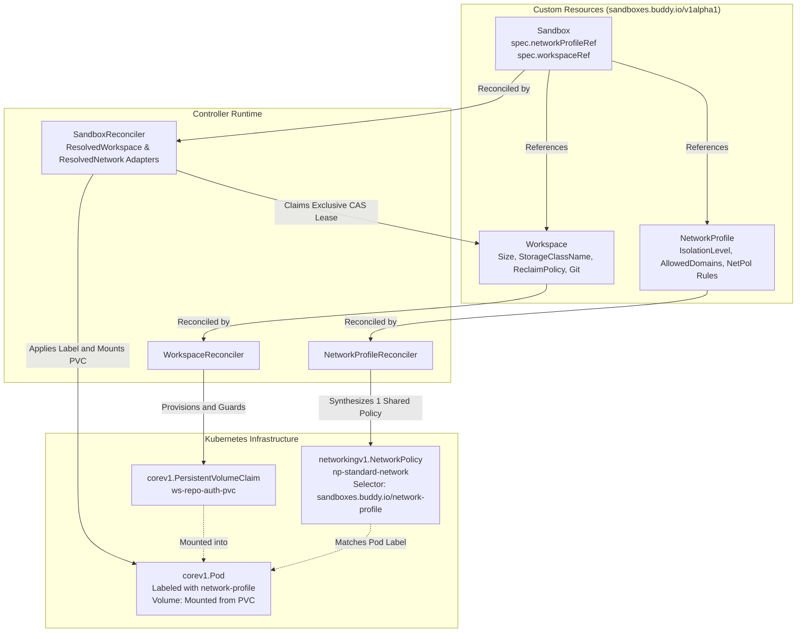

# Decoupled NetworkProfile and Workspace Custom Resources

## 1. Problem Statement

Autonomous coding agents execute inside isolated sandbox containers that require distinct configurations for storage persistence and network security boundaries:
1. **Coupled Storage Lifecycle**:
   When storage definitions (`spec.workspace`) are tightly bound inside compute resources (`Sandbox`), persistent volume claims (PVCs) cannot easily be retained, snapshotted, or transferred across successive agent execution attempts without incurring container restart penalties or PVC ownership contention.
2. **Coupled Network Policy & High-Scale Churn**:
   When network egress boundaries (`spec.network`) are directly attached to individual compute pods, every sandbox lifecycle event generates dedicated `NetworkPolicy` objects in etcd. In scaled and warm-pooled environments, this causes O(N) watch fan-out across cluster nodes and frequent CNI eBPF/iptables recompilation.
3. **Pre-Warmed Pooling Requirements**:
   Warm pooling requires clean, unencumbered compute pods. If storage mounts or specific network policies are embedded in the pod template, pods cannot be pre-warmed and dynamically leased to distinct tasks.

This specification decouples storage and network perimeters into first-class custom resources (`Workspace` and `NetworkProfile`), refactoring `Sandbox` to reference them via `spec.workspaceRef` and `spec.networkProfileRef` while preserving backward compatibility for legacy inline configurations.

---

## 2. System Architecture



---

## 3. Custom Resource Definitions

### 3.1 NetworkProfile (`sandboxes.buddy.io/v1alpha1`)

`NetworkProfile` defines reusable egress boundaries and network isolation levels:

```go
// NetworkIsolationLevel defines the isolation preset.
// +kubebuilder:validation:Enum=HardPerimeter;DefaultDenyAll;PermissiveDev
type NetworkIsolationLevel string

const (
	IsolationHardPerimeter NetworkIsolationLevel = "HardPerimeter"
	IsolationDefaultDenyAll NetworkIsolationLevel = "DefaultDenyAll"
	IsolationPermissiveDev NetworkIsolationLevel = "PermissiveDev"
)

// NetworkProfileSpec defines desired network egress boundaries.
type NetworkProfileSpec struct {
	// IsolationLevel configures preset network boundaries. Defaults to HardPerimeter.
	// +kubebuilder:default=HardPerimeter
	// +optional
	IsolationLevel NetworkIsolationLevel `json:"isolationLevel,omitempty"`

	// AllowedDomains specifies declarative FQDNs and wildcard domains permitted for egress.
	// +listType=set
	// +kubebuilder:validation:MaxItems=32
	// +kubebuilder:validation:items:Pattern="^(\\*)?(\\*\\.)?([a-zA-Z0-9-]+\\.)+[a-zA-Z]{2,}$"
	// +optional
	AllowedDomains []string `json:"allowedDomains,omitempty"`

	// BlockClusterInternal drops egress traffic to RFC1918 subnets and Carrier-Grade NAT.
	// Defaults to true.
	// +kubebuilder:default=true
	// +optional
	BlockClusterInternal *bool `json:"blockClusterInternal,omitempty"`

	// BlockMetadataService drops egress traffic to 169.254.169.254/32.
	// Defaults to true.
	// +kubebuilder:default=true
	// +optional
	BlockMetadataService *bool `json:"blockMetadataService,omitempty"`

	// AllowAPIBroker permits access to the in-cluster credential broker.
	// +optional
	AllowAPIBroker bool `json:"allowAPIBroker,omitempty"`

	// AllowInternetWeb permits outbound HTTP and HTTPS traffic to ports 80 and 443.
	// Defaults to true.
	// +kubebuilder:default=true
	// +optional
	AllowInternetWeb *bool `json:"allowInternetWeb,omitempty"`

	// AllowDNS permits outbound DNS traffic to CoreDNS.
	// Defaults to true.
	// +kubebuilder:default=true
	// +optional
	AllowDNS *bool `json:"allowDNS,omitempty"`
}

// NetworkProfileStatus defines observed state of NetworkProfile.
type NetworkProfileStatus struct {
	// SynthesizedNetworkPolicyName is the name of the managed NetworkPolicy.
	// +optional
	SynthesizedNetworkPolicyName string `json:"synthesizedNetworkPolicyName,omitempty"`

	// Conditions represent observations of current state.
	// +optional
	Conditions []metav1.Condition `json:"conditions,omitempty"`
}
```

### 3.2 Workspace (`sandboxes.buddy.io/v1alpha1`)

`Workspace` manages storage provisioning, volume retention, and Git configuration independently of compute pods:

```go
// WorkspacePhase represents the observed lifecycle phase of the workspace.
// +kubebuilder:validation:Enum=Pending;Ready;Bound;Failed
type WorkspacePhase string

const (
	WorkspacePhasePending WorkspacePhase = "Pending"
	WorkspacePhaseReady   WorkspacePhase = "Ready"
	WorkspacePhaseBound   WorkspacePhase = "Bound"
	WorkspacePhaseFailed  WorkspacePhase = "Failed"
)

// WorkspaceSpec defines the storage volume and Git seeding configuration.
type WorkspaceSpec struct {
	// ReclaimPolicy defines whether the underlying PVC is preserved (Retain) or deleted (Delete)
	// when the Workspace custom resource is deleted. Defaults to Retain.
	// +kubebuilder:validation:Enum=Retain;Delete
	// +kubebuilder:default=Retain
	// +optional
	ReclaimPolicy WorkspaceReclaimPolicy `json:"reclaimPolicy,omitempty"`

	// Size is the requested volume size (e.g. 10Gi).
	// +kubebuilder:validation:Pattern="^[0-9]+(\\.[0-9]+)?(E|P|T|G|M|k|Ei|Pi|Ti|Gi|Mi|Ki)?$"
	// +optional
	Size string `json:"size,omitempty"`

	// StorageClassName specifies the storage class to use.
	// +optional
	StorageClassName *string `json:"storageClassName,omitempty"`

	// Git specifies repository seeding configuration.
	// +optional
	Git *GitRepositorySpec `json:"git,omitempty"`

	// MountPath is where the workspace is mounted inside containers. Defaults to /workspace.
	// +kubebuilder:default="/workspace"
	// +optional
	MountPath string `json:"mountPath,omitempty"`

	// PersistentVolumeClaim references an existing pre-provisioned PVC.
	// +optional
	PersistentVolumeClaim *PersistentVolumeClaimWorkspace `json:"persistentVolumeClaim,omitempty"`
}

// WorkspaceStatus defines the observed state of Workspace.
type WorkspaceStatus struct {
	// Phase is the current lifecycle phase.
	// +optional
	Phase WorkspacePhase `json:"phase,omitempty"`

	// PVCName is the name of the underlying PersistentVolumeClaim.
	// +optional
	PVCName string `json:"pvcName,omitempty"`

	// Capacity is the actual allocated capacity of the underlying volume.
	// +optional
	Capacity string `json:"capacity,omitempty"`

	// BoundSandboxRef references the active Sandbox currently mounting this workspace.
	// +optional
	BoundSandboxRef *corev1.LocalObjectReference `json:"boundSandboxRef,omitempty"`

	// Conditions represent observations of current state.
	// +optional
	Conditions []metav1.Condition `json:"conditions,omitempty"`
}
```

### 3.3 Sandbox Extension & Validation Rules

`SandboxSpec` references the decoupled resources:

```go
type SandboxSpec struct {
	// WorkspaceRef references an independent Workspace custom resource.
	// +optional
	WorkspaceRef *corev1.LocalObjectReference `json:"workspaceRef,omitempty"`

	// NetworkProfileRef references an independent NetworkProfile custom resource.
	// +optional
	NetworkProfileRef *corev1.LocalObjectReference `json:"networkProfileRef,omitempty"`

	// ... other existing fields
}
```

#### CEL Validations on `SandboxSpec`:
- **Immutability**: `workspaceRef` and `networkProfileRef` cannot be modified after sandbox creation.
- **Mutual Exclusivity**: A sandbox cannot specify both `workspaceRef` and custom inline storage/git properties, nor both `networkProfileRef` and custom inline `allowedDomains`.
- **Suspension Compatibility**: Sandboxes with `workspaceRef` or writable PVCs can enter cold suspension (`suspend: true`).

---

## 4. Reconciliation Lifecycles

### 4.1 NetworkProfile Reconciliation
- Synthesizes a single `networkingv1.NetworkPolicy` named `np-<profile-name>` in the same namespace, selecting pods labeled `sandboxes.buddy.io/network-profile: <profile-name>`.
- Replaces O(N) NetworkPolicy creation with O(1) shared policies, reducing CNI eBPF/iptables recompilation load.
- When `spec.networkProfileRef` is configured on a sandbox, `SandboxReconciler` labels the pod and sets proxy environment variables directly from `profile.Spec.AllowedDomains`.

### 4.2 Workspace Lifecycle & RWO Mutual Exclusion
- `WorkspaceReconciler` creates the PVC `ws-<name>-pvc` (if dynamic) and adds the retention finalizer `sandboxes.buddy.io/workspace-retention` when `ReclaimPolicy == Retain`.
- Once the PVC reaches `Bound`, `Workspace.Status.Phase` transitions to `Ready`.
- When an active Sandbox references the workspace:
  1. `SandboxReconciler` verifies `Workspace.Status.BoundSandboxRef`. If claimed by another non-terminal sandbox, the reconciler halts pod creation, sets condition `StorageConfigured=False` with reason `WorkspaceAlreadyMounted`, and requeues.
  2. If available, `SandboxReconciler` performs an atomic CAS claim, setting `BoundSandboxRef` to itself and `Phase = Bound`.
  3. When the Sandbox finishes, fails, or suspends, it releases the claim, returning the workspace to `Ready`.

### 4.3 Git Seeding Lifecycle
- Git seeding is executed in-band by the Sandbox Pod `git-init` container.
- Before executing `git clone`, the init container evaluates `git rev-parse --is-inside-work-tree`.
- If an existing work tree is present, the init script logs that the repository is already initialized and exits with code 0 immediately (under 10ms). This prevents multi-attach errors and eliminates duplicate clone overhead across sequential sandbox attachments.

---

## 5. Security & Isolation Invariants

1. **Namespace Isolation**: `NetworkProfile` and `Workspace` are namespaced resources. They cannot be referenced or attached across tenant namespace boundaries.
2. **Egress Gateway Token Authenticity**: Egress tokens minted for `buddy-egress-gateway` remain scoped to individual sandboxes (`sub: sandbox.Name`) even when using a shared `NetworkProfile`.
3. **Storage Retention Guarantees**: Under `ReclaimPolicy: Retain`, deleting a `Workspace` custom resource preserves the underlying PVC for forensic inspection or snapshotting.
