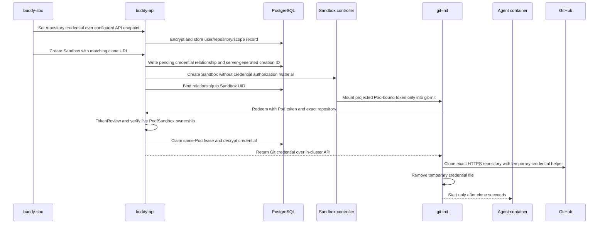

# Service Credentials and Private Git Access

* **Author:** hoangndst
* **Status:** Proposed
* **Date:** 2026-11-23

## Overview

Buddy stores encrypted credentials for supported services and uses each only through its service-specific authorization path. OpenAI and Anthropic credentials authorize model requests through the existing provider broker. A GitHub credential authorizes one private HTTPS clone in the sandbox's `git-init` container. The agent process does not receive the GitHub token.

Credentials are encrypted in PostgreSQL and belong to a Buddy user. The supported services share user ownership, encryption keys, metadata-only management, and authenticated API access. Provider capabilities and Git clone claims remain separate because their authorization, target, and delivery rules differ. OpenAI and Anthropic credentials support a user-wide default and a sandbox-specific override. GitHub credentials are additionally bound to one exact repository. A sandbox-specific GitHub credential overrides the user's credential only for the same repository.

## The Problem

Buddy already stores OpenAI and Anthropic API keys, resolves sandbox-specific overrides, and proxies provider traffic. Private Git clone credentials use a separate Kubernetes Secret created by an operator and mounted only into `git-init`. Users do not have a Buddy-managed workflow to save, list, replace, and remove their own GitHub clone credentials.

Adding GitHub as an ordinary provider would mix Git operations with model requests. Git needs an exact repository boundary and a short-lived init-container workflow. The system must preserve that boundary while letting a user manage the encrypted credential through the authenticated Buddy API and CLI.

## Goals

* Preserve current OpenAI and Anthropic credential commands, storage, scopes, and broker behavior.
* Let a user store, replace, list, and remove a GitHub token for one canonical HTTPS repository.
* Support user-wide and named sandbox-specific GitHub records. A sandbox-specific record takes precedence only for the same user, host, and repository path.
* Keep credential values encrypted at rest and out of user-facing Sandbox responses, agent environment values, logs, errors, and workspaces.
* Authenticate managed clone redemption with a short-lived, audience-bound, Pod-bound ServiceAccount token mounted only in `git-init`.
* Keep Git authorization state out of Sandbox and Pod specifications. Do not give the agent GitHub API access or Git push credentials.
* Preserve operator-managed `--git-secret-ref` behavior for compatibility. An explicit `--git-secret-ref` selects that credential source.
* Require explicit service adapters and destination policies before accepting any additional service identifier.

## Non-Goals

* OpenAI OAuth, Anthropic OAuth, or interactive provider sign-in.
* GitHub API calls, Git push, or access to a GitHub token from the running agent container.
* Credential support for arbitrary services, hosts, headers, or request methods.
* A Buddy-managed GitHub App installation or automatic GitHub token minting.
* Replacement of the existing operator-managed Kubernetes Secret workflow.

## Critical User Journeys

### Store and use a repository credential

* **Given:** The user is logged in to a Buddy API endpoint and has a fine-grained GitHub token for one repository.
* **When:** The user runs `buddy-sbx secret set github --repo https://github.com/acme/service.git` and then starts `buddy-sbx run codex --clone https://github.com/acme/service.git`.
* **Then:** The CLI prompts without echoing the token and sends it only to the authenticated Buddy API. The API encrypts it and selects it only for a matching clone. `git-init` redeems a Pod token and completes the clone. No user-facing API response, agent container, workspace, or log contains the GitHub token.

### Configure a sandbox-specific repository credential

* **Given:** The user wants a different token for one named Sandbox and repository.
* **When:** The user runs `buddy-sbx secret set github --repo <repository-url> --sandbox <sandbox-name>` before creating that Sandbox.
* **Then:** The record can be used only when the same user creates that named Sandbox for that exact repository. It overrides the user-wide record for that repository. The API binds it to the created Sandbox UID and immutable creation ID, so a later object reusing the name cannot use it.

### Remove or replace a credential

* **Given:** The user has a repository credential at user-wide or sandbox scope.
* **When:** The user replaces it or runs `buddy-sbx secret rm github --repo <repository-url> [--sandbox <name>]`.
* **Then:** The API changes the encrypted record and audits metadata only. Removal prevents future credential claims. The user revokes the underlying GitHub token with GitHub to invalidate any token already redeemed by an in-progress clone.

### Use the legacy operator-managed credential

* **Given:** A Sandbox request includes `--git-secret-ref`.
* **When:** The request is submitted.
* **Then:** The explicit `--git-secret-ref` selects the existing same-namespace Secret path. The API does not select a managed GitHub credential for that request.

## Technical Plan

### Credential storage and scope

The `service_credentials` table stores encrypted values and common owner, service, scope, target, key-version, and timestamp fields. Its service column is syntactically constrained; public API writes and credential use must resolve through the compile-time catalog. User ownership, encryption keys, and metadata-only management are shared. Provider-specific options and Git repository identity remain typed and service-specific. Provider broker capabilities and Git clone claims remain separate authorization records and are not interchangeable.

OpenAI and Anthropic continue to use provider-specific validation and request brokerage. Git records contain the owner user ID, canonical HTTPS host, canonical repository path, scope, optional sandbox name, encrypted token, key version, and timestamps. The unique key is `(user, host, repository path)` for user-wide scope and `(user, host, repository path, sandbox)` for sandbox scope. Repository text is validated as supplied and is never case-folded. The only supported Git host is `github.com`; repository paths have exactly two segments, `owner/repository`, and matching preserves the exact path including any `.git` suffix. Accept lowercase `github.com` hostnames and paths with exactly two non-empty segments; reject uppercase hostnames, trailing slashes, percent-encoding, repeated separators, dot segments, userinfo, ports, query strings, and fragments instead of normalizing them. Repository path case is matched exactly as supplied.

Provider scope semantics do not change. Git scope resolution uses the exact owner, host, path, and sandbox name; the sandbox record wins over the user's record. A named Sandbox-scoped record may be stored before Sandbox creation because a first clone creates the Sandbox. It remains pending for at most 24 hours. For Git credential requests, the API ignores any client-supplied creation ID and generates a fresh server-side ID. It writes the pending credential relationship before creating the Sandbox, then binds it to the Kubernetes UID after creation. The relationship includes the user, selected credential record, exact repository, namespace, name, UID, and server-generated creation ID; a later object reusing the name cannot use it. The API delete handler revokes the relationship when deletion is requested. A durable API watcher observes enabled tenant namespaces and revokes relationships when a deletion timestamp appears; a periodic sweeper confirms object deletion or UID replacement and completes cleanup after API or watcher failures. A terminating object remains revoked but retains its credential record until Kubernetes confirms deletion. Failed create requests roll back pending bindings, and ambiguous create results are reconciled only by exact server-generated creation ID. Successful clone completion closes only the delivery claim; the sandbox-scoped credential remains bound until Sandbox deletion. An unclaimed record expires and can be set again. The server-generated creation ID is stored in an annotation as a second identity check alongside the Kubernetes UID.

The CLI retains `buddy-sbx secret set|ls|rm` and resolves service IDs through the built-in catalog. GitHub set and remove operations require a repository URL. GitHub set accepts a hidden prompt or standard input, never a raw command-line token. Listing shows service, scope, Sandbox name, repository host/path, and update time without token fragments. Existing provider endpoint and model options remain valid only for OpenAI. Help text and validation errors state the accepted Git URL form and do not include the token.

### Built-in service catalog

The API, CLI, and credential stores resolve service IDs through one compile-time catalog. This release registers `openai` and `anthropic` as provider services and `github` as a repository-clone service. Each entry names its display label, accepted scope and target requirements, and typed policy path. The catalog is closed: an unknown ID is rejected by the API and CLI before storage or use.

Adding a service requires an explicit catalog entry, service-specific validation and storage options, an approved delivery path, and tests for destination and credential exposure. Provider services use the provider broker. Repository services use exact repository identity and clone claims. A descriptor cannot provide user-selected hosts, headers, request methods, or routes. Authentication-method metadata is added only when a supported service needs another method.

### API contract

Existing OpenAI and Anthropic endpoints remain unchanged. GitHub metadata and values use a dedicated Git credential handler so provider options and provider broker routes cannot apply to Git records.

| Method and path | Access | Behavior |
| --- | --- | --- |
| `GET /api/v1/credentials` | Active user | Return metadata for provider and Git credentials owned by the user. Never return values or encrypted data. |
| `PUT /api/v1/git-credentials?repository=<url>[&sandbox=<name>]` | Active user | Validate the canonical `github.com` repository URL, encrypt the supplied token, and replace the record at the selected scope. |
| `DELETE /api/v1/git-credentials?repository=<url>[&sandbox=<name>]` | Active user | Remove only the matching user's record and scope. |
| `POST /internal/v1/git-clone-credentials/redeem` on the in-cluster `buddy-api` Service | Pod-bound ServiceAccount token | Validate workload identity and claim the credential for the exact clone. Return the credential only to an authorized Git `git-init` Pod. |
| `POST /internal/v1/git-clone-credentials/complete` on the in-cluster `buddy-api` Service | Same Pod-bound ServiceAccount token | Record `succeeded` or `failed` for the matching Pod claim. Repeating the same outcome is idempotent; a different outcome after success returns conflict. |

The create-Sandbox application flow parses a candidate GitHub URL once into a validated repository identity before credential selection. That identity is used for exact matching, binding, and the Sandbox clone configuration. Invalid or lookalike URLs cannot select a managed credential. If `--git-secret-ref` is explicitly supplied, it takes precedence and the API skips managed credential selection, even when a matching managed record exists. There is no request option that selects both credential sources. For managed Git credential use, the API ignores any client-supplied creation ID and generates a fresh server-side ID. It stores a pending credential relationship keyed by namespace, name, and server-generated ID before creating the Sandbox, then binds that relationship to the Kubernetes UID after creation. If creation returns an ambiguous error, the API reads the object and resolves only an exact server-ID match; it never deletes an object based on a caller-selected ID. The create endpoint is non-idempotent in this release; clients recover by querying the returned Sandbox name and UID. Caller-selected IDs are never accepted as authorization proof. The user identity is kept in this database relationship and is not copied into a user-controlled Sandbox field. The Sandbox spec contains no credential selector or redemption secret. The pending relationship is written before the Sandbox create call, so a fast controller cannot race a missing selection; the broker waits until the relationship has the created Sandbox UID before authorizing redemption. The authenticated user is identified by the existing Buddy bearer token. Git values use the request body `{ "value": "<token>" }`; repository and scope are query parameters, and the credential value is never placed in a URL. The combined metadata listing is served by the existing authenticated route. Provider broker capabilities and Git clone delivery claims use separate authorization and delivery paths.

### Clone Pod token and delivery

The API creates the Sandbox with its ordinary Git clone configuration but no credential selector or redemption secret. The controller disables automatic ServiceAccount token mounting and projects a short-lived token with a dedicated audience into `git-init` only. The init script reads the projected token immediately before each request so kubelet rotation is honored. Kubernetes binds this token to the Pod; the agent container has no projected token. The init container presents the token and exact repository URL to internal routes hosted by the existing `buddy-api` process. `buddy-api` validates the token with Kubernetes TokenReview, requires `authenticated=true`, the exact returned audience and exact service account username, and reads the Pod name and UID only from TokenReview `status.user.extra` claims (`authentication.kubernetes.io/pod-name` and `authentication.kubernetes.io/pod-uid`). It never authorizes from locally decoded JWT claims. It then reads the live Pod and verifies its UID, namespace, service account, controller-owned labels, and owner reference to the exact Sandbox UID. It reads that Sandbox and verifies its immutable creation ID and Git clone configuration against the credential relationship stored during authenticated creation; the relationship contains the user ID and selected credential record ID. TokenReview authenticates the Pod identity; the database credential relationship and live Kubernetes objects authorize the requested clone. For every redemption request, the API first reads the Buddy user through the identity store and fails closed if the user is disabled or the lookup fails. In the same PostgreSQL transaction that creates the delivery claim, it locks and rechecks the user row with `FOR SHARE`; this serializes the claim against the administrative status update. No process-local status cache is used, so all API replicas observe committed deactivation before creating a new claim. A claim serialized before deactivation may finish, and a token already returned to `git-init` cannot be recalled; deactivation blocks claims serialized afterward. TokenReview calls and Kubernetes reads fail closed on errors and use bounded timeouts. The sandbox Pod uses a dedicated, unprivileged `buddy-sandbox` ServiceAccount with automount disabled; the controller creates it without Kubernetes API permissions. The `buddy-api` ServiceAccount receives `create` permission on TokenReview through a separate ClusterRole. Its existing tenant-scoped permissions allow reads of Pods and Sandboxes; no Secret-read or workload-mutation permissions are added for credential redemption.

The broker stores a durable claim keyed by the Sandbox UID, creation ID, and Pod UID. The projected token requests a 600-second lifetime, the shortest supported by Kubernetes. The init deadline is five minutes after Pod start, capped by the Sandbox active deadline; the claim also enforces at most three redemption attempts per Pod. Repeated requests from the same Pod UID during that window receive the same credential, while another Pod UID is denied. A completion request includes the exact repository and outcome. It repeats TokenReview and the live-object checks, then verifies the existing claim belongs to the same Sandbox UID, creation ID, and Pod UID. Successful completion closes the claim permanently. Failed attempts increment the bounded retry count and may be retried by the same Pod within the retry limit and deadline. Repeating the same completion is idempotent; a conflicting outcome is rejected. If `git-init` exits before reporting completion, the claim remains attached to that Pod. The same Pod may retry until limits expire, and a replacement can claim only after the old Pod UID is confirmed absent. After the deadline, no Pod can receive the credential while the original Pod exists; the controller must delete a stuck Pod before a replacement can claim it. TokenReview rejects tokens bound to deleted Pods, and a live Pod lookup must confirm that the original UID is absent before the database claim can be released for replacement. Claims for deleted Pods and completed clones are cleaned up idempotently. Sandbox-scoped credential cleanup compares the credential record ID, Sandbox UID, and creation ID; it preserves user-wide credentials and cannot delete a record bound to a newer object. Redemption requests have a 16 KiB body limit, and the returned credential is limited to 8 KiB. TokenReview, Kubernetes reads, and database operations have bounded timeouts. No credential selector or bearer authorization material is stored in Sandbox or Pod spec fields, annotations, labels, environment variables, or command arguments.

The init script writes the redeemed token only to a memory-backed `emptyDir` mounted into `git-init`. The projected token uses mode `0440` with a Pod `fsGroup` matching the init container group; the temporary Git credential file and `curl` configuration use mode `0600`. The `curl` configuration keeps the projected token out of process arguments and environment variables. Requests use a fixed in-cluster API URL, bounded timeouts, and do not follow redirects. The Git credential helper responds only for the exact HTTPS host and repository path. It does not persist credentials into Git configuration or `.git/config`. A cleanup trap removes temporary credential files after clone success or failure. The redemption response is the only API response containing the GitHub token; it is returned over the in-cluster API connection to the authorized init process and is never included in a user-facing response. The response sets `Cache-Control: no-store` and `Pragma: no-cache`. The handler logs a random request ID, stable outcome code, duration, and authorized workload UIDs; it does not log the repository, user identity, token, or authorization header. The init shell runs without tracing, writes only to a mode-0600 config file, and does not print broker response bodies on failure.

For every managed Git clone Pod, independently of provider `AllowAPIBroker` settings, the controller applies a distinct `sandboxes.buddy.io/git-credential-redemption=true` label. Its NetworkPolicy permits egress to the existing `buddy-api` Service on TCP 8080; the API ingress policy allows that port only from redemption-labeled Pods in enabled tenant namespaces. Kubernetes NetworkPolicy applies to the whole Pod, so the agent container can reach the same API endpoint, but it has neither the projected Pod token nor Kubernetes API credentials. `buddy-api` authorizes redemption only after TokenReview and live-object checks. Its egress policy also needs access to Kubernetes API server endpoints. The local KinD configuration allows `172.21.0.3/32` on TCP 6443; deployments must configure all API server endpoint CIDRs for their cluster. The manifests use standard Kubernetes NetworkPolicy and do not require Cilium CRDs. Regular users continue to access Sandbox data through the Buddy API and do not receive direct Kubernetes read access to Sandbox objects.

### Data migration and compatibility

Migration 003 is an expand migration. It creates the shared encrypted service record table and Git binding/claim tables, copies existing provider rows without changing IDs or ciphertext, and synchronizes legacy provider writes while mixed API versions may run. The current runtime dual-writes provider changes during this compatibility window. Deploy the migration before the new API. Old API versions continue using `provider_credentials`; new API versions read the shared rows. Rollback first deploys the old API, which continues to see provider rows through the legacy table; Git managed credentials are unavailable to the old version but their additive records remain intact. Do not drop either representation as part of rollback. Define and test the point at which legacy synchronization can be removed in a later migration. The migration must be safe to retry after interruption. The database constrains service identifiers to a safe syntax; API writes and credential use resolve identifiers through the compile-time service catalog.

Update the existing `buddy-api` ServiceAccount RBAC before enabling managed Git credential delivery. Provider capabilities remain limited to OpenAI and Anthropic. Existing custom endpoint options and active provider broker capabilities remain valid.

The legacy `--git-secret-ref` continues to accept only repository-bound HTTPS secrets. An explicit SecretRef selects the legacy source and prevents managed credential selection for the request. Removing a stored Git credential prevents future claims but does not revoke a token already returned to a running init container; revoke that token with GitHub to stop its use.

## Security Boundaries

* The Buddy API receives credential values only over HTTPS for remote endpoints. Local development may use loopback HTTP. Values are never accepted as command-line arguments.
* PostgreSQL stores only authenticated ciphertext and key version. The API uses the existing mounted encryption key set. Database backups and encryption keys must be preserved together.
* The GitHub adapter accepts only `github.com` HTTPS repository URLs with canonical paths, no userinfo, query, fragment, or explicit port. Host and path comparisons are exact.
* A GitHub token is decrypted by `buddy-api` only after Pod-bound token authorization validation. It is returned only to `git-init`, never to an agent API, provider route, agent environment, command argument, or workspace file.
* The `git-init` script uses the token only for the exact repository, disables HTTP redirects, suppresses credential-bearing output, and removes its temporary credential file on completion.
* The agent container receives no GitHub token or projected redemption token. NetworkPolicy permits the Pod to reach the internal Git routes on `buddy-api` for managed Git clones; Pod identity and live Sandbox authorization are required for redemption.
* GitHub tokens are user-supplied and may permit more than clone. Recommend fine-grained tokens limited to one repository and read-only contents permission where supported. Buddy does not claim to narrow the token's provider-side permissions.
* Audit records contain the actor, operation, target service/repository/scope, time, and outcome. They do not contain credential values, projected token values, authorization headers, or request/response bodies. Credential mutations do not report success if a required audit write fails; the failure is emitted through secret-free operational logging and an error response.

## Failure Modes

* **No matching GitHub credential:** public clone proceeds without credentials. A private clone fails through the normal `git-init` failure condition and retained Pod logs.
* **Invalid or under-permissioned GitHub token:** the init process reports a redacted authentication failure; it does not log the response body or credential helper output. The user can replace or remove the stored token.
* **Repository mismatch:** credential claim or redemption fails closed if the host or path differs, including a sibling repository on the same host.
* **Invalid audience, expired token, wrong Pod, or wrong Sandbox:** TokenReview or live-object checks reject the request without decrypting or returning the token.
* **Credential removed before redemption:** the lookup fails and the token is not returned. Removal after redemption does not revoke an already redeemed GitHub token; revoke it at GitHub to stop active use.
* **API unavailable to `git-init`:** clone initialization fails after bounded retries and the Sandbox status identifies the Git credential request failure without exposing the token or credential.
* **Redemption authorization failure:** secret-free reason codes and request IDs distinguish invalid token or audience, Pod identity mismatch, Sandbox mismatch, repository mismatch, disabled user, stale claim, storage or key failure, and retry exhaustion. Structured logs include only workload UIDs and stable operation outcomes, not user or repository labels.
* **Credential decryption or database failure:** redemption fails closed. API readiness reports storage/key failures according to the credential-store behavior. The claim operation uses a bounded transaction and never holds a database transaction during Git network activity.
* **Clone failure after redemption:** the init script removes its temporary credential file, reports a redacted init failure, and may retry within the same Pod up to the configured attempt limit and deadline. The failed Pod remains available for safe diagnostics after the limit is reached.

## Delivery Order

Implement the components in dependency order: schema and encrypted Git records; authenticated credential APIs and Sandbox binding; internal `buddy-api` routes, TokenReview and RBAC; controller token projection and network policy; CLI commands and user documentation. Keep user-wide and named Sandbox-specific scopes in the same release because both are required by the credential management contract. Do not enable managed credential delivery until the migration, API RBAC, network policies, and readiness checks are deployed.

## Alternatives Considered

### Reuse provider credential storage and routes for GitHub

* **Pros:** Fewer storage and handler types.
* **Cons:** Provider routes represent model requests and have different destination, lifetime, and exposure rules. Including Git in provider broker authorization would couple Git clone to model request handling.
* **Reason for rejection:** GitHub clone authorization remains a separate credential purpose and protocol.

### Keep GitHub credentials only in Kubernetes Secrets

* **Pros:** Reuses the current init-only mount and needs no encrypted Git credential store.
* **Cons:** Users cannot manage credentials through Buddy CLI or a later dashboard; operators must provision a Secret for each user/repository.
* **Reason for rejection:** The user-managed credential lifecycle is a product requirement.

### Proxy all Git Smart HTTP traffic through Buddy

* **Pros:** The GitHub token would never enter a Sandbox Pod.
* **Cons:** Requires a dedicated Git transport proxy, streaming request handling, remote URL rewriting, and separate operational routing.
* **Reason for deferral:** This design covers initial clone only and uses an isolated init-container boundary.

### Accept arbitrary service names and destinations

* **Pros:** New credentials could be stored without adding provider-specific code.
* **Cons:** Arbitrary destination and header selection can expose credentials to unintended hosts and bypass existing broker policies.
* **Reason for rejection:** Each supported service requires an explicit adapter and destination policy.

## Non-Functional Requirements

### Security and privacy

Credential claims and completion must be atomic across API replicas. Credential values and authorization tokens must be absent from Sandbox and Pod specs, user-facing responses, and logs. Tests must inspect projected volume mounts, container fields, workspace files, init output, and failure messages. User deactivation and credential removal must deny future claims across all replicas. Broker claim transactions read the authoritative user status on each redemption; a disabled user cannot receive a new token.

### Availability and resource use

Redemption uses the shared PostgreSQL store and must not hold a database transaction open during Git network operations. It performs one bounded identity verification and one atomic claim state change per clone. A credential-store outage denies managed Git clone credential delivery; it does not alter public clone behavior or controller operation on already-created Sandboxes.

### Rollout and rollback

Deploy the additive migration before the API version that uses the new tables. The prior API version ignores the new tables and continues handling provider credentials. Roll back the API before considering schema rollback; do not drop Git credential tables while data may be needed after redeploy. Backup restoration requires the matching encryption keys.

## Additional Resources

* [User Identity and Brokered Provider Credentials](user_identity_and_provider_credentials.md)
* [Custom Provider Endpoints and Models](custom_provider_endpoints_and_models.md)
* [Isolated Git Clone Mode](isolated_git_clone_and_ignore_engine.md)
* [Git credential helper configuration](https://git-scm.com/docs/gitcredentials)
* [Kubernetes TokenReview and Pod-bound ServiceAccount claims](https://kubernetes.io/docs/reference/access-authn-authz/service-accounts-admin/)
* [Kubernetes RBAC](https://kubernetes.io/docs/reference/access-authn-authz/rbac/)
* [GitHub fine-grained personal access tokens](https://docs.github.com/en/authentication/keeping-your-account-and-data-secure/managing-your-personal-access-tokens)
* [GitHub App installation tokens](https://docs.github.com/en/apps/creating-github-apps/authenticating-with-a-github-app/authenticating-as-a-github-app-installation)

## Future Improvements

* Add other service identifiers only with an adapter-specific origin, route, method, credential, redirect, request-size, response-filtering, and test policy.
* Consider a GitHub App integration that mints short-lived repository-scoped installation tokens if user-provided token handling proves insufficient.
