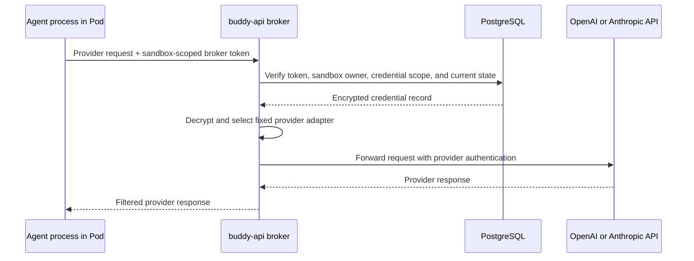

# User Identity and Brokered Provider Credentials

* **Author:** hoangndst
* **Status:** Implementation in progress
* **Date:** 2026-11-22

## Overview

Buddy's API currently authenticates callers with a configured bearer token mapped to a Kubernetes namespace. This design adds named users, explicit administrator permissions, and a durable provider credential store for Codex and Claude Code. The CLI and a later dashboard use the same API authorization rules.

Users configure the Buddy API endpoint they use, such as a local KinD ingress or a public deployment. There is no separate `--cloud` mode. Buddy login tokens identify users; provider credentials authorize model requests and are handled by a broker outside the sandbox Pod.

## The Problem

A single token-to-namespace mapping cannot identify multiple users, distinguish administrators from regular users, or enforce ownership of sandboxes and provider credentials. The CLI stores a namespace value that looks like user-controlled context even though the gateway actually derives the namespace from the token. Provider credential handling is also split: the Codex project workflow uses a temporary broker session, while legacy runs still expose a guarded direct-forwarding option.

Without a user identity and shared credential store, the dashboard cannot reliably show each user their own resources or let administrators manage users. Without a durable broker store, provider credentials are lost on API restart and cannot be consistently used or revoked across replicas.

## Goals

* Give each caller a stable user identity and role.
* Assign each regular user one Kubernetes namespace on the server. Do not let regular users select or override it through CLI configuration or API request data.
* Let administrators create and disable users, issue and revoke Buddy login tokens, and manage resources across user namespaces through explicit admin routes.
* Support one-time first-admin bootstrap without public self-registration.
* Support Codex with an OpenAI API key and Claude Code with an Anthropic API key.
* Store provider credentials by user and scope. User-wide credentials are available to that user's sandboxes. A sandbox-specific API key overrides the user's user-wide key for that sandbox.
* Keep provider values out of Pods, sandbox resources, API responses, logs, and error messages. Use fixed provider broker routes.
* Persist user, token, provider credential, and audit metadata across API restarts and replicas.
* Keep the operator and sandbox controller independent of user authentication.
* Define API behavior that the CLI and later dashboard can share.

## Non-Goals

* Dashboard UI in this milestone. The dashboard will use these API endpoints in a later milestone.
* Password-based accounts, public registration, organization federation, OIDC login, teams, and multi-namespace user membership.
* Agy or provider adapters beyond the named Codex and Claude Code integrations.
* Generic custom host/header injection, HTTPS interception, registry credentials, or a claim that every Docker service identifier works in Buddy.
* Allowing an administrator API to retrieve plaintext user provider credentials.
* Making Kubernetes controllers interpret Buddy identities or tokens.

## Critical User Journeys

### First administrator setup

* **Given:** `buddy-api` is installed with a one-time bootstrap secret and PostgreSQL is ready.
* **When:** The operator runs the bootstrap command with the secret and supplies the administrator identity and namespace.
* **Then:** The API creates one administrator, marks bootstrap complete, invalidates the bootstrap secret, and returns a new Buddy login token once.

### User onboarding

* **Given:** An administrator is authenticated.
* **When:** They create a user, assign a Kubernetes namespace, and issue a token.
* **Then:** The token is shown once, only its hash is persisted, and the user can configure `buddy-sbx` with the API endpoint and token.

### Provider credential setup

* **Given:** A user is logged in to the configured Buddy API endpoint.
* **When:** They run `buddy-sbx secret set openai` or `buddy-sbx secret set anthropic`.
* **Then:** The CLI securely prompts, sends credential material only to the Buddy API over HTTPS, and the API encrypts it before persistence. The CLI never places secret values in command arguments or shell history.

### Scoped provider use

* **Given:** A user has a user-wide credential and may have a sandbox-specific credential for the same provider.
* **When:** The agent sends a request to a supported broker route.
* **Then:** The broker verifies the sandbox capability and ownership, selects the sandbox-specific API key if present or falls back to the user-wide key, and forwards only to the fixed provider endpoint.

### Token or provider credential revocation

* **Given:** An administrator revokes a user token, or its owner removes a provider credential.
* **When:** Any API replica receives a subsequent request.
* **Then:** Shared storage reflects the revocation and rejects the request. The operation is audited without recording secret material.

## Technical Plan

### Identity and authorization

Authentication middleware resolves a request to a principal containing a stable user ID, role, and assigned namespace. Existing user-facing Sandbox routes derive the namespace only from that principal. They do not trust namespace values from flags, headers, query parameters, or request bodies.

Regular users have one assigned namespace. Administrators have no implicit Sandbox namespace; they use explicit admin routes naming the target user ID. The API resolves that user ID to its assigned namespace. The API service account gets a reusable namespaced-resource `ClusterRole`, bound by `RoleBinding` only in enabled tenant namespaces. Cluster operators provision namespaces and bindings out of band; the API cannot create namespaces, RoleBindings, or ClusterRoleBindings. Do not bind the API service account to this ClusterRole cluster-wide. The ClusterRole excludes namespace/RBAC administration, Kubernetes Secrets, and cluster-scoped resources.

`buddy-api namespace enable --namespace <name>` is an operator-only command run with operator kubeconfig and database access. It verifies the namespace, applies the API service account RoleBinding to the shared minimal ClusterRole, and registers the namespace as enabled in PostgreSQL. The command is idempotent. User creation may assign only an enabled namespace that is not assigned to another user. `default` is enabled by the local gateway overlay. The broker runs one Sandbox list/watch cache per enabled namespace; a stale or unhealthy cache denies broker requests only in its namespace.

Buddy login tokens are random opaque bearer tokens. The API stores a one-way hash with token metadata, displays the value only when issued, and supports expiry and revocation. The first administrator is created with a one-time bootstrap secret that is disabled after use. There is no public self-registration.

The operator runs `buddy-api bootstrap-admin --namespace <enabled-namespace> --bootstrap-token-file <path>` once. PostgreSQL stores only a hash of the one-time bootstrap token. A transaction locks the singleton bootstrap row, creates the first admin and login token, and consumes the bootstrap record. Concurrent or repeated bootstrap attempts fail without issuing another admin token. `buddy-api recover-admin-token --user-id <id>` is a break-glass local command: it revokes that admin's prior tokens, issues one replacement, records an audit event, and prints the token once. There is no HTTP bootstrap or recovery route. Buddy login tokens expire after 90 days; an admin issues a replacement. The API prevents disabling or demoting the last active admin.

The HTTP contract is:

| Method and path | Access | Behavior |
| --- | --- | --- |
| `GET /api/v1/auth/whoami` | Any active user | Return stable user ID, display name, role, and informational assigned namespace. |
| `GET /api/v1/admin/users` | Admin | List user metadata without tokens or provider values. |
| `POST /api/v1/admin/users` | Admin | Accept `{displayName, namespace}`; assign a stable user ID and regular-user role. |
| `PATCH /api/v1/admin/users/{userID}` | Admin | Enable or disable a user; last-active-admin protection applies. |
| `PATCH /api/v1/admin/users/{userID}/role` | Admin | Promote or demote a user with explicit last-active-admin protection. |
| `POST /api/v1/admin/users/{userID}/tokens` | Admin | Issue a 90-day token and return its plaintext once. |
| `DELETE /api/v1/admin/users/{userID}/tokens/{tokenID}` | Admin | Revoke one token. |
| `POST /api/v1/admin/users/{userID}/sandboxes` and descendants | Admin | Perform Sandbox operations in that user's server-assigned namespace. |
| `GET /api/v1/credentials` | Active user | List credential metadata for that user only. |
| `PUT /api/v1/credentials/{service}` | Active user | Set or replace a user-wide key or a key for one owned Sandbox. |
| `DELETE /api/v1/credentials/{service}` | Active user | Remove the selected scope. |

Normal user Sandbox routes use the caller's assigned namespace. A regular user cannot select a namespace. An administrator's own identity does not grant an implicit namespace; cross-user Sandbox operations must name a target user ID.

### Persistent store and provider encryption

PostgreSQL is the canonical store for enabled namespaces, users, namespace assignments, Buddy token hashes, provider credential metadata and ciphertext, broker capability hashes, and audit events. It provides one shared source of truth to all API replicas and transactions for credential replacement, authorization, and revocation. Bundle a pinned single-replica PostgreSQL StatefulSet with a PVC for KinD and basic self-hosted use; document that it is not highly available. Allow production deployments to use externally operated PostgreSQL.

Ship versioned SQL migrations embedded in the API image and run them from a one-shot `buddy-api migrate` Job before rolling out the API. Serialize migrations with a PostgreSQL advisory lock and record applied versions in a migration table. API replicas do not run schema migrations during startup. Use forward-compatible expand/contract changes and document the compatibility window, backup/restore, and rollback procedure. Back up database state and encryption keys together.

The API encrypts provider credentials with authenticated encryption before writing them to PostgreSQL. Each ciphertext records a key version. Encryption keys are supplied to `buddy-api` through a Kubernetes Secret mounted separately from the database. The key set can retain old versions for reads while a new active version is used for writes. Automated re-encryption and key retirement procedures are deferred; operators must retain every key version still referenced by stored credentials. Database backups and encryption keys must be backed up and restored together.

The API does not store provider values in Kubernetes Secret resources, Sandbox CRs, Pods, or persistent volumes. The database is not exposed to sandbox workloads.

### Provider credential model

Credential records contain owner user ID, service identifier, scope, optional sandbox name, encrypted API key, key version, timestamps, and status. Secret reads resolve by `(user ID, service, scope)`. Sandbox-specific API keys take precedence over that user's user-wide key. Setting a sandbox-scoped key requires the named Sandbox to exist in the user's namespace. Another user's same-named Sandbox cannot resolve the credential because owner user ID is part of the key.

`buddy-sbx secret ls` returns only service, scope, sandbox name when applicable, and update time. It never returns credential fragments. `buddy-sbx secret rm` removes the selected scope and takes effect on the next broker request. Updating a credential also affects the next request, including requests from already-running sandboxes.

The user-wide scope is the default. `--sandbox <name>` selects a Sandbox-specific override. The request body carrying a provider key is accepted only over HTTPS, has a strict size limit, and is never reflected in responses. The server encrypts the value before persistence. An administrator cannot retrieve another user's plaintext credential.

First-wave commands:

```text
buddy-sbx secret set openai
buddy-sbx secret set openai --sandbox <sandbox-name>
buddy-sbx secret set anthropic
buddy-sbx secret set anthropic --sandbox <sandbox-name>
buddy-sbx secret ls
buddy-sbx secret rm openai
buddy-sbx secret rm openai --sandbox <sandbox-name>
buddy-sbx secret rm anthropic
```

Secret input must use a hidden terminal prompt or standard input. A raw secret is not accepted as a normal command-line argument. OpenAI account OAuth is deferred until a user-controlled credential architecture is designed and reviewed.

Docker's built-in service identifiers and custom secret commands are useful catalog patterns, but generic custom HTTPS header injection is not part of this design. Buddy's existing egress gateway uses opaque HTTP CONNECT and cannot rewrite TLS-encrypted headers. A future custom-secret design must provide an explicit secure broker path and fixed destination policy before such credentials become usable.

### Broker request path



The API issues an opaque random 32-byte capability when creating a supported agent Sandbox. It stores only the capability hash in PostgreSQL, bound to the user ID, namespace, Sandbox name, Kubernetes UID, creation ID, provider, exact method/path allowlist, issued/expiry times, and revocation state. A pending record is created before the Sandbox, then activated after the Kubernetes UID is known. Failed or ambiguous creation revokes the pending capability and cleans up only an object verified by its creation ID. The capability expires at the earlier of the Sandbox deadline and two hours, and is not renewed in this release. Only the capability is placed in the provider agent's expected credential variable; the provider key remains in the API database.

For each provider request, the broker checks that the capability is active, unexpired, unrevoked, bound to the current user and Sandbox UID/creation ID, and permitted for that exact provider, method, and path. It also checks the current Sandbox state and namespace cache. Pending, expired, revoked, suspended, deleting, terminal, stale-cache, recreated, and mismatched requests fail closed. Deletion, suspension, and terminal state revoke capabilities in shared database state so all replicas observe the change.

Codex uses a fixed OpenAI Responses route. Claude Code uses fixed Anthropic Messages routes, initially `POST /v1/messages` and token counting only if verified as required by the pinned CLI version. Anthropic uses `x-api-key` and the required version header. Each adapter applies request size limits, deadlines, safe upstream error handling, and provider-specific authorization. Unknown paths, methods, query parameters, and destination hosts fail closed.

The first release accepts API keys only. Provider credentials are never copied into agent configuration files or Pod environment variables. OpenAI OAuth, generic custom credentials, and additional providers require separate designs.

### CLI and configuration

`buddy-sbx login` connects to the endpoint selected by the user and verifies the Buddy token with `whoami`. The token is stored in the local Buddy config file, created with owner-only permissions (0600) inside an owner-only config directory (0700). Contexts contain endpoint and credential reference, not `default_namespace`; existing `default_namespace` fields are ignored and removed on the next config write. Namespace information is informational output from the server, never an authorization selector for a regular user.

The dashboard, when added, will use the same API role checks. Browser authentication must use a server-managed session cookie or equivalent backend-for-frontend flow, not store reusable bearer tokens in JavaScript local storage.

### Migration and rollout

Fresh installations configure PostgreSQL, an encryption key set, and a one-time administrator bootstrap secret before enabling multi-user API routes. The first administrator bootstraps the service, assigns a namespace, then creates user identities and login tokens.

Existing installations cannot infer multiple users from a shared static token. Operators explicitly map the current token and namespace to an initial administrator or migration owner, then issue unique tokens to users. The migration command requires an enabled namespace and an empty identity store. Once complete, the API rejects the old static token path and removes `BUDDY_API_TOKEN` and `BUDDY_API_NAMESPACE` as normal authentication configuration. Rollback requires restoring the database and matching encryption keys; it must not silently reactivate old shared tokens.

The migration command creates one initial admin from the legacy token and namespace, issues a new Buddy token, and records the old token fingerprint in the migration audit event. After cutover, remove the old token Secret; the new API authentication path does not accept it. Do not keep a dual-auth window or restore static authentication during rollback. The CLI ignores any existing `default_namespace` field, omits it from future config writes, and treats namespace output from `whoami` as informational. Remove `--unsafe-forward-provider-key`; reject former uses with a migration message and reject explicit `OPENAI_API_KEY` or `ANTHROPIC_API_KEY` values on Sandbox runs.

### Failure behavior and operations

If PostgreSQL or the encryption key set is unavailable, login, credential changes, and provider broker requests fail closed. API liveness remains independent from readiness; readiness is false when identity or credential storage is unavailable. Database health and pool saturation are measured without exposing queries containing secret data.

Audit events record actor, action, target identity or credential metadata, timestamp, and outcome for user creation, token issue/revoke, credential set/update/remove, and broker authorization. They never include raw tokens, provider values, authorization headers, or provider response bodies.

User deactivation revokes Buddy tokens and broker capabilities, which prevents further use of that user's stored provider credentials. It does not delete credentials, sandboxes, or workspace data. Resource cleanup remains an explicit administrator operation.

## Alternatives Considered

### Keep static token-to-namespace mappings

* **Pros:** No durable identity database or migration.
* **Cons:** No stable user identity, roles, token lifecycle, or reliable resource ownership.
* **Reason for rejection:** The dashboard and per-user credential scopes require API-level identity and authorization.

### Store user credentials in Kubernetes Secret resources

* **Pros:** Uses a Kubernetes-native API and can place records in user namespaces.
* **Cons:** Kubernetes Secrets are base64 encoded and may be stored unencrypted in etcd unless encryption at rest is configured. The API service account gains sensitive cross-namespace Secret permissions; revocation remains an application concern.
* **Reason for rejection:** PostgreSQL provides a transactional multi-replica source of truth while application encryption keeps provider ciphertext separate from cluster Secret access.

### Keep credentials in gateway memory

* **Pros:** Simple and avoids persistent secret storage.
* **Cons:** Credentials disappear on restart and are not shared across replicas.
* **Reason for rejection:** Users expect saved credentials and revocation to work regardless of which API replica handles a request.

### Inject generic custom credentials through the current egress proxy

* **Pros:** Could mirror Docker's custom secret command shape.
* **Cons:** The CONNECT proxy cannot modify encrypted HTTPS headers without TLS termination and a new certificate trust boundary.
* **Reason for deferral:** Do not claim support until a separate broker or TLS design can preserve the credential boundary.

## Non-Functional Requirements

### Security and privacy

* Use TLS for Buddy CLI and dashboard traffic.
* Store only hashes of Buddy login tokens.
* Encrypt provider values before database persistence and keep encryption keys outside PostgreSQL.
* Keep provider values out of Pods, Sandbox CRs, responses, logs, metrics, and error text.
* Enforce owner and role checks on every API route, including WebSocket, file transfer, suspend/resume, and provider broker paths.
* Do not log provider request bodies or response bodies.

### Availability and consistency

* Every API replica uses PostgreSQL for token status, user mapping, credential reads, and revocation.
* Revocation and credential updates apply to the next broker request.
* Database and encryption-key loss must not cause fallback to shared static authentication or direct key forwarding.

### Rollout

* Deploy database schema before enabling user-token authentication.
* Require explicit migration of the current local shared token to one initial admin or migration owner.
* Retain a documented database and encryption-key backup procedure.
* Do not claim horizontal API scaling until revocation and database failover tests pass.

## Implementation and Verification

The implementation adds PostgreSQL-backed users, namespace assignments, Buddy token hashes, encrypted provider credentials, broker capabilities, and audit records. The CLI supports endpoint login and provider-key set, list, and remove commands. Codex and Claude Code use fixed provider adapters. Remote gateway endpoints require HTTPS; loopback HTTP remains available for local development.

The initial release accepts API keys only. It does not include provider-key rotation tooling, OpenAI OAuth, a dashboard, or generic custom credential services. The local KinD deployment uses a single-replica PostgreSQL StatefulSet; production availability and backup operations remain the operator's responsibility.

Verification for this change includes `make manifests generate && make fmt vet && make test && make lint`, deployment of the operator and API to KinD `dell-cluster`, one-time administrator bootstrap, CLI login, user-scoped credential storage and metadata listing, provider-backed Codex Sandbox creation, and a check that the Pod received a broker capability rather than the stored provider key. The live smoke test removes its Sandbox and dummy provider credential afterward. Automated PostgreSQL integration tests and real-provider API calls are not part of this verification.
