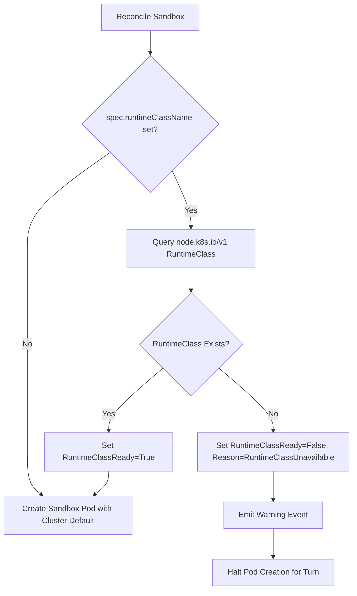

# Workload Isolation, RuntimeClasses, and Hardened Runtimes

## 1. Overview and Motivation

AI coding agents execute untrusted source code, install external dependencies, and execute shell processes during autonomous development tasks. Relying solely on standard Linux container namespaces (`runc`) leaves the host kernel exposed to kernel exploits, syzkaller fuzzing chains, and container breakout vulnerabilities.

Buddy Sandboxes establishes a defense-in-depth security model by providing multi-engine workload isolation, hardened container execution contexts, fine-grained network policies, and declarative workspace management.

This document specifies the technical design and execution plan for **Milestone 3: Workload Isolation, RuntimeClasses & Defense in Depth**.

---

## 2. RuntimeClass Discovery and Pre-Flight Validation

The `Sandbox` custom resource defines `spec.runtimeClassName` (e.g. `"gvisor"`, `"kata-containers"`, or omitted for cluster default).

To prevent broken pods from entering indefinite `Pending` states when a requested runtime is missing, the reconciler implements pre-flight validation against cluster `node.k8s.io/v1` `RuntimeClass` resources before pod creation:



1. **RBAC Requirement**: The controller adds cluster-scoped permissions for `node.k8s.io`:
   ```go
   // +kubebuilder:rbac:groups=node.k8s.io,resources=runtimeclasses,verbs=get;list;watch
   ```
2. **Dynamic Watcher**: `SetupWithManager` registers a watch on `node.k8s.io/v1` `RuntimeClass`. When an administrator installs a missing `RuntimeClass`, affected sandboxes reconcile automatically without manual restarts.
3. **Condition Contract**: When `RuntimeClass` is missing:
   * Condition `RuntimeClassReady` is set to `Status: False`, `Reason: RuntimeClassUnavailable`, `Message: RuntimeClass "<name>" not found`.
   * Condition `Ready` is set to `Status: False`, `Reason: RuntimeClassUnavailable`.
   * Sandbox remains in `Pending` phase without thrashing the API server.

---

## 3. Native Scheduling Delegation via RuntimeClass

Kubernetes native `node.k8s.io/v1` `RuntimeClass` provides built-in scheduling capabilities:
* `scheduling.nodeSelector`: Selects nodes that support the runtime (e.g., nodes with hardware virtualization extensions or gVisor kernel modules).
* `scheduling.tolerations`: Tolerates dedicated node taints (e.g., `sandboxes.buddy.io/isolated=true:NoSchedule`).

The controller sets `pod.Spec.RuntimeClassName = sandbox.Spec.RuntimeClassName`. The kube-apiserver admission chain automatically merges `scheduling.nodeSelector` and `scheduling.tolerations` into the Pod specification. This eliminates the need for custom scheduling controllers in the operator.

---

## 4. Pod Security Context Hardening

Sandbox pods enforce the Pod Security Admission `Restricted` baseline:

```yaml
spec:
  runtimeClassName: gvisor
  securityContext:
    runAsNonRoot: true
    runAsUser: 1000
    fsGroup: 1000
    fsGroupChangePolicy: "OnRootMismatch"
    seccompProfile:
      type: RuntimeDefault
  containers:
  - name: agent
    securityContext:
      allowPrivilegeEscalation: false
      readOnlyRootFilesystem: true
      runAsNonRoot: true
      runAsUser: 1000
      capabilities:
        drop: ["ALL"]
      seccompProfile:
        type: RuntimeDefault
```

* **Filesystem Immutability**: The container root filesystem is read-only. Writable directories are mounted as isolated `emptyDir` volumes at `/workspace`, `/tmp`, and `/home/sandbox`.
* **Seccomp Profile**: Standard `RuntimeDefault` is enforced. For gVisor and Kata, system calls are mediated by the user-space Sentry kernel or guest VM hypervisor.
* **Process Limits**: PID limits are governed at the node level via Kubelet configuration (`--pod-max-pids`) and CRI runtime handlers.

---

## 5. API Gateway and Developer CLI Plumbing

To expose runtime isolation to developers and automated workflows:

1. **API Schema (`pkg/api/v1/types.go`)**:
   Add `RuntimeClassName *string` to `CreateSandboxRequest` and `SandboxResponse`.
2. **Gateway Handlers (`internal/gateway/handlers.go`)**:
   Map `req.RuntimeClassName` to `sandboxesv1alpha1.SandboxSpec.RuntimeClassName` during `POST /api/v1/sandboxes`.
3. **CLI Flags (`cmd/buddy-sbx/run.go`)**:
   Add `--runtime-class` flag:
   ```bash
   buddy-sbx run --runtime-class gvisor golang:1.25
   ```

---

## 6. Pod Status Observation & Failure Recovery

The controller's `observePodStatus` method is updated to observe runtime and scheduling failures:

1. **InitContainer Statuses**: Inspect `pod.Status.InitContainerStatuses` for `Waiting` reasons (`CrashLoopBackOff`, `ImagePullBackOff`, `ErrImagePull`) and terminated non-zero exit codes.
2. **Scheduler Conditions**: Inspect `pod.Status.Conditions` for `PodScheduled=False` with `Reason=Unschedulable` (e.g. when no nodes satisfy the runtime's node selector). Propagate the scheduler message directly to `SandboxStatus.Conditions`.

---

## 7. KinD and CI Verification Architecture

To verify runtime isolation in CI environments without hardware virtualization (`/dev/kvm`):

1. **KinD gVisor Setup**: Install `runsc` in the KinD node container configured with `platform = "ptrace"`. Register `RuntimeClass` `gvisor`.
2. **Mock Kata Handler**: Configure KinD containerd to register a handler named `kata-containers` pointing to `io.containerd.runc.v2`. Register `RuntimeClass` `kata-containers`.
3. **CI Test Suite**:
   * Test 1: Verify sandbox runs with default runtime (`runc`).
   * Test 2: Verify sandbox runs under `gvisor` with syscall isolation.
   * Test 3: Verify sandbox requesting non-existent runtime transitions to `RuntimeClassUnavailable`.

---

## 8. Implementation Tasks (Milestone 3 Execution Plan)

Milestone 3 is implemented across 6 sequential tasks:

* **Task 3.1: API Gateway and CLI Runtime Plumbing**
  * Update `pkg/api/v1/types.go` (`CreateSandboxRequest`, `SandboxResponse`).
  * Update `internal/gateway/handlers.go` (`CreateSandboxHandler`).
  * Update `cmd/buddy-sbx/run.go` (`--runtime-class` flag).
  * Unit tests for gateway and CLI flag parsing.

* **Task 3.2: Reconciler Pre-Flight Validation and RuntimeClass Discovery**
  * Update `api/v1alpha1/sandbox_types.go` with `RuntimeClassReady` conditions.
  * Add RBAC rules for `node.k8s.io` `runtimeclasses`.
  * Implement `reconcileRuntimeClass` in `internal/controller/sandbox_controller.go`.
  * Register `Watches(&nodev1.RuntimeClass{}, ...)` in `SetupWithManager`.
  * Envtest coverage for missing and valid runtime classes.

* **Task 3.3: Pod Security Context Hardening & Defense-in-Depth**
  * Verify `corev1.SeccompProfileTypeRuntimeDefault` on pod and container security contexts.
  * Unit tests verifying `runAsUser: 1000`, `readOnlyRootFilesystem: true`, and dropped capabilities.

* **Task 3.4: Controller Pod Status Observation and Failure Recovery**
  * Update `observePodStatus` to monitor `pod.Status.InitContainerStatuses`.
  * Update `observePodStatus` to surface `PodScheduled=False` `Unschedulable` conditions.
  * Unit tests for init-container failures and unschedulable pod states.

* **Task 3.5: KinD CI Integration Test Suite**
  * Update KinD configuration and CI workflow to include gVisor `ptrace` and mock handlers.
  * Add integration tests in `test/e2e/e2e_test.go`.

* **Task 3.6: Architecture Documentation Updates**
  * Update `docs/architecture.md` with runtime class specifications and security profiles.

---

## 9. Security & Threat Model

| Threat | Attack Vector | Mitigation |
| :--- | :--- | :--- |
| **Host Kernel Exploitation** | Untrusted agent executes syzkaller or kernel exploit | gVisor user-space kernel or Kata microVM hardware boundary via `spec.runtimeClassName` |
| **Privilege Escalation** | Agent attempts SUID binary execution or capability acquisition | `allowPrivilegeEscalation: false`, `capabilities.drop: ["ALL"]`, `runAsNonRoot: true` |
| **Filesystem Tampering** | Agent modifies system binaries or libraries | `readOnlyRootFilesystem: true`; writable storage restricted to `/workspace`, `/tmp`, and `/home/sandbox` |
| **Resource Starvation** | Agent spawns process fork bombs or memory allocations | cgroups v2 memory/CPU limits; Kubelet `--pod-max-pids` node-level enforcement |
| **Cluster Internal Pivot** | Agent scans internal Kubernetes services or metadata | NetworkPolicy default-deny ingress and egress blocks on RFC1918 subnets and `169.254.169.254/32` |
