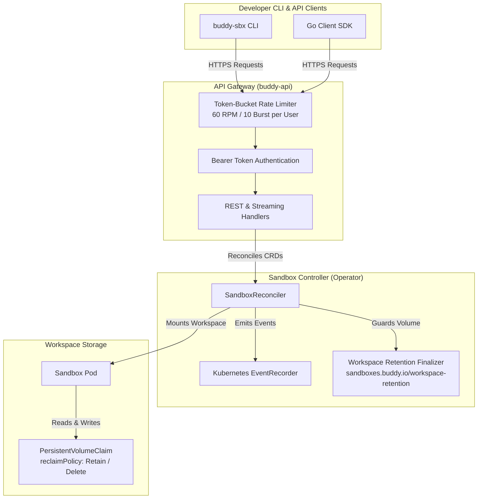

# Workspace Retention, Event Recording & Rate Limiting

## 1. Problem Statement

Autonomous coding agents create, build, and modify repositories inside remote sandbox workspaces. In production environments, three operational gaps present risks to developer workflows and platform stability:

1. **Accidental Workspace Destruction on Sandbox Deletion**:
   When a `Sandbox` custom resource is deleted, Kubernetes garbage collection automatically cascades deletion to all child resources configured with `metav1.OwnerReference`. For dynamically provisioned persistent volume claims (PVCs), this immediately and irrevocably destroys the volume and all uncommitted agent progress, even if the user intended only to stop the compute pod.
2. **Missing Kubernetes Event Observability**:
   The `SandboxReconciler` currently lacks an `EventRecorder`. When pod scheduling fails, container images fail to pull, deadlines expire, or runtime errors occur, no standard Kubernetes events (`Warning` or `Normal`) are emitted on the `Sandbox` resource. Cluster operators and automated scripts inspecting `kubectl describe sandbox <name>` see only static status conditions without an event timeline.
3. **Unprotected API Gateway Endpoints**:
   The in-cluster API gateway (`buddy-api`) lacks token-bucket rate limiting. Rapid client loops, misconfigured CI runners, or compromised tokens can overwhelm in-cluster controllers and exhaust upstream model provider quotas.

This specification defines the declarative workspace retention policy, finalizer-guarded storage lifecycles, Kubernetes event emission, and token-bucket API rate limiting.

---

## 2. System Architecture



---

## 3. Declarative Workspace Reclaim Policy

### CRD Schema Extension (`sandboxes.buddy.io/v1alpha1`)

The `WorkspaceSpec` is extended with an explicit `reclaimPolicy` field:

```go
// WorkspaceReclaimPolicy defines the retention policy for dynamically created persistent storage.
// +kubebuilder:validation:Enum=Retain;Delete
type WorkspaceReclaimPolicy string

const (
	// WorkspaceReclaimRetain preserves the underlying PersistentVolumeClaim when the Sandbox is deleted.
	WorkspaceReclaimRetain WorkspaceReclaimPolicy = "Retain"
	// WorkspaceReclaimDelete removes the underlying PersistentVolumeClaim via cascading deletion when the Sandbox is deleted.
	WorkspaceReclaimDelete WorkspaceReclaimPolicy = "Delete"
)

type WorkspaceSpec struct {
	// ReclaimPolicy defines whether dynamically created persistent storage is preserved (Retain)
	// or deleted (Delete) when the Sandbox custom resource is deleted.
	// Defaults to Retain to prevent accidental data loss.
	// +kubebuilder:validation:Enum=Retain;Delete
	// +kubebuilder:default=Retain
	// +optional
	ReclaimPolicy WorkspaceReclaimPolicy `json:"reclaimPolicy,omitempty"`
    
    // ... other existing fields
}
```

### Safety Finalizer Lifecycle

To enforce `reclaimPolicy: Retain`:
1. **Creation**:
   * When `spec.workspace.reclaimPolicy` is `Retain` (the default) and persistent storage is dynamically provisioned, the controller attaches the finalizer `sandboxes.buddy.io/workspace-retention` to the `Sandbox` resource.
   * The dynamically created PVC does **not** configure a cascading `metav1.OwnerReference` pointing to the `Sandbox`. Instead, it carries the label `sandboxes.buddy.io/sandbox: <name>` and `sandboxes.buddy.io/reclaim-policy: Retain`.
2. **Deletion**:
   * When `Sandbox.DeletionTimestamp` is non-zero, the controller checks the retention policy.
   * Under `Retain`, the controller verifies that the PVC is cleanly decoupled, sets the condition `StorageRetained=True`, emits a `Normal` event informing that the volume is preserved, removes the finalizer, and allows the `Sandbox` CR deletion to complete.
   * Under `Delete`, the PVC carries an `OwnerReference` and is automatically collected by Kubernetes garbage collection upon Sandbox deletion.

---

## 4. Kubernetes Event Recorder Integration

The `SandboxReconciler` integrates `record.EventRecorder` to emit structured events directly on the `Sandbox` custom resource:

| Event Type | Reason | Description |
| :--- | :--- | :--- |
| `Normal` | `Created` | Emitted when the sandbox pod is successfully constructed and created. |
| `Normal` | `StorageRetained` | Emitted when a sandbox is deleted and its persistent volume claim is preserved. |
| `Normal` | `Suspended` | Emitted when a persistent sandbox compute pod is stopped and workspace suspended. |
| `Normal` | `Resumed` | Emitted when a suspended sandbox is resumed and pod recreated. |
| `Normal` | `Completed` | Emitted when the agent container finishes with exit code 0. |
| `Warning` | `InitFailed` | Emitted when `git-init` container fails credential redemption or repository cloning. |
| `Warning` | `DeadlineExceeded` | Emitted when the sandbox reaches `maxDurationSeconds` and is terminated. |
| `Warning` | `CrashLoop` | Emitted when the agent container exits with a non-zero exit code or OOMKilled. |
| `Warning` | `InvalidRuntimeClass` | Emitted when the requested runtime class is not found in the cluster. |

The controller's RBAC role in `config/rbac/role.yaml` is granted `create` and `patch` permissions for core `events`.

---

## 5. Token-Bucket Rate Limiter Middleware

The API gateway (`buddy-api`) implements a per-principal token-bucket rate limiter:

* **Algorithm**: Token bucket via `golang.org/x/time/rate`.
* **Limits**: 60 requests per minute (1 request/sec sustained) with a burst allowance of 10 requests.
* **Keying**:
  * Authenticated requests: Keyed by user ID (`principal.UserID.String()`).
  * Unauthenticated requests: Keyed by client IP (`net.SplitHostPort(r.RemoteAddr)`).
* **Behavior on Limit Exceeded**:
  * Returns HTTP status code `429 Too Many Requests`.
  * Injects header `Retry-After: 60`.
  * Returns structured JSON payload:
    ```json
    {
      "error": "rate limit exceeded: please slow down your requests"
    }
    ```
* **Memory Management**: An active visitor cleaner runs periodically to prune idle clients whose last access exceeds 5 minutes.

---

## 6. Security Boundaries & Failure Modes

1. **Storage Safety by Default**: Because `reclaimPolicy` defaults to `Retain`, deleting a `Sandbox` custom resource via `kubectl delete` or REST API will never delete the underlying PVC. Users must explicitly set `reclaimPolicy: Delete` or manually delete the PVC to release storage.
2. **Reentrancy and Finalizer Removal**: The controller's finalizer removal is idempotent. If a network disruption occurs during finalizer deletion, subsequent reconciliation attempts re-check the storage state and remove the finalizer cleanly.
3. **Fair Queuing**: Per-user rate limiting isolates noisy tenants. A single user exhausting their token bucket does not impact other developers or automated pipelines.
