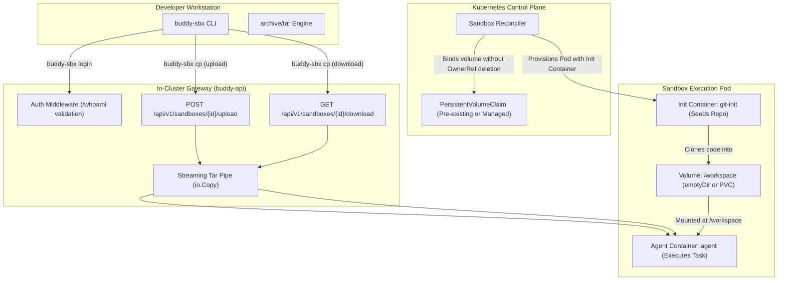

# Workspaces, Repository Seeding, and Streaming File Synchronization

## 1. Overview and Motivation

AI coding agents require access to existing source code repositories, project assets, and build artifacts to perform software engineering tasks. Relying strictly on blank ephemeral filesystems forces developers to manually create files through interactive shell commands or bake code into custom container images.

Milestone 4 establishes declarative workspace storage, automated Git repository seeding, bidirectional streaming file transfers, and a streamlined developer login foundation:

1. **Declarative Git Repository Seeding**: Automated initialization of git repositories into the sandbox workspace via dedicated init-containers prior to agent container startup.
2. **Persistent Volume Claim Management**: Support for durable storage volumes that survive sandbox teardown, with strict ownership guards preventing cascading deletion of user data.
3. **Bidirectional Streaming File Synchronization (`buddy-sbx cp`)**: Low-overhead transfer of files and directories between local developer workstations and remote containers using standard tar archives over HTTP chunked streaming.
4. **Developer Login & Authentication Foundation**: Implementation of `buddy-sbx login` supporting local KinD auto-discovery and token verification against a new `GET /api/v1/auth/whoami` gateway endpoint.

---

## 2. System Architecture



---

## 3. Declarative Workspace Storage Models

The `Sandbox` CRD schema (`sandboxes.buddy.io/v1alpha1`) extends `spec.workspace` to support both ephemeral and persistent storage backends:

```yaml
spec:
  workspace:
    ephemeral: true # Uses node-local emptyDir volume
    mountPath: "/workspace"
```

### 3.1 Persistent Volume Claim (PVC) Management
For persistent workspaces that retain dependencies, build caches, and repository edits across multiple agent sessions:

```yaml
spec:
  workspace:
    persistentVolumeClaim:
      claimName: "developer-workspace-pvc"
      readOnly: false
    mountPath: "/workspace"
```

#### Ownership Invariant:
When mounting an existing PVC via `claimName`:
* The reconciler **must not** attach an `OwnerReference` pointing to the ephemeral `Sandbox` resource.
* Attaching an owner reference would trigger Kubernetes garbage collection to delete the developer's persistent volume when the sandbox completes or is removed via `--rm`.
* When `persistentVolumeClaim.claimName` is set, the volume remains independent of the sandbox lifecycle.

---

## 4. Declarative Git Repository Seeding

To seed a git repository into `/workspace` before the agent process begins execution, the CRD defines `spec.workspace.git`:

```yaml
spec:
  workspace:
    mountPath: "/workspace"
    git:
      url: "https://github.com/my-org/my-project.git"
      revision: "feat/autonomous-task" # Branch, tag, or commit SHA (default: HEAD)
      depth: 1                         # Shallow clone depth (0 for full history)
      subpath: ""                      # Optional destination subpath inside /workspace
      secretRef:
        name: "git-credentials"        # Secret containing token or SSH key
```

### 4.1 Init-Container Orchestration
When `spec.workspace.git` is configured, the controller inserts a dedicated init-container named `git-init` ahead of the main `agent` container:

1. **Volume Mount**: Mounts the workspace volume at `/workspace`.
2. **Security Context**: Runs under the same non-root UID 1000 and dropped capabilities as the agent container.
3. **Execution Sequence**:
   * Evaluates authentication credentials from environment variables mounted from `secretRef` (supporting HTTPS Personal Access Tokens or SSH deploy keys).
   * Executes `git clone --depth <depth> --branch <revision> <url> /workspace/<subpath>`.
   * Sets appropriate file permissions (`chown -R 1000:1000 /workspace`).
4. **Failure Recovery**:
   * If git clone fails (e.g. invalid URL, authentication failure, branch not found), `git-init` terminates with a non-zero exit code.
   * As implemented in Milestone 3, `observePodStatus` inspects `pod.Status.InitContainerStatuses`, immediately transitions the Sandbox to phase `Failed`, and sets condition `Ready=False` with `Reason=InitContainerFailed` without leaving the sandbox stalled in `Pending`.

---

## 5. Bidirectional Streaming File Transfer (`buddy-sbx cp`)

The developer CLI provides a dedicated copy command matching standard container conventions:

```bash
# Upload local file/directory to sandbox:
buddy-sbx cp ./local-dir my-sandbox:/workspace/project

# Download file/directory from sandbox to local:
buddy-sbx cp my-sandbox:/workspace/dist.tar.gz ./dist.tar.gz
```

### 5.1 Syntax and Path Disambiguation
* `SRC` or `DST` must use the format `<sandbox-id>:<container-path>`.
* Copying directly between two separate sandboxes is rejected.
* Relative paths on the host are resolved to absolute local paths.
* Container paths default to `/workspace` if relative.

### 5.2 Streaming Tar Protocol
To avoid memory exhaustion when transferring large repositories, dependencies, or compiled binaries:

1. **Upload Flow**:
   * CLI archives local files into an in-memory streaming `tar` reader (`archive/tar`).
   * Streams the archive to `POST /api/v1/sandboxes/{id}/upload?path=<destination>` as `application/x-tar`.
   * Gateway passes the request body stream directly into the container using Kubernetes remote exec:
     ```bash
     tar -xf - -C <destination>
     ```
   * Memory usage on both client and gateway remains bounded by small pipe buffers (32KB chunks), with zero temporary files created on disk.

2. **Download Flow**:
   * CLI requests `GET /api/v1/sandboxes/{id}/download?path=<source>`.
   * Gateway executes in container:
     ```bash
     tar -cf - -C <dir> <file>
     ```
   * Streams output directly as chunked HTTP response to CLI.
   * CLI unpacks the streaming tar archive onto the local filesystem.

---

## 6. Developer Authentication Foundation (`buddy-sbx login`)

To support multi-cluster developer onboarding and eliminate manual configuration file editing:

### 6.1 Gateway WhoAmI Endpoint
Add `GET /api/v1/auth/whoami` to `internal/gateway/handlers.go`:
* **Method**: `GET`
* **Path**: `/api/v1/auth/whoami`
* **Headers**: `Authorization: Bearer <token>`
* **Response Payload**:
  ```json
  {
    "user": "developer",
    "namespace": "default",
    "authMode": "static"
  }
  ```

### 6.2 CLI Login Command (`buddy-sbx login`)
Add `cmd/buddy-sbx/login.go`:
1. `buddy-sbx login --local`:
   * Queries local cluster context via `~/.kube/config`.
   * Derives default endpoint (`http://localhost:8080`), local dev token, and namespace `default`.
   * Validates via `GET /api/v1/auth/whoami` and writes to `~/.buddy/config.yaml`.
2. `buddy-sbx login --token <token> [endpoint]`:
   * Validates token against endpoint `/api/v1/auth/whoami`.
   * Derives tenant namespace and writes context to `~/.buddy/config.yaml`.
3. Interactive Prompt:
   * If run in a TTY without `--token`, prompts `Enter token: ` with terminal echo suppressed.

### 6.3 Security Hardening
* Tighten `~/.buddy` configuration directory permissions to `0700`.
* Remove URL query-parameter token fallback in `internal/gateway/auth.go`; require `Authorization: Bearer` headers across REST and WebSocket handshakes.

---

## 7. Implementation Tasks (Milestone 4 Execution Plan)

* **Task 4.1: CRD Schema and API Types for Workspaces & Git**
  * Update `api/v1alpha1/sandbox_types.go` with `GitRepositorySpec` and `PersistentVolumeClaimWorkspace`.
  * Update `pkg/api/v1/types.go` with workspace fields on `CreateSandboxRequest` and `SandboxResponse`.
  * Run `make manifests generate`.

* **Task 4.2: Reconciler Workspace Mounts & Git Init-Container**
  * Update `internal/controller/sandbox_controller.go`:
    * Implement init-container injection for `git-init` when `spec.workspace.git` is populated.
    * Implement PVC volume mounting with non-cascading `OwnerReference` protection.
    * Set condition `WorkspaceConfigured` with status `True`/`False`.
  * Unit and envtest specs covering git init-container injection and PVC mounting.

* **Task 4.3: Gateway File Transfer Endpoints (`/upload` & `/download`)**
  * Implement `POST /api/v1/sandboxes/{id}/upload` in `internal/gateway/handlers.go`.
  * Implement `GET /api/v1/sandboxes/{id}/download` in `internal/gateway/handlers.go`.
  * Stream tar archives directly to/from container stdio via `RemoteExecutor`.

* **Task 4.4: Gateway Auth Endpoint & Hardening**
  * Add `GET /api/v1/auth/whoami` handler in `internal/gateway/handlers.go`.
  * Remove `r.URL.Query().Get("token")` fallback from `internal/gateway/auth.go`.
  * Add unit tests verifying `/whoami` and query-token rejection.

* **Task 4.5: Developer CLI `cp` and `login` Commands**
  * Implement `cmd/buddy-sbx/cp.go` with streaming tar packing/unpacking.
  * Implement `cmd/buddy-sbx/login.go` with `--token`, `--local`, and interactive prompt.
  * Set `0700` directory mode in `cmd/buddy-sbx/config.go`.
  * Unit tests for CLI parsing and tar archiving.

* **Task 4.6: Local KinD Cluster Verification**
  * Build and load operator image to KinD `dell-cluster`.
  * Verify end-to-end:
    * `buddy-sbx login --local` sets up context.
    * Sandbox boots with `git` repo clone.
    * `buddy-sbx cp` copies file into `/workspace` and verifies content.
    * `buddy-sbx cp` pulls file out of `/workspace`.
