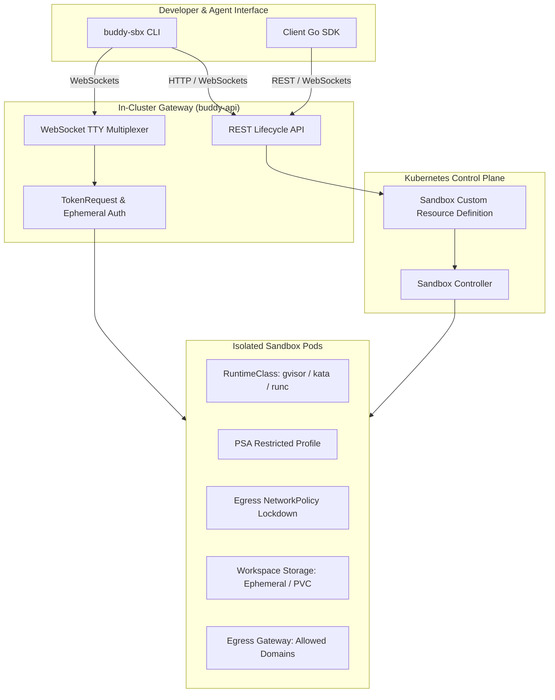
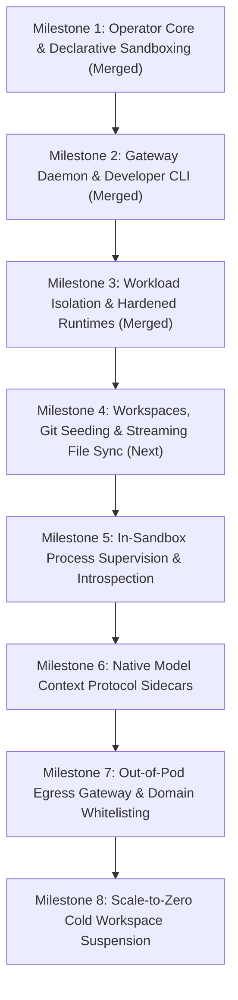

# Buddy Sandboxes: Architecture and Platform Roadmap

* **Author:** hoangndst
* **Date:** 2026-11-20
* **Status:** Active Platform Roadmap

---

## 1. Vision and Architecture Strategy

Buddy Sandboxes is a Kubernetes-native platform providing isolated, declarative execution environments for automated AI coding agents and interactive developer workflows.

Autonomous coding agents run untrusted third-party code, execute arbitrary shell commands, install unverified dependencies, and modify source repositories. Running such workloads on developer workstations or unconstrained Kubernetes nodes risks:
1. Host kernel exploitation and container breakout.
2. Network reconnaissance and credential theft against internal cluster services and cloud metadata endpoints.
3. Resource exhaustion (CPU, memory, and process table starvation) causing node instability.
4. Loss of uncommitted code changes during abrupt container terminations.

Buddy Sandboxes solves these challenges through a layered architecture:

---

## 2. Milestone Sequencing & Dependency Graph

---

## 3. Detailed Milestone Specifications

### Milestone 1: Operator Core & Declarative Sandboxing
* **Status:** Completed & Merged (PR #2)
* **Objective:** Establish the foundational Kubernetes operator using Kubebuilder and controller-runtime to manage isolated sandbox lifecycles declaratively.
* **Key Deliverables:**
  * Custom Resource Definition: `sandboxes.buddy.io/v1alpha1` (`Sandbox` CRD) with validated spec and status schemas.
  * Controller Reconciler: Idempotent reconciler provisioning child Pods, `emptyDir` workspace mounts, and scoped `NetworkPolicy` objects.
  * Security Context: Enforces `runAsNonRoot: true`, `runAsUser: 1000`, `readOnlyRootFilesystem: true`, and dropping `ALL` capabilities.
  * Network Boundary: Scoped egress `NetworkPolicy` denying RFC1918 private subnets and cloud metadata (`169.254.169.254/32`).
  * Automated Garbage Collection: Native Kubernetes `OwnerReferences` ensuring deterministic cascading cleanup on sandbox deletion.

---

### Milestone 2: In-Cluster Gateway Daemon & Developer CLI (`buddy-sbx`)
* **Status:** Completed & Merged (PR #3)
* **Objective:** Decouple developers and autonomous agents from direct Kubernetes API access by introducing an in-cluster gateway daemon (`buddy-api`) and a companion developer CLI (`buddy-sbx`).
* **Key Deliverables:**
  * Gateway Daemon (`cmd/buddy-api`, `internal/gateway`): Stateless REST lifecycle endpoints and WebSocket (RFC 6455) terminal exec multiplexing.
  * Privilege Isolation: Ephemeral, pod-scoped `TokenRequest` authentication eliminating ambient cluster-wide `pods/exec` permissions.
  * Developer CLI (`cmd/buddy-sbx`): Commands `run`, `exec`, `logs`, `list`, `rm`, `port`, and `config`.
  * Agent Presets: Built-in configurations for `codex`, `claude`, `aider`, `devin`, and `shell` with flag forwarding.
  * Interactive Terminal UX: Terminal raw-mode handling (`golang.org/x/term`), window resizing (`SIGWINCH`), signal propagation, and multi-cluster context switching (`~/.buddy/config.yaml`).

---

### Milestone 3: Workload Isolation, RuntimeClasses & Defense in Depth
* **Status:** Completed & Merged (PR #4)
* **Objective:** Elevate sandbox isolation from standard Linux container namespaces to multi-engine sandboxed runtimes (user-space application kernels and microVMs) with native Kubernetes scheduling and hardened security profiles.
* **Key Architecture & Design Decisions:**
  * **Multi-Engine RuntimeClass Support**: Declarative support for `spec.runtimeClassName` (e.g. `gvisor`/`runsc` for user-space syscall interception, `kata-containers` for hardware microVM boundaries, or omitted for cluster defaults).
  * **Pre-Flight Validation**: Controller queries `node.k8s.io/v1` `RuntimeClass` before pod creation. If absent, it sets condition `RuntimeClassReady=False` (`Reason: RuntimeClassUnavailable`) without thrashing or creating broken pods.
  * **Native Scheduling Delegation**: Rely on native `RuntimeClass.scheduling.nodeSelector` and `tolerations` merged automatically by kube-apiserver admission. Avoid custom scheduling controllers in the operator.
  * **Security Profile**: Pod Security Admission `Restricted` baseline: `runAsUser: 1000`, `readOnlyRootFilesystem: true`, `capabilities.drop: ["ALL"]`, and `seccompProfile.type: RuntimeDefault`. PID limits governed at the node level via Kubelet `--pod-max-pids` and CRI runtime handlers.
  * **API and CLI Plumbing**: Extend `pkg/api/v1` `CreateSandboxRequest` with `RuntimeClassName *string`, map in `internal/gateway/handlers.go`, and add `--runtime-class` flag to `cmd/buddy-sbx/run.go`.
  * **CI Testing Architecture**: KinD testing using gVisor in `platform=ptrace` mode and a mock `kata-containers` containerd handler to verify scheduling, admission, and sandboxing in standard CI environments without bare-metal `/dev/kvm`.

---

### Milestone 4: Workspaces, Repository Seeding & Streaming File Synchronization
* **Status:** Planned (Immediate Next Milestone)
* **Objective:** Decouple ephemeral sandbox containers from repository storage, enabling automated Git repository seeding, persistent workspace volumes, and streaming bidirectional file transfers (`buddy-sbx cp`).
* **Key Architecture & Design Decisions:**
  * **Declarative Git Seeding**: Extend `SandboxSpec` with `spec.workspace.git`: repository URL, revision (branch/tag/commit), destination subpath, and credentials `secretRef` (SSH key or Personal Access Token). Orchestrate an init-container that clones the repository before the agent container boots.
  * **Persistent Volume Claim (PVC) Management**: Support `spec.workspace.persistentVolumeClaim` with `claimName` support. When attaching pre-existing claims, skip setting `OwnerReference` to prevent cascading deletion of user volumes.
  * **Streaming File Transfer (`buddy-sbx cp`)**: Add `buddy-sbx cp <src> <dst>` command. Implement streaming file transfers using Go standard library `archive/tar` streaming over chunked HTTP transport, avoiding in-memory ring-buffer complexity and preventing memory exhaustion.
  * **Explicit Version Control**: Keep git commits and pushes explicit via developer/agent commands; avoid automatic commits on pod termination to prevent pushing half-written code.

---

### Milestone 5: In-Sandbox Process Supervision & Introspection
* **Status:** Planned
* **Objective:** Provide process supervision, zombie process reaping, and secure environment introspection inside sandbox pods without compromising container immutability.
* **Key Architecture & Design Decisions:**
  * **Process Namespace Sharing (`shareProcessNamespace: true`)**: Enable process namespace sharing across the Pod. The native Kubernetes pause container runs as PID 1 to reap orphan zombie processes across all containers, allowing the agent container to execute its native `ENTRYPOINT` and `CMD` untouched.
  * **Downward API Introspection**: Deliver sandbox identity, namespace, allocated resources, and execution deadlines to the agent via Kubernetes Downward API environment variables and volume files. Inject credentials via tmpfs Secret mounts, eliminating unauthenticated local HTTP endpoints and stopping local credential theft.
  * **Clean Process Teardown**: Propagate OS signals (`SIGTERM`, `SIGINT`) gracefully across the shared process tree during cancellation.

---

### Milestone 6: Native Model Context Protocol (MCP) Sidecars
* **Status:** Planned
* **Objective:** Enable declarative attachment of Model Context Protocol (MCP) servers to sandbox environments, providing agents with standardized, authenticated tool access.
* **Key Architecture & Design Decisions:**
  * **Native Kubernetes Sidecar Containers**: Implement MCP sidecars using native Kubernetes sidecar containers (`initContainers` with `restartPolicy: Always`, K8s 1.28+). Kubelet automatically terminates sidecar init containers when the primary `spec.containers` complete, preventing completion hangs under `RestartPolicy: Never`.
  * **Deterministic Exit Code Filtering**: In `observePodStatus`, explicitly filter `pod.Status.ContainerStatuses` by primary container name (`"agent"`) when calculating `sandbox.Status.ExitCode`.
  * **In-Pod Tool Transport**: Connect agent processes to MCP sidecars over isolated Unix Domain Sockets in shared memory volumes (`/tmp/mcp`).
  * **Tool Access Control**: Implement an in-path L7 JSON-RPC authorization proxy validating tool invocation requests against declarative access policies.

---

### Milestone 7: Out-of-Pod Egress Gateway & Domain Whitelisting
* **Status:** Planned
* **Objective:** Enforce Layer 7 destination domain allowlists (e.g. `api.anthropic.com`, `api.openai.com`, `github.com`) to prevent data exfiltration while permitting legitimate API connections.
* **Key Architecture & Design Decisions:**
  * **Decoupled Out-of-Pod Egress Gateway**: Deploy a lightweight, shared forward proxy deployment (`buddy-egress-gateway`, HTTP CONNECT proxy) per namespace or cluster-wide in the operator namespace.
  * **Host CNI NetworkPolicy Lockdown**: When `spec.network.allowedDomains` is populated, the controller suppresses direct open internet rules (`0.0.0.0/0`) and locks pod egress strictly to cluster DNS and the `buddy-egress-gateway` Service. Raw TCP connections to unapproved IPs are dropped by the host CNI at the Linux veth boundary.
  * **Per-Sandbox Proxy Authentication**: The controller injects a unique, ephemeral `Proxy-Authorization` token per sandbox into `HTTP_PROXY` environment variables, allowing the shared proxy to resolve domain allowlists deterministically without relying on ephemeral source IPs.
  * **Multi-Protocol Tunneling Support**: Support HTTP CONNECT raw TCP tunneling and SOCKS5 proxying to allow Git SSH and standard developer TCP tools to traverse the allowlist without syntax changes.
  * **Pluggable CNI Provider**: Support opt-in generation of native CNI FQDN policies (e.g. Cilium `toFQDNs`) when supported by the underlying cluster.

---

### Milestone 8: Scale-to-Zero Cold Workspace Suspension & Fast Resumption
* **Status:** Planned
* **Objective:** Maximize cluster compute efficiency by detecting idle agents, evicting pods to save compute, and restoring active sessions on demand.
* **Key Architecture & Design Decisions:**
  * **Scale-to-Zero Architecture**: Redefine hibernation as clean workspace cold suspension. When a sandbox exceeds `spec.idleTimeoutSeconds`, sync workspace storage to backing PersistentVolumeClaims, delete the execution pod, and transition status to `Suspended`.
  * **CRD Schema Extension**: Add `Suspended` to `SandboxPhase` enum and add `spec.suspended: bool` to prevent the controller reconciler from recreating pods while suspended. Reject suspension for ephemeral `emptyDir` workspaces to prevent data loss.
  * **Instant Re-Hydration**: Upon receiving a client command (`buddy-sbx exec`) or incoming trigger, the gateway updates `spec.suspended = false`, triggering the reconciler to spin up a warm pod attaching the existing PVC within 4 to 8 seconds.

---

## 4. Multi-Milestone Technical Risk Matrix

| Risk | Impacted Milestone | Severity | Technical Remediation |
| :--- | :--- | :--- | :--- |
| **Missing RuntimeClass Causes Pod Hang** | Milestone 3 | High | Pre-flight validation against `node.k8s.io/v1` `RuntimeClass`; set condition `RuntimeClassUnavailable`. |
| **Untestable Runtimes in Standard CI** | Milestone 3 | Medium | KinD integration testing with gVisor `ptrace` and mock containerd runtime handlers. |
| **Init-Container Egress Deadlock** | Milestone 4 & 7 | Critical | Enforce HTTPS git transport with pre-injected proxy configuration; drop port 22 assumptions. |
| **PVC Concurrency Lockout (`ReadWriteOnce`)** | Milestone 4 & 8 | High | Controller state machine waits for previous pod complete termination before scheduling resuming pod. |
| **Unauthenticated Credential Leak on Loopback** | Milestone 5 | Critical | Replace loopback HTTP metadata endpoints with Kubernetes Downward API and Secret mounts. |
| **Daemon Sidecar Pod Completion Hang** | Milestone 6 | Critical | Use native Kubernetes sidecar containers (`initContainers` with `restartPolicy: Always`). |
| **Shared Proxy Allowlist Bleed on IP Reuse** | Milestone 7 | Critical | Enforce per-sandbox ephemeral authentication tokens on HTTP CONNECT proxy requests. |
| **DNS Tunneling Data Exfiltration** | Milestone 7 | High | Restrict DNS queries via DNS allowlist proxy or route external resolution through the egress gateway. |
| **Ephemeral Data Loss on Hibernation** | Milestone 8 | Critical | Reject hibernation requests on sandboxes backed by ephemeral `emptyDir` volumes. |
