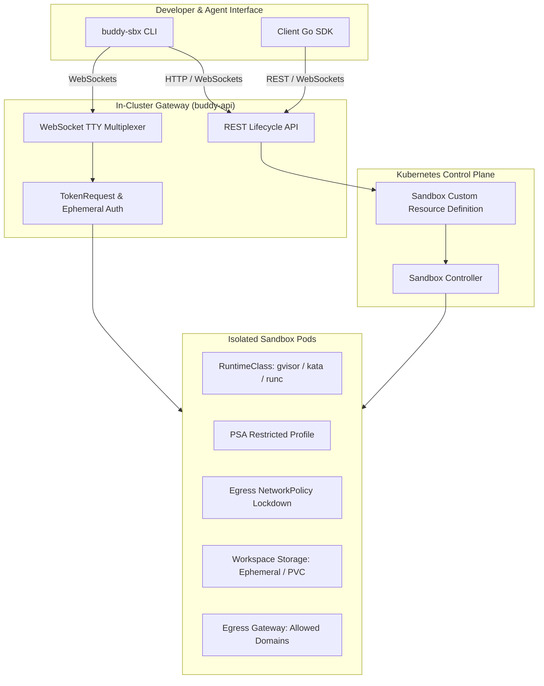
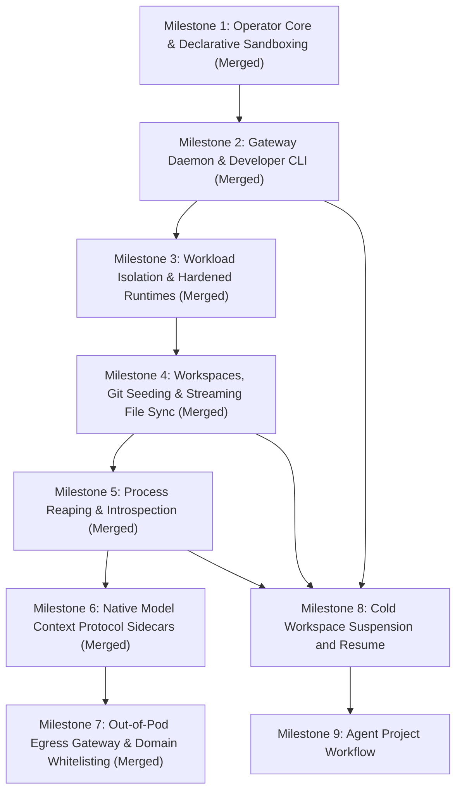

# Buddy Sandboxes: Architecture and Platform Roadmap

* **Author:** hoangndst
* **Date:** 2026-11-20
* **Status:** Active Platform Roadmap

---

## 1. Vision and Architecture Strategy

Buddy Sandboxes is a Kubernetes-native platform providing isolated, declarative execution environments for automated AI coding agents and interactive developer workflows.

Autonomous coding agents run untrusted third-party code, execute arbitrary shell commands, install unverified dependencies, and modify source repositories. Running such workloads on developer workstations or unconstrained Kubernetes nodes risks:
1. Host kernel exploitation and container breakout.
2. Network reconnaissance and credential theft against internal cluster services and cloud metadata endpoints.
3. Resource exhaustion (CPU, memory, and process table starvation) causing node instability.
4. Loss of uncommitted code changes during abrupt container terminations.

Buddy Sandboxes solves these challenges through a layered architecture:

---

## 2. Milestone Sequencing & Dependency Graph

Milestone numbering records the planned delivery order. Arrows identify required project components, not mandatory dependency on every earlier milestone.

---

## 3. Detailed Milestone Specifications

### Milestone 1: Operator Core & Declarative Sandboxing
* **Status:** Completed & Merged (PR #2)
* **Objective:** Establish the foundational Kubernetes operator using Kubebuilder and controller-runtime to manage isolated sandbox lifecycles declaratively.
* **Key Deliverables:**
  * Custom Resource Definition: `sandboxes.buddy.io/v1alpha1` (`Sandbox` CRD) with validated spec and status schemas.
  * Controller Reconciler: Idempotent reconciler provisioning child Pods, `emptyDir` workspace mounts, and scoped `NetworkPolicy` objects.
  * Security Context: Enforces `runAsNonRoot: true`, `runAsUser: 1000`, `readOnlyRootFilesystem: true`, and dropping `ALL` capabilities.
  * Network Boundary: Scoped egress `NetworkPolicy` denying RFC1918 private subnets and cloud metadata (`169.254.169.254/32`).
  * Automated Garbage Collection: Native Kubernetes `OwnerReferences` ensuring deterministic cascading cleanup on sandbox deletion.

---

### Milestone 2: In-Cluster Gateway Daemon & Developer CLI (`buddy-sbx`)
* **Status:** Completed & Merged (PR #3)
* **Objective:** Decouple developers and autonomous agents from direct Kubernetes API access by introducing an in-cluster gateway daemon (`buddy-api`) and a companion developer CLI (`buddy-sbx`).
* **Key Deliverables:**
  * Gateway Daemon (`cmd/buddy-api`, `internal/gateway`): Stateless REST lifecycle endpoints and WebSocket (RFC 6455) terminal exec multiplexing.
  * Privilege Isolation: Ephemeral, pod-scoped `TokenRequest` authentication eliminating ambient cluster-wide `pods/exec` permissions.
  * Developer CLI (`cmd/buddy-sbx`): Commands `run`, `exec`, `logs`, `list`, `rm`, `port`, and `config`.
  * Agent Presets: Built-in configurations for `codex`, `claude`, `aider`, `devin`, and `shell` with flag forwarding.
  * Interactive Terminal UX: Terminal raw-mode handling (`golang.org/x/term`), window resizing (`SIGWINCH`), signal propagation, and multi-cluster context switching (`~/.buddy/config.yaml`).

---

### Milestone 3: Workload Isolation, RuntimeClasses & Defense in Depth
* **Status:** Completed & Merged (PR #4)
* **Objective:** Elevate sandbox isolation from standard Linux container namespaces to multi-engine sandboxed runtimes (user-space application kernels and microVMs) with native Kubernetes scheduling and hardened security profiles.
* **Key Architecture & Design Decisions:**
  * **Multi-Engine RuntimeClass Support**: Declarative support for `spec.runtimeClassName` (e.g. `gvisor`/`runsc` for user-space syscall interception, `kata-containers` for hardware microVM boundaries, or omitted for cluster defaults).
  * **Pre-Flight Validation**: Controller queries `node.k8s.io/v1` `RuntimeClass` before pod creation. If absent, it sets condition `RuntimeClassReady=False` (`Reason: RuntimeClassUnavailable`) without thrashing or creating broken pods.
  * **Native Scheduling Delegation**: Rely on native `RuntimeClass.scheduling.nodeSelector` and `tolerations` merged automatically by kube-apiserver admission. Avoid custom scheduling controllers in the operator.
  * **Security Profile**: Pod Security Admission `Restricted` baseline: `runAsUser: 1000`, `readOnlyRootFilesystem: true`, `capabilities.drop: ["ALL"]`, and `seccompProfile.type: RuntimeDefault`. PID limits governed at the node level via Kubelet `--pod-max-pids` and CRI runtime handlers.
  * **API and CLI Plumbing**: Extend `pkg/api/v1` `CreateSandboxRequest` with `RuntimeClassName *string`, map in `internal/gateway/handlers.go`, and add `--runtime-class` flag to `cmd/buddy-sbx/run.go`.
  * **CI Testing Architecture**: KinD testing using gVisor in `platform=ptrace` mode and a mock `kata-containers` containerd handler to verify scheduling, admission, and sandboxing in standard CI environments without bare-metal `/dev/kvm`.

---

### Milestone 4: Workspaces, Repository Seeding & Streaming File Synchronization
* **Status:** Merged (PR #5)
* **Objective:** Decouple ephemeral sandbox containers from repository storage, enabling automated Git repository seeding, persistent workspace volumes, and streaming bidirectional file transfers (`buddy-sbx cp`).
* **Key Architecture & Design Decisions:**
  * **Declarative Git Seeding**: Extend `SandboxSpec` with `spec.workspace.git`: repository URL, revision (branch/tag/commit), destination subpath, and credentials `secretRef` (SSH key or Personal Access Token). Orchestrate an init-container that clones the repository before the agent container boots.
  * **Persistent Volume Claim (PVC) Management**: Support `spec.workspace.persistentVolumeClaim` with `claimName` support. When attaching pre-existing claims, skip setting `OwnerReference` to prevent cascading deletion of user volumes.
  * **Streaming File Transfer (`buddy-sbx cp`)**: Add `buddy-sbx cp <src> <dst>` command. Implement streaming file transfers using Go standard library `archive/tar` streaming over chunked HTTP transport, avoiding in-memory ring-buffer complexity and preventing memory exhaustion.
  * **Explicit Version Control**: Keep git commits and pushes explicit via developer/agent commands; avoid automatic commits on pod termination to prevent pushing half-written code.

---

### Milestone 5: Process Reaping & Introspection
* **Status:** Completed & Merged (PR #6)
* **Objective:** Offer opt-in orphan-process reaping and provide nonsecret sandbox identity, resource, and duration metadata to agent processes.
* **Key Architecture & Design Decisions:**
  * **Opt-In Process Namespace Sharing**: Add `spec.shareProcessNamespace`, false by default and immutable after Sandbox creation. When enabled, the pause process is PID 1 and reaps orphaned children. The agent entrypoint receives a non-1 PID. Images that rely on PID 1 behavior must leave sharing disabled.
  * **Downward API Introspection**: Expose the Sandbox name, Pod name, namespace and UID, CPU and memory requests and limits, and configured maximum duration as environment variables. Reserve only the exact controller-provided variable names. No new Secret is mounted into the agent.
  * **Standard Pod Termination**: Keep Kubernetes signal handling and its termination grace period. Shared process namespace does not broadcast SIGTERM or SIGINT to process groups, and the controller does not add a custom supervisor.
  * **Recreation and Data**: Process namespace mode is fixed at Sandbox creation. Changing modes requires deleting and recreating the Sandbox. External PVC data persists; `emptyDir` data is lost.
  * **Deadline Updates**: `maxDurationSeconds` can be set once or tightened to a smaller value. Removing or increasing a configured deadline is rejected; the controller applies supported changes to the Pod deadline and reports legacy mismatches through status.

---

### Milestone 6: Native Model Context Protocol (MCP) Sidecars
* **Status:** Completed & Merged (PR #7)
* **Objective:** Enable declarative attachment of Model Context Protocol (MCP) servers to sandbox environments, providing agents with standardized, isolated tool access.
* **Key Architecture & Design Decisions (DEC-008):**
  * **Native Kubernetes Sidecar Containers**: Implement MCP sidecars using native Kubernetes sidecar containers (`initContainers` with `restartPolicy: Always`, K8s 1.28+, KEP-753). Kubelet automatically terminates sidecar init containers when the primary `spec.containers` complete, preventing completion hangs under `RestartPolicy: Never`.
  * **Pod-Local HTTP/SSE Transport**: Connect agent processes to MCP sidecars over pod-local TCP (`127.0.0.1:<port>`). Excludes in-pod stdio bridges (agents run stdio tools as local child processes) and L7 JSON-RPC reverse proxies.
  * **Automated TCP Startup Probes**: The controller synthesizes TCP socket startup probes on declared ports (30s threshold) to prevent agent execution before the sidecar begins listening.
  * **Deterministic Exit Code and Phase Filtering**: In `observePodStatus`, decouple sandbox terminal phase and exit code from sidecar shutdown signals (SIGTERM 143 / SIGKILL 137). In `checkPendingPodErrors`, ignore native sidecar termination and evaluate fatal waiting conditions (`CrashLoopBackOff`, `ImagePullBackOff`).
  * **PSA Restricted Security & Scratch Volumes**: Enforce non-root UID 1000, read-only root filesystems, dropped capabilities, and dedicated `tmp-mcp-<name>` scratch `emptyDir` volumes mounted at `/tmp` with `HOME=/tmp`. Mount workspace optionally via `mountWorkspace: true`.
  * **Discovery Contract**: Inject `BUDDY_MCP_<NAME>_URL`, `BUDDY_MCP_<NAME>_PORT`, and `BUDDY_MCP_SERVERS` into the agent container.

---

### Milestone 7: Out-of-Pod Egress Gateway & Domain Whitelisting
* **Status:** Merged (PR #8)
* **Objective:** Enforce Layer 7 destination domain allowlists (e.g. `api.anthropic.com`, `api.openai.com`, `github.com`) to prevent data exfiltration while permitting legitimate API connections.
* **Key Architecture & Design Decisions:**
  * **Decoupled Out-of-Pod Egress Gateway**: Deploy a lightweight, shared forward proxy deployment (`buddy-egress-gateway`, HTTP CONNECT proxy) per namespace or cluster-wide in the operator namespace.
  * **Host CNI NetworkPolicy Lockdown**: When `spec.network.allowedDomains` is populated, the controller suppresses direct open internet rules (`0.0.0.0/0`) and locks pod egress strictly to cluster DNS and the `buddy-egress-gateway` Service. Raw TCP connections to unapproved IPs are dropped by the host CNI at the Linux veth boundary.
  * **Per-Sandbox Proxy Authentication**: The controller injects a unique, ephemeral `Proxy-Authorization` token per sandbox into `HTTP_PROXY` environment variables, allowing the shared proxy to resolve domain allowlists deterministically without relying on ephemeral source IPs.
  * **Multi-Protocol Tunneling Support**: Support HTTP CONNECT raw TCP tunneling and SOCKS5 proxying to allow Git SSH and standard developer TCP tools to traverse the allowlist without syntax changes.
  * **Pluggable CNI Provider**: Support opt-in generation of native CNI FQDN policies (e.g. Cilium `toFQDNs`) when supported by the underlying cluster.

---

### Milestone 8: Cold Workspace Suspension and Resume
* **Status:** Merged (PR #9)
* **Objective:** Let users stop execution Pods while preserving PVC-backed workspace data, then explicitly restart the configured workload on demand.
* **Key Architecture & Design Decisions:**
  * **Explicit Cold Suspension**: Add `spec.suspend`, with a separate suspension status state. Keep execution outcome phases unchanged. V1 does not infer idleness or suspend based on gateway inactivity.
  * **Persistent Workspace Eligibility**: Suspend only workspaces already mounted from a writable PVC. Preserve the claim across Pod removal. Reject `emptyDir` and read-only PVC workspaces rather than copying ephemeral data.
  * **Explicit Resume**: Add `buddy-sbx suspend` and `buddy-sbx resume` with REST operations. `exec`, port-forward, upload, and download do not wake the Sandbox implicitly. Resume starts the configured command in a new Pod and may repeat external side effects.
  * **Deadline and Pod Replacement**: Preserve the original execution deadline across Pod generations, wait for the old Pod to disappear before creating one replacement, and use a bounded graceful deletion. Measure resume timing by supported storage and image environments; do not promise a fixed 4 to 8 second time.
  * **Future Automatic Suspension**: Defer timeout-based suspension until supported workloads can publish an explicit busy/idle signal. A missing or stale signal must block automatic suspension.

---

### Milestone 9: Agent Project Workflow
* **Status:** In Progress
* **Objective:** Let `buddy-sbx run <agent|image> <local-path>` execute against a bounded local project snapshot and return changes, using the existing Kubernetes Sandbox and terminal streaming backend. Project runs retain the Sandbox by default; explicit `--rm` removes it only after successful result synchronization.
* **Key Architecture & Design Decisions:**
  * **Snapshot-Based Workspace**: Treat the positional local path as a project snapshot, not a host mount. Reuse streaming upload/download, apply path and size limits, and detect conflicts before writing results.
  * **Attached and Detached Runs**: Attached project runs start the agent through the existing TTY and retain the Sandbox by default; `--rm` deletes only after successful result synchronization. `--detach` creates an idle Sandbox and stages files without launching a process; custom images provide an idle command. Later `exec` and `cp` are explicit operations.
  * **Codex Credential Broker**: Build a pinned Codex image and keep the host API key outside Sandbox and Pod resources. A scoped token connects Codex to a fixed-origin broker. Shell and custom images receive no ambient provider keys; Claude and Aider project runs fail closed until adapters exist.
  * **Snapshot and Git Context**: Exclude host `.git` metadata and initialize fresh workspace Git metadata from the snapshot. Define tar paths relative to `/workspace` and remove the workspace archive prefix before local merge.
  * **Lifecycle Boundary**: `exec` starts a new process. Persistent PTY reattachment, `attach`, and named Sandbox reuse are deferred. Legacy no-path provider-key forwarding requires an explicit unsafe opt-in.
  * **Security Scope**: Do not claim production readiness for hostile code. DNS tunneling enforcement, production multi-tenant gateway operations, and mandatory gVisor or microVM execution remain future work.

---

## 4. Multi-Milestone Technical Risk Matrix

| Risk | Impacted Milestone | Severity | Technical Remediation |
| :--- | :--- | :--- | :--- |
| **Missing RuntimeClass Causes Pod Hang** | Milestone 3 | High | Pre-flight validation against `node.k8s.io/v1` `RuntimeClass`; set condition `RuntimeClassUnavailable`. |
| **Untestable Runtimes in Standard CI** | Milestone 3 | Medium | KinD integration testing with gVisor `ptrace` and mock containerd runtime handlers. |
| **Init-Container Egress Deadlock** | Milestone 4 & 7 | Critical | Enforce HTTPS git transport with pre-injected proxy configuration; drop port 22 assumptions. |
| **PVC Concurrency Lockout (`ReadWriteOnce`)** | Milestone 4 & 8 | High | Controller state machine waits for previous pod complete termination before scheduling resuming pod. |
| **Orphaned Child Processes and Missing Agent Context** | Milestone 5 | Medium | Offer opt-in shared PID namespace reaping and expose nonsecret identity, resource, and duration fields through the Downward API. |
| **Daemon Sidecar Pod Completion Hang** | Milestone 6 | Critical | Use native Kubernetes sidecar containers (`initContainers` with `restartPolicy: Always`). |
| **Shared Proxy Allowlist Bleed on IP Reuse** | Milestone 7 | Critical | Enforce per-sandbox ephemeral authentication tokens on HTTP CONNECT proxy requests. |
| **DNS Tunneling Data Exfiltration** | Milestone 7 | High | Restrict DNS queries via DNS allowlist proxy or route external resolution through the egress gateway. |
| **Cold Resume Repeats Command Side Effects** | Milestone 8 | High | Document process restart semantics, require idempotent workload commands where needed, and preserve the original execution deadline across Pod generations. |
