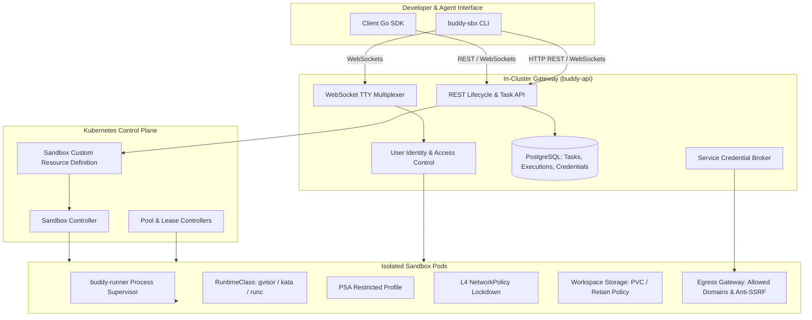
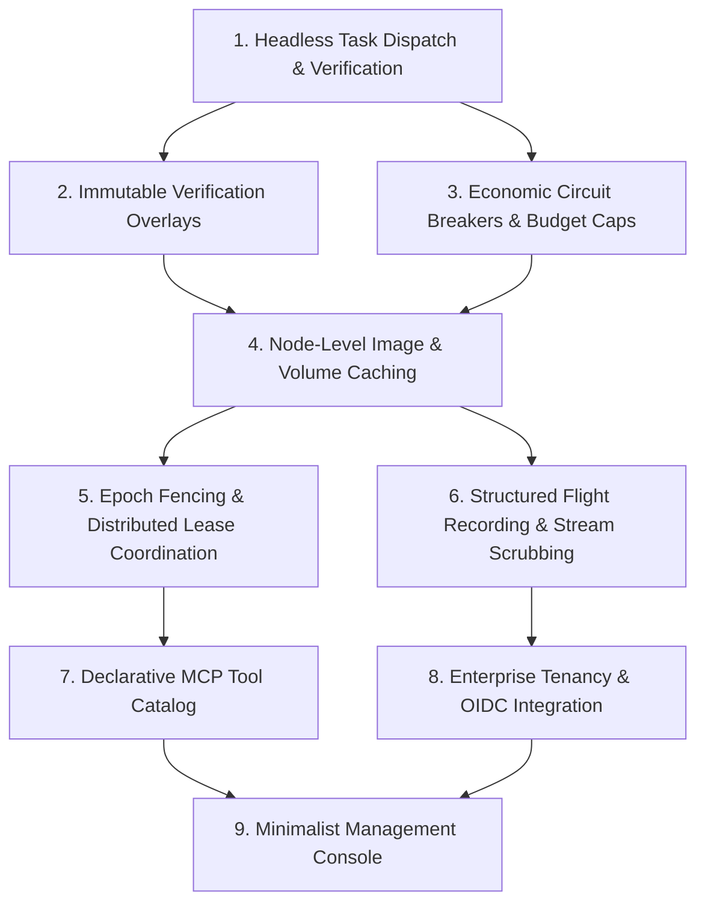

# Platform Architecture & Product Roadmap

## 1. Vision and Architecture Strategy

Buddy Sandboxes is an independent, Kubernetes-native platform providing isolated, declarative execution environments for automated AI coding agents and developer workflows.

Autonomous coding agents execute untrusted third-party code, run arbitrary shell commands, install unverified dependencies, and modify source repositories. Running these workloads on developer workstations or unconstrained Kubernetes nodes introduces major security and operational risks:

1. **Host Exploitation and Breakout**: Vulnerabilities in container runtimes or host kernels can be used to escape container boundaries.
2. **Network Reconnaissance & Credential Theft**: Untrusted agents can probe internal cluster networks, databases, and cloud metadata services (`169.254.169.254`).
3. **Resource Starvation**: Unbounded process forks, compilation loops, or memory leaks can destabilize underlying nodes.
4. **Credential Exfiltration**: Raw provider API keys (`ANTHROPIC_API_KEY`, `OPENAI_API_KEY`) can be stolen by malicious dependencies or prompt injection attacks.
5. **State Loss on Disconnect**: Ephemeral client-tethered sessions risk losing uncommitted agent progress if connections drop.

Buddy Sandboxes addresses these challenges through a layered architecture:

---

## 2. Core Platform Capabilities

The platform delivers the following capabilities across infrastructure, security, and developer ergonomics:

### Workload Isolation & Multi-Engine Runtimes
* **Multi-Engine Sandboxing**: Declarative support for user-space application kernels (`gvisor`/`runsc`) and microVMs (`kata-containers`), validated before pod scheduling.
* **Hardened Security Profile**: Enforces Pod Security Admission `Restricted` standards by default: non-root execution (`UID 1000`), read-only root filesystems, dropped Linux capabilities (`ALL`), and `RuntimeDefault` seccomp profiles.

### Developer CLI & Single-Command Workflow (`buddy-sbx`)
* **Cloud-Native CLI**: Command-line tool connecting to cluster operators over secure HTTPS: `run`, `exec`, `logs`, `get`, `create`, `delete`, `port-forward`, `cp`, and `attach`.
* **Interactive Terminal Streaming**: Low-latency PTY multiplexing over WebSockets with client window resizing (`SIGWINCH`) and signal handling.
* **Local Project Snapshots**: Stages local code repositories into remote sandbox `/workspace` directories and synchronizes changes back upon session exit.

### Scoped Service Credential Broker & Zero Secret Exposure
* **Encrypted Secret Storage**: Provider credentials and Git tokens are encrypted at rest using AES-256-GCM in PostgreSQL with multi-version key rotation.
* **Ephemeral Git Seeding**: Init containers authenticate via Kubernetes `TokenReview` against Pod-bound ServiceAccount tokens, cloning private repositories into memory-backed files before workload execution.
* **In-Cluster Reverse Broker**: Outbound model calls route through the Buddy Gateway reverse broker, which verifies capabilities and injects credentials dynamically without exposing them to container code.
* **Rate Limits and Concurrency Controls**: Configurable per-credential limits for requests per minute (RPM), maximum concurrent in-flight requests, and rolling tokens per minute (TPM).

### Out-of-Pod Egress Filtering & Network Lockdown
* **Layer 4 Hard Perimeter**: Default deny for RFC1918 private subnets and cloud metadata services (`169.254.169.254`).
* **Layer 7 Domain Filtering**: Outbound web requests route through a dedicated Egress Gateway enforcing strict domain allowlists and preventing DNS rebinding and SSRF attacks.

### Workspaces & Storage Lifecycle
* **Independent Storage Lifecycle**: Dedicated `Workspace` custom resource managing persistent volumes (`PersistentVolumeClaim`) with declarative retention policies (`Retain` vs `Delete`).
* **Dynamic Ignore Engine**: Hierarchical evaluation of `.gitignore` and `.agentsignore` at every directory level, supporting nested exclusion and explicit negation rules.
* **Cold Suspension & Resume**: Suspends idle PVC-backed sandboxes by terminating compute pods while preserving persistent disk state, resuming on demand.

### Warm Standby Pooling & Ephemeral Leases
* **Sub-Second Runner Allocation**: `SandboxPool` maintains pre-warmed standby compute pods running base container images.
* **Transactional Claims**: `SandboxLease` coordinates atomic two-phase binding between incoming execution requests and warm standby runners.

### In-Guest Process Supervisor & Resilient Sessions (`buddy-runner`)
* **Process Supervisor Sidecar**: Runs in a shared process namespace to handle process lifecycles and reap orphaned child processes.
* **In-Guest Circular Ring Buffer**: Preserves sequenced terminal output (4MB) across client disconnections, gateway restarts, and network drops.
* **Detached Sessions**: Run background workloads via `buddy-sbx run -d` and reattach via `buddy-sbx attach <session-id>`.

### Durable Task & Execution Orchestration Layer
* **Relational Task State Machine**: Relational PostgreSQL schema decoupling high-level user tasks from individual execution attempts, retries, and agent profiles.
* **Client Idempotency Keys**: Enforces atomic state transitions using `Idempotency-Key` headers, preventing duplicate runs on network retries.

### Native Model Context Protocol (MCP) Sidecars
* **Declarative Tool Attachment**: Connects MCP server sidecars using native Kubernetes sidecar containers.
* **Automated Probing**: Synthesizes TCP socket startup probes to prevent agent execution until tool endpoints are listening.
* **Termination Isolation**: Decouples sandbox exit codes from sidecar shutdown signals, preventing hangs and false failure reporting.

---

## 3. Product Roadmap

The forward engineering roadmap focuses on durable task execution, verification integrity, cost controls, high-density node performance, and enterprise operations:

### 1. Headless Task Dispatch & Automated Verification Gates
* **Asynchronous Task Dispatch**: Wire the PostgreSQL task claim loop to warm `SandboxLease` allocations for non-interactive execution.
* **Automated Verification Gates**: Execute post-run verification commands (e.g. `go test -v ./...`, `npm test`) in a clean process namespace, failing runs that exit non-zero.
* **Artifact & Patch Extraction**: Automatic generation and storage of unified Git diffs and patch archives upon task completion.
* **Task CLI Commands**: Subcommands for task lifecycle: `buddy-sbx task run`, `list`, `get`, and `logs`.

### 2. Immutable Verification Overlays & Test Protection
* **Pristine Test Overlays**: Mount repository test definitions into `/workspace/.buddy/pristine-tests` as read-only volumes owned by root (UID 0).
* **Anti-Tampering Gate**: Execute verification commands strictly against pristine test definitions to prevent agents from deleting or modifying test suites to fake successful runs.
* **Pre-Merge Validation**: Reject task completion if unauthorized modifications to test files are detected in the candidate diff.

### 3. Economic Circuit Breakers & Cumulative Budget Enforcement
* **Task Budget Ceilings**: Declarative budget limits per task (`max_total_tokens`, `max_cost_cents`, `max_turns`).
* **Cumulative Consumption Tracking**: Control-plane tracking of cumulative prompt and completion token expenditure across reasoning turns.
* **Automated Circuit Breaking**: Terminate agent execution when budget thresholds are reached, updating task status to `BudgetExceeded`.

### 4. Node-Level Image Caching & Copy-on-Write Volume Storage
* **Pre-Puller DaemonSet**: Kubernetes daemon pre-pulling version-pinned agent base images across all cluster nodes to eliminate cold pull latencies.
* **Copy-on-Write Volume Caching**: Node-local volume caching (overlayfs) for shared language dependency trees (`node_modules`, `go-build-cache`), reducing disk writes and network download times.

### 5. Epoch Fencing & Distributed Lease Coordination
* **Monotonic Epoch Tokens**: Assign strictly increasing integer epoch tokens to every execution lease attempt.
* **Stale Worker Invalidation**: Gateway and broker validation rejecting requests bearing superseded epochs with HTTP 409 Conflict.
* **Split-Brain Elimination**: Prevent recovered zombie workers from corrupting Git branches after execution reassignment.

### 6. Structured Flight Recording & Stream Scrubbing
* **Turn-by-Turn Telemetry**: Capture step-level structured events (prompt token count, completion tokens, tool call parameters, execution duration, and file diffs).
* **Inline Stream Secret Scrubber**: Regex and entropy filtering on WebSocket exec channels to redact capability tokens, Git secrets, and API credentials from output streams.
* **Diagnostic Inspection**: CLI inspection via `buddy-sbx task inspect <id> --turns` with JSON export support.

### 7. Declarative MCP Sidecar Catalog
* **Centralized Tool Registry**: Catalog for searching, configuring, and attaching verified Model Context Protocol servers to agent sandboxes.
* **Standardized Tool Contracts**: Unified credential injection and in-container endpoint discovery for MCP sidecars.

### 8. Enterprise Tenancy & OIDC Integration
* **Single Sign-On (SSO)**: Integration with enterprise identity providers (Okta, Google Workspace, GitHub Enterprise).
* **Team-Level Tenancy**: Organization and team namespace isolation with role-based access control.
* **User Lifecycle Sync**: Automated sandbox termination and egress token revocation upon user deactivation.

### 9. Minimalist Management Console
* **Embedded Web Dashboard**: Management UI inside `buddy-api` for viewing active sandboxes, task attempts, and historical diffs.
* **Live Session Viewer**: Web-based terminal viewer, user profile configuration, and credential management interface.
