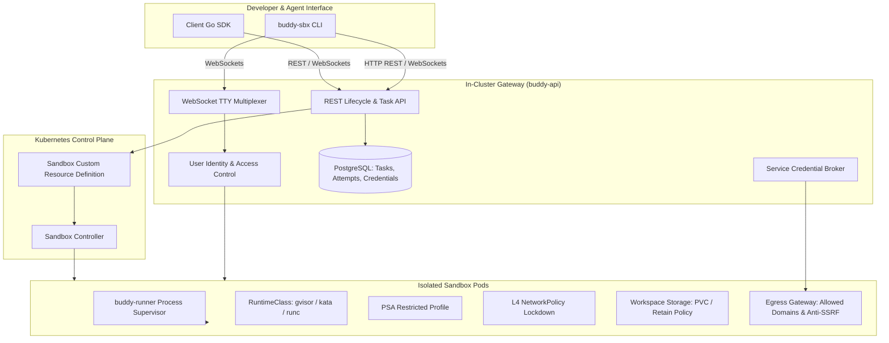
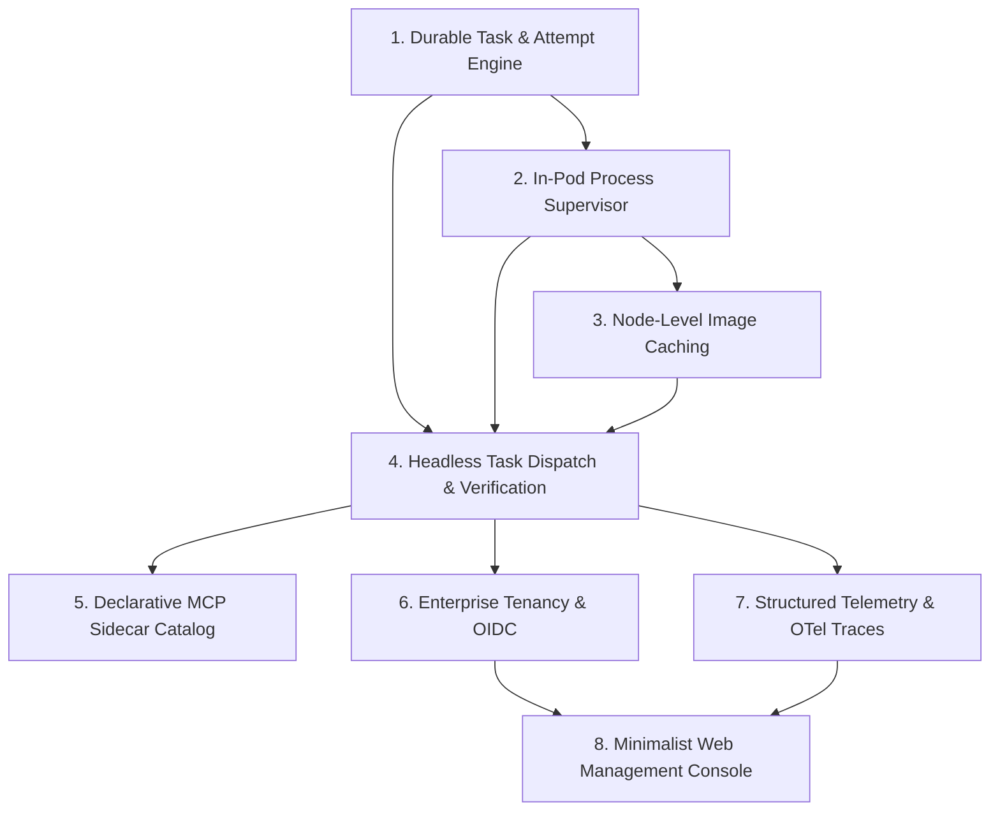

# Platform Architecture & Product Roadmap

## 1. Vision and Architecture Strategy

Buddy Sandboxes is an independent, Kubernetes-native platform providing isolated, declarative execution environments for automated AI coding agents and developer workflows.

Autonomous coding agents execute untrusted third-party code, run arbitrary shell commands, install unverified dependencies, and modify source repositories. Running these workloads on developer workstations or unconstrained Kubernetes nodes introduces major security and operational risks:

1. **Host Exploitation and Breakout**: Vulnerabilities in container runtimes or host kernels can be leveraged to escape container boundaries.
2. **Network Reconnaissance & Credential Theft**: Untrusted agents can probe internal cluster networks, databases, and cloud metadata services (`169.254.169.254`).
3. **Resource Starvation**: Unbounded process forks, compilation loops, or memory leaks can destabilize underlying nodes.
4. **Credential Exfiltration**: Raw provider API keys (`ANTHROPIC_API_KEY`, `OPENAI_API_KEY`) can be stolen by malicious dependencies or prompt injection attacks.
5. **State Loss on Disconnect**: Ephemeral client-tethered sessions risk losing uncommitted agent progress if connections drop.

Buddy Sandboxes addresses these challenges through a layered architecture:

---

## 2. Core Platform Capabilities

The platform delivers the following capabilities across infrastructure, security, and developer ergonomics:

### Workload Isolation & Multi-Engine Runtimes
* **Multi-Engine Sandboxing**: Declarative support for user-space application kernels (`gvisor`/`runsc`) and microVMs (`kata-containers`), validated before pod scheduling.
* **Hardened Security Profile**: Enforces Pod Security Admission `Restricted` standards by default: non-root execution (`UID 1000`), read-only root filesystems, dropped Linux capabilities, and `RuntimeDefault` seccomp profiles.

### Developer CLI & Single-Command Workflow (`buddy-sbx`)
* **Cloud-Native CLI**: Ergonomic command-line tool connecting to cluster operators over secure HTTPS: `run`, `exec`, `logs`, `list`, `rm`, `port`, `cp`, `secret`, and `admin`.
* **Interactive Terminal Streaming**: Low-latency PTY multiplexing over WebSockets with client window resizing (`SIGWINCH`) and signal handling.
* **Local Project Snapshots**: Stages local code repositories into remote sandbox `/workspace` directories and synchronizes changes back upon session exit.

### Scoped Service Credential Broker & Zero Secret Exposure
* **Encrypted Secret Storage**: Provider credentials and Git tokens are encrypted at rest using AES-256-GCM in PostgreSQL with multi-version key rotation.
* **Ephemeral Git Seeding**: Init containers authenticate via Kubernetes `TokenReview` against Pod-bound ServiceAccount tokens, cloning private repositories into memory-backed files before workload execution.
* **In-Cluster Reverse Broker**: Outbound model calls route through the Buddy Gateway reverse broker, which verifies capabilities and dynamically injects credentials without exposing them to untrusted container code.

### Out-of-Pod Egress Filtering & Network Lockdown
* **Layer 4 Hard Perimeter**: Default deny for RFC1918 private subnets and cloud metadata services (`169.254.169.254`).
* **Layer 7 Domain Filtering**: Outbound web requests route through a dedicated Egress Gateway enforcing strict domain allowlists and preventing DNS rebinding/SSRF attacks.

### Workspaces & Storage Lifecycle
* **Flexible Storage**: Supports ephemeral scratch storage and persistent volumes (`PersistentVolumeClaim`) with declarative retention policies (`Retain` vs `Delete`).
* **Dynamic Ignore Engine**: Hierarchical evaluation of `.gitignore` and `.agentsignore` at every directory level, supporting nested exclusion and explicit negation rules.
* **Cold Suspension & Resume**: Suspends idle PVC-backed sandboxes by terminating compute pods while preserving persistent disk state, resuming on demand.

### Native Model Context Protocol (MCP) Sidecars
* **Declarative Tool Attachment**: Connects MCP server sidecars using native Kubernetes sidecar containers.
* **Automated Probing**: Synthesizes TCP socket startup probes to prevent agent execution until tool endpoints are listening.
* **Termination Isolation**: Decouples sandbox exit codes from sidecar shutdown signals, preventing hangs and false failure reporting.

---

## 3. Product Roadmap

The forward engineering roadmap focuses on durable execution, process resilience, objective verification, and enterprise scalability:

### 1. Durable Task & Attempt Engine
* Persistent relational execution model in PostgreSQL decoupling task definitions from individual execution attempts.
* Client idempotency keys (`Idempotency-Key` HTTP header) with atomic state transitions, preventing duplicate runs and git index collisions on network retries.
* Distributed task execution locking per sandbox to eliminate split-brain concurrency.

### 2. In-Pod Process Supervisor (`buddy-runner`)
* Lightweight Go supervisor deployed as a sidecar container with shared process namespaces (`shareProcessNamespace: true`).
* In-guest circular ring buffer (1 to 4 MB) preserving sequenced execution output across client disconnections and gateway restarts.
* CLI commands: `buddy-sbx run --detach` and `buddy-sbx attach <task-id>` for reconnectable execution sessions.

### 3. Node-Level Image Caching & Fast Starts
* Kubernetes `DaemonSet` image pre-puller for pinned agent base images (`golang:1.25`, pinned Codex/Claude).
* Sub-3-second sandbox cold starts utilizing node-level image cache with standard lazy scheduling.

### 4. Headless Task Dispatch & Automated Verification
* Non-interactive batch execution: `buddy-sbx run <preset> --prompt "..." --verify "go test ./..." --wait`.
* Verification gates that abort local workspace merges and preserve remote diagnostic environments if test commands fail.
* Automated Git branch creation and patch generation upon task completion.

### 5. Declarative MCP Sidecar Catalog
* Centralized catalog for searching, configuring, and attaching verified Model Context Protocol servers to agent sandboxes.
* Standardized credential injection and in-container endpoint discovery for MCP tools.

### 6. Enterprise Tenancy & OIDC
* Single Sign-On (SSO) integration with enterprise identity providers (Okta, Google Workspace, GitHub Enterprise).
* Organization and team tenancy models with fine-grained role-based access control.
* Automated user deactivation reconciliation, terminating active sandboxes and revoking egress tokens.

### 7. Structured Telemetry & OpenTelemetry Tracing
* End-to-end distributed tracing across CLI, Gateway, Controller, and Runner using OpenTelemetry.
* Custom Prometheus metrics (`sandbox_duration_seconds`, `active_sandboxes_total`, `egress_bytes_total`).
* Audit log streaming to external enterprise SIEM platforms.

### 8. Minimalist Web Management Console
* Embedded web console inside `buddy-api` for inspecting active sandboxes, task attempts, and historical diffs.
* Live terminal streaming viewer, user profile settings, and provider credential management UI.
