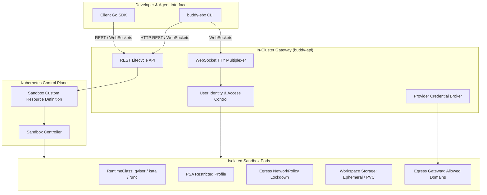
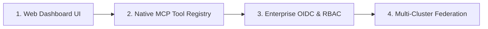

# Platform Architecture & Product Roadmap

## 1. Vision and Architecture Strategy

Buddy Sandboxes is a Kubernetes-native platform providing isolated, declarative execution environments for automated AI coding agents and interactive developer workflows.

Autonomous coding agents execute untrusted third-party code, run arbitrary shell commands, install unverified dependencies, and modify source repositories. Running these workloads on developer workstations or unconstrained Kubernetes nodes introduces major security and operational risks:

1. **Host Exploitation and Breakout**: Vulnerabilities in container runtimes or host kernels can be leveraged to escape container boundaries.
2. **Network Reconnaissance & Credential Theft**: Untrusted agents can probe internal cluster networks, databases, and cloud metadata services (`169.254.169.254`).
3. **Resource Starvation**: Unbounded process forks, compilation loops, or memory leaks can destabilize underlying nodes.
4. **Credential Exfiltration**: Raw provider API keys (`ANTHROPIC_API_KEY`, `OPENAI_API_KEY`) can be stolen by malicious dependencies or prompt injection attacks.

Buddy Sandboxes addresses these challenges through a layered architecture:

---

## 2. Core Platform Capabilities

The platform delivers the following capabilities across infrastructure, security, and developer ergonomics:

### Workload Isolation & Multi-Engine Runtimes
* **Multi-Engine Sandboxing**: Declarative support for user-space application kernels (`gvisor`/`runsc`) and microVMs (`kata-containers`), validated before pod scheduling.
* **Hardened Security Profile**: Enforces Pod Security Admission `Restricted` standards by default: non-root execution (`UID 1000`), read-only root filesystems, dropped Linux capabilities, and `RuntimeDefault` seccomp profiles.

### Developer CLI & Single-Command Workflow (`buddy-sbx`)
* **Cloud-Native CLI**: Ergonomic command-line tool connecting to cluster operators over secure HTTPS: `run`, `exec`, `logs`, `ls`, `rm`, `port`, `cp`, and `secret`.
* **Interactive Terminal Streaming**: Low-latency PTY multiplexing over WebSockets with client window resizing (`SIGWINCH`) and signal handling.
* **Local Project Snapshots**: Stages local code repositories into remote sandbox `/workspace` directories and synchronizes changes back upon session exit.

### Brokered Provider Credentials & Zero Secret Exposure
* **Cloud Secret Store**: Provider credentials for Claude Code and OpenAI Codex are encrypted at rest using AES-256-GCM in PostgreSQL.
* **Ephemeral Capabilities**: Container processes receive short-lived, sandbox-scoped cryptographic capability tokens (`bb_cap_...`) rather than raw secrets.
* **In-Cluster Reverse Broker**: Outbound model calls route through the Buddy Gateway reverse broker, which verifies capabilities, enforces token rate limits and quotas, and dynamically injects real credentials before egressing.

### Out-of-Pod Egress Filtering & Network Lockdown
* **NetworkPolicy Isolation**: Default deny for RFC1918 private subnets and cloud metadata services.
* **Domain Whitelisting**: Outbound web requests route through a dedicated Egress Gateway enforcing strict domain allowlists and preventing DNS rebinding/SSRF attacks.

### Workspaces, Git Seeding & Streaming File Transfer
* **Flexible Storage**: Supports ephemeral scratch storage and persistent volumes (`PersistentVolumeClaim`).
* **Automated Git Seeding**: Init containers clone repositories, check out branches, and configure credentials before the agent container launches.
* **Streaming Transfers (`buddy-sbx cp`)**: Bidirectional streaming file and folder transfers using chunked HTTP tar streams.

### Native Model Context Protocol (MCP) Sidecars
* **Declarative Tool Attachment**: Connects MCP server sidecars using native Kubernetes sidecar containers.
* **Automated Probing**: Synthesizes TCP socket startup probes to prevent agent execution until tool endpoints are listening.
* **Termination Isolation**: Decouples sandbox exit codes from sidecar shutdown signals, preventing hangs and false failure reporting.

### Process Management & Workspace Suspension
* **Process Namespace Sharing**: Opt-in PID namespace sharing allowing PID 1 to reap orphaned child processes.
* **Downward API Introspection**: Exposes non-sensitive sandbox metadata (name, pod UID, resource limits, deadlines) to the workload.
* **Cold Suspension & Resume**: Suspends idle PVC-backed sandboxes by terminating compute pods while preserving persistent disk state, resuming on demand.

---

## 3. Future Roadmap

The following platform features are scheduled for subsequent releases:

### 1. Web Dashboard UI
* Browser-based management console for inspecting active sandboxes, resource utilization, and live terminal streaming.
* User profile, access token generation, and provider credential management UI.

### 2. Native MCP Tool Registry
* Centralized catalog for searching, configuring, and attaching verified third-party MCP servers to agent sandboxes.
* Standardized credential brokering for MCP sidecars (GitHub, Slack, database connectors).

### 3. Enterprise OIDC & Role-Based Access Control
* Single Sign-On (SSO) integration with enterprise identity providers (Okta, Google Workspace, GitHub Enterprise).
* Organization and team tenancy models with fine-grained role-based access control.

### 4. Multi-Cluster Federation & Hybrid Scheduling
* Distributed scheduling of sandbox workloads across multi-region Kubernetes clusters.
* Smart placement based on GPU availability, data locality, and spot instance pricing.
